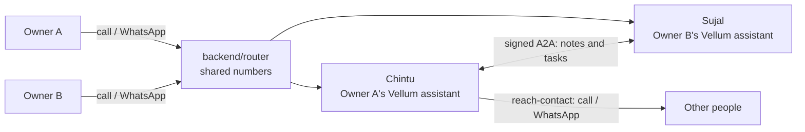

# Bunty

> **Keep this file current.** Whoever changes how the project works or how to run it updates
> this README in the same pull request. Rules for AI tools are in [AGENTS.md](AGENTS.md).
> Everything built so far, phase by phase: [CHANGES.md](CHANGES.md).

## What Bunty is

Bunty gives every person their own personal AI assistant, built on the open-source
[Vellum assistant](https://github.com/vellum-ai/vellum-assistant). You reach it with a normal
**phone call** or on **WhatsApp** (text or voice note). There is no app to download.

It remembers you, sets reminders, and acts for you: it can **call or message people**, and it can
**hand work to other people's assistants**. Example: Owner A tells their assistant (Chintu) "ask
Owner B to make three presentations by tomorrow". Chintu sends the task to Owner B's assistant
(Sujal). Sujal asks Owner B whether to take it, does the work with Owner B's permissions, asks
Owner B before sending anything back, and Chintu brings the files to Owner A. **The owner approves
at each step**, and the approvals are checked in code, not only in the prompt.

India first, in Hindi, English, Hinglish and Gujarati.



- One Vellum assistant per person (own memory, owner and credentials).
- Shared phone and WhatsApp numbers; the router finds the caller's own assistant.
- New abilities are Vellum plugins in `integrations/`. We change `vellum/` only when a plugin
  cannot do the job, and only after the team agrees.

Full design: [docs/architecture/ARCHITECTURE.md](docs/architecture/ARCHITECTURE.md).

## Status

Stage: **prototype**. All nine roadmap phases are built and tested **against mocks**: no real
call, message or paid service has been used yet. Each phase's live check needs the keys listed
under [Keys still empty](#keys-still-empty). Details: [CHANGES.md](CHANGES.md).

| Phase | What | Where | Status |
| --- | --- | --- | --- |
| 0 | Tooling and Vellum plugin spikes | `integrations/spike-plugin-channel`, root `package.json` | Built; spikes checked in Vellum source, live run needs an LLM key |
| 1 | Reminders | `integrations/reminders` | Setup documented (built into Vellum) |
| 2 | WhatsApp | `integrations/whatsapp` | Setup + signed test-webhook kit; owner-on-WhatsApp needs a `vellum/` change (not made) |
| 3 | Shared-number router | `backend/router` | Built and tested with mocks |
| 4 | Phone calls | `integrations/calls` | Voice config + exit-check scripts (built into Vellum) |
| 5 | Reach a contact (call / text / tell) | `integrations/reach-contact` | Plugin built and tested with mocks |
| 6 | Assistant to assistant: pairing + notes | `integrations/a2a-delegation` | Built, tested end to end in one process |
| 7 | Assistant to assistant: tasks with owner gates | `integrations/a2a-delegation` | Built, tested end to end in one process |
| 8 | Hardening and server deploy | `backend/router`, `backend/deploy`, `infra`, plugins | Built and tested with mocks; voice replies not wired into Vellum |
| - | Bunty branding (name, voice, dashboard, CLI) | `integrations/bunty-brand`, `infra/scripts/set-bunty-identity.ts`, `infra/scripts/check-brand.ts`, small `vellum/` edits (D-18) | Built, targeted tests pass; manual phone test not run yet |

Not started: Google (Gmail, Calendar) via Composio; Zomato and Swiggy.
Website: built in `website/` (plain static HTML, CSS and JS, hosted on Hostinger). The old
[Vercel preview](https://website-seven-xi-36.vercel.app) still shows the previous site.

## Folders

| Folder | What's inside |
| --- | --- |
| `vellum/` | Vellum open-source assistant, our copy (plain copy, updated by hand). Unchanged so far |
| `backend/router/` | Shared-number router: WhatsApp and calls to the right assistant, onboarding, delete my data, rate limits, metrics |
| `backend/deploy/` | Generates the server's Caddyfile (HTTPS per assistant) |
| `integrations/a2a-delegation/` | Plugin: pair with another assistant, notes, delegated tasks with Gates A/B/C |
| `integrations/reach-contact/` | Plugin: "call / text / tell X", read back, approve, send |
| `integrations/whatsapp/` | Setup notes, signed test-webhook kit, voice-reply adapter |
| `integrations/calls/` | Setup notes, India voice config, Phase 4 exit-check scorer |
| `integrations/reminders/` | Setup notes (reminders are built into Vellum) |
| `integrations/spike-plugin-channel/` | Throwaway Phase 0 plugin; delete after the live spikes |
| `integrations/_template/` | Copy this to start a new integration |
| `integrations/_shared-types/` | Type shim for `@vellumai/plugin-api` used by our typecheck |
| `infra/` | Docker Compose (router + Caddy), server deploy and "delete my data" runbook |
| `website/` | Static site, no build step: a single landing page |
| `docs/architecture/` | Architecture, roadmap, protocols, decisions, overnight log (see below) |

## Install and run the tests

You need [Bun](https://bun.sh) (1.3.11 recommended; the tests also run on 1.2) and Git.

```bash
git clone <our repo URL>
cd <repo>
bun install                # dev dependencies only: typescript, @types/bun
bun run check              # typecheck + all tests in backend/, integrations/, infra/ + brand check
```

Expect `157 pass, 0 fail`, then `check-brand: ... 0 not allowed`. `bun run check:brand`
fails if a user-facing "Vellum" comes back (see D-18). `bun run test` never runs Vellum's own tests; inside `vellum/` run only
the test file you need (`bun test path/to/file.test.ts`).

Everything runs with mocks by default (`BUNTY_ADAPTERS` unset). Set `BUNTY_ADAPTERS=real` only
when the keys below are filled in; a missing key then fails with an error naming it.

### Run the router locally

```bash
cp .env.example .env       # any random strings work for the ROUTER_* values locally
bun run router             # listens on :8787
```

Then follow [backend/router/README.md](backend/router/README.md) "How to run" to add a user and
send a fake, correctly signed WhatsApp with `integrations/whatsapp/scripts/send-test-webhook.ts`.

### Start your own Vellum assistant

```bash
cd vellum
./setup.sh                # installs dependencies and the `vellum` command
source ~/.bashrc          # or ~/.zshrc
vellum hatch              # creates your assistant (add --remote docker to use Docker)
vellum client             # talk to it in the terminal
```

Other commands: `vellum wake` (start), `vellum sleep` (stop, keeps data), `vellum ps` (list).

### Install our plugins into your assistant

```bash
cp -R integrations/<app-name> "$VELLUM_WORKSPACE_DIR/plugins/<app-name>"
assistant plugins list    # should show <app-name> as ok
```

Plugins with webhooks (`a2a-delegation`) also need their ingress approved in the assistant's
channel settings. Each integration's README lists its secrets and how to test it.

### Website

```bash
cd website
python3 -m http.server 8080   # open http://localhost:8080
```

Open it through a server, not by double-clicking the file: asset links are root paths like `/assets/`.
Deploy on Hostinger: upload the contents of `website/` (including the hidden `.htaccess`) into `public_html`.
See [website/README.md](website/README.md).

## Keys still empty

Every name is in [.env.example](.env.example) with no value. Never commit `.env`; inside Vellum,
store secrets with `assistant credentials prompt`.

| Keys | Service | Where they plug in |
| --- | --- | --- |
| `ANTHROPIC_API_KEY` | Claude (LLM) | Every assistant. Needed for every live check |
| `WHATSAPP_ACCESS_TOKEN`, `WHATSAPP_PHONE_NUMBER_ID`, `WHATSAPP_APP_SECRET`, `WHATSAPP_VERIFY_TOKEN` | Meta WhatsApp Cloud API | Each assistant (`--service whatsapp`); token + phone number id also for the router's onboarding reply and voice replies |
| `ROUTER_WHATSAPP_APP_SECRET`, `ROUTER_WHATSAPP_VERIFY_TOKEN` | Meta (same app) | Router `.env` |
| `TWILIO_ACCOUNT_SID`, `TWILIO_AUTH_TOKEN`, `TWILIO_PHONE_NUMBER` | Twilio | Each assistant (`twilio-setup` skill) |
| `ROUTER_TWILIO_AUTH_TOKEN` | Twilio (same account) | Router `.env` |
| `DEEPGRAM_API_KEY` | Speech to text | Each assistant |
| `ELEVENLABS_API_KEY`, `ELEVENLABS_VOICE_HI`, `ELEVENLABS_VOICE_EN`, `ELEVENLABS_VOICE_GU` | Text to speech | Each assistant; `integrations/calls/scripts/voice-config.ts`; voice-reply adapter |
| `ROUTER_INTERNAL_HMAC_KEY`, `ROUTER_METRICS_TOKEN` | Our own random secrets | Router `.env`; the HMAC key also in each assistant (router hints) |
| `ROUTER_PUBLIC_BASE_URL`, `ROUTER_ONBOARDING_URL`, `ROUTER_PORT`, `ROUTER_DB_PATH` | Router settings | Router `.env` |
| `BUNTY_ADAPTERS`, `BUNTY_ASSISTANT_ID`, `BUNTY_ROUTER_URL`, `BUNTY_ASSISTANT_NAME`, `BUNTY_OWNER_NAME` | Our settings | Each assistant's environment |
| `COMPOSIO_API_KEY` | Google via Composio | Not built yet |
| `NOTION_TOKEN` | Notion MCP for AI tools | Your AI tool (see the collaborator setup PDF) |

Assistant-to-assistant pairing secrets are created by the plugin and kept in Vellum's credential
store; nobody types them.

## Docs

| Doc | What it is |
| --- | --- |
| [CHANGES.md](CHANGES.md) | Everything built so far, by phase, with tests and decisions |
| [docs/architecture/ARCHITECTURE.md](docs/architecture/ARCHITECTURE.md) | The target design |
| [docs/architecture/ROADMAP.md](docs/architecture/ROADMAP.md) | Phases 0 to 8 with exit checks |
| [docs/architecture/decisions.md](docs/architecture/decisions.md) | Decision log D-01 to D-18 |
| [docs/architecture/bunty-branding-inventory.md](docs/architecture/bunty-branding-inventory.md) | Every "Vellum" a user could see, its category, and every `vellum/` edit for the rebrand |
| [docs/architecture/bunty-branding-manual-tests.md](docs/architecture/bunty-branding-manual-tests.md) | Phone and chat test script for the rebrand (4 languages) |
| [docs/architecture/a2a-delegation-protocol.md](docs/architecture/a2a-delegation-protocol.md) | Assistant-to-assistant wire protocol |
| [docs/architecture/channels-phone-whatsapp.md](docs/architecture/channels-phone-whatsapp.md) | Calls, WhatsApp and router behaviour |
| [docs/architecture/MASTER-PROMPT.md](docs/architecture/MASTER-PROMPT.md) | Prompt for AI coding tools, one session per phase |
| [docs/architecture/OVERNIGHT-LOG.md](docs/architecture/OVERNIGHT-LOG.md) | Detailed log of the overnight build |
| [infra/README.md](infra/README.md) | Local and server setup, monitoring, "delete my data" runbook |

## Tech stack (prototype)

Vellum (Bun + TypeScript), Claude, Twilio, Deepgram, ElevenLabs, Meta WhatsApp Cloud API,
SQLite + Qdrant (inside Vellum), `bun:sqlite` for our router and plugins, Docker and Caddy on one
cloud server, plain HTML/CSS for the website. Full table with reasons:
[AGENTS.md](AGENTS.md#4-tech-stack).

## Team

Three people in India, Boston and the UK. Code and reviews on GitHub; feature pages and the
daily standup log in Notion.
