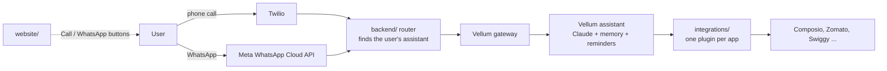

# AI Assistant (working name)

A personal AI assistant you reach with a normal phone call or on WhatsApp. You don't need to
download an app. Tell it what to do, such as setting a reminder, calling someone, booking an
appointment or ordering food. It remembers you and confirms when each task is done.

India first, in Hindi, English, Hinglish and Gujarati.

> **Keep this file current.** Whoever changes how the project works or how to run it updates
> this README in the same pull request. Rules for AI tools are in [AGENTS.md](AGENTS.md).

## Status

Stage: **prototype**, built on the open-source [Vellum assistant](https://github.com/vellum-ai/vellum-assistant).

| Integration | Status |
| --- | --- |
| Reminders | Not started |
| WhatsApp | Not started |
| Phone calls | Not started |
| Google (Gmail, Calendar) via Composio | Not started |
| Zomato and Swiggy | Not started |
| Website | Not started |

## How it works (prototype)



- Each tester gets their own Vellum assistant (one owner per assistant).
- Calls and WhatsApp share the same assistant and memory.
- New apps are added as Vellum plugins in `integrations/`, one at a time.

Full design: `docs/Assistant architecture overview.pdf`. Feature details and daily progress: Notion.

## Folders

| Folder | What's inside |
| --- | --- |
| `vellum/` | Vellum open-source assistant, our copy (plain copy, updated by hand) |
| `integrations/` | One folder per connected app; `_template/` to start a new one |
| `backend/` | Small services outside Vellum, such as the phone-number router |
| `website/` | Static site: About us, Scope, Pricing, Contact us, Onboarding |
| `infra/` | Docker Compose and scripts to run it on a server |
| `docs/` | Exported PDFs and images |

## Tech stack (prototype)

Vellum (Bun + TypeScript), Claude, Twilio, Deepgram, ElevenLabs, Meta WhatsApp Cloud API,
SQLite + Qdrant (inside Vellum), Composio, Zomato and Swiggy MCP, plain HTML/CSS on Cloudflare
Pages, Docker on one cloud server. Full table with reasons: [AGENTS.md](AGENTS.md#4-tech-stack).

## How to run

### You need

- macOS or Linux (Windows: use WSL), Git, and [Bun](https://bun.sh) 1.3.11 (Vellum's setup
  installs it if missing)
- Docker, if you run the assistant in containers
- An Anthropic API key. Later: Twilio account and number, Meta WhatsApp test number
- Notion connected to your AI tool (see the collaborator setup PDF)

### 1. Get the code

```bash
git clone <our repo URL>
cd <repo>
cp .env.example .env      # fill in your own values, never commit .env
```

### 2. Start your own Vellum assistant

```bash
cd vellum
./setup.sh                # installs dependencies and the `vellum` command
source ~/.bashrc          # or ~/.zshrc
vellum hatch              # creates your assistant (add --remote docker to use Docker)
vellum client             # talk to it in the terminal
```

Other commands: `vellum wake` (start), `vellum sleep` (stop, keeps data), `vellum ps` (list).

### 3. Install our integrations

```bash
cp -R integrations/<app-name> "$VELLUM_WORKSPACE_DIR/plugins/<app-name>"
assistant plugins list    # should show <app-name> as ok
```

Each integration's own README lists the secrets it needs and how to test it.

### 4. Website

```bash
cd website
python3 -m http.server 8080   # open http://localhost:8080
```

### Phone calls and WhatsApp

To be filled in when the calls and WhatsApp integrations are built (Twilio setup, WhatsApp test
number, and the `backend/` router).

## Team

Three people in India, Boston and the UK. Code and reviews on GitHub; feature pages and the
daily standup log in Notion.
