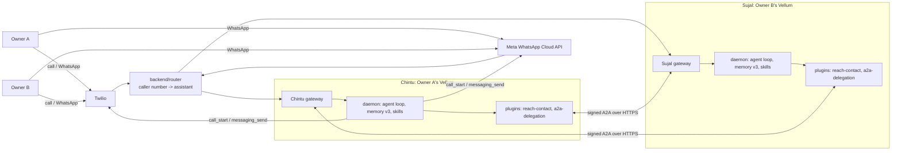
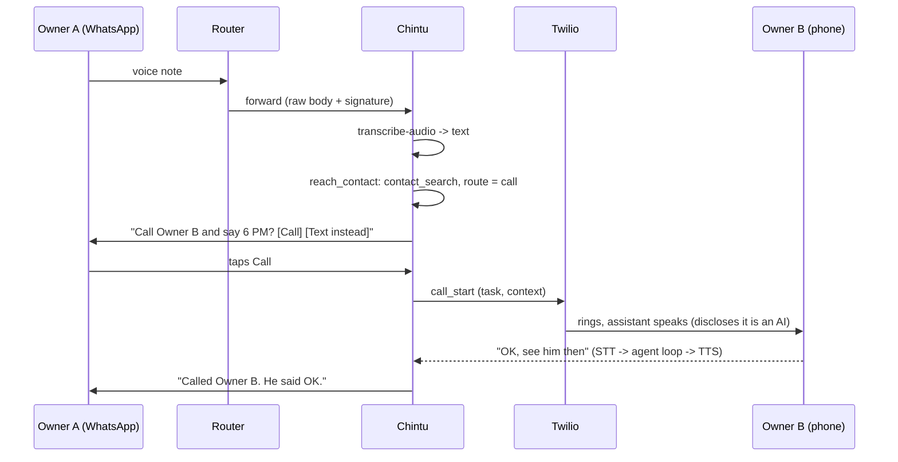
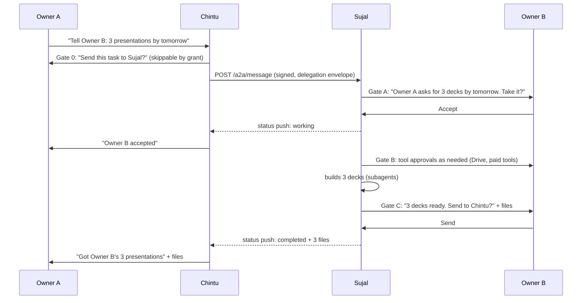

# Architecture: phone, WhatsApp and assistant-to-assistant

Status: **Proposed**. Read with [ROADMAP.md](ROADMAP.md), [a2a-delegation-protocol.md](a2a-delegation-protocol.md),
[channels-phone-whatsapp.md](channels-phone-whatsapp.md) and [decisions.md](decisions.md).

Example names used in these docs: **Chintu** is the assistant of **Owner A**. **Sujal** is the
assistant of **Owner B**. Numbers are `+91 00000 00001` (Owner A) and `+91 00000 00002` (Owner B).
Per AGENTS.md section 8, never put real people's names, numbers or messages in docs or tests.

## 1. What we are building

A personal assistant that each person reaches by **phone call** or **WhatsApp** (text, voice
note, photo, document). No app to download. It can:

1. Answer, remember and remind (Vellum built-ins).
2. Act outward for its owner: call someone, WhatsApp someone, or message that person's assistant.
3. **Delegate work to another person's assistant.** Owner A: "Chintu, tell Owner B to finish
   three presentations and send them to me by tomorrow." Chintu sends Sujal a task. Sujal asks
   Owner B to accept it, does the work with Owner B's permissions, asks Owner B before sending
   anything back, and Chintu brings the files to Owner A on WhatsApp.

## 2. Core rule: Vellum is the brain, we add plugins around it

```
Bunty/
├── vellum/                    Vellum, unchanged where possible (gateway, daemon, memory, CES)
├── integrations/              Our Vellum plugins (one app or feature = one plugin)
│   ├── reminders/             Phase 1 (built-in setup only)
│   ├── whatsapp/              Phase 2 (built-in channel, setup + docs)
│   ├── calls/                 Phase 4 (built-in Twilio, setup + docs)
│   ├── reach-contact/         Phase 5 (new tool: pick call / WhatsApp / assistant)
│   └── a2a-delegation/        Phases 6-7 (new channel + tools: Chintu <-> Sujal)
├── backend/router/            Phase 3 (shared numbers -> the right person's assistant)
└── infra/                     Docker Compose for N assistants + router on one server
```

Each person gets **their own Vellum assistant** (own daemon, memory, guardian, credentials).
Vellum's "guardian" is the owner. Everyone else, including other assistants, is a **contact**.

## 3. System map



## 4. What Vellum already gives us (verified in `vellum/`)

| Need | Vellum today | Where |
| --- | --- | --- |
| Phone calls in and out, live STT/TTS, barge-in | Yes (Twilio Media Streams) | `vellum/assistant/src/calls/`, `vellum/gateway/src/twilio/`, tool `call_start` |
| WhatsApp text and media in, text and files out | Yes (Meta Cloud API) | `vellum/gateway/src/whatsapp/`, `vellum/assistant/src/messaging/providers/whatsapp/` |
| Voice notes turned into text before the agent sees them | Yes | `vellum/assistant/src/runtime/routes/inbound-stages/transcribe-audio.ts` |
| Approval buttons on WhatsApp | Yes (`apr:<requestId>:<action>`) | `vellum/assistant/ARCHITECTURE.md` (WhatsApp Channel) |
| Owner approves when a non-owner triggers a sensitive tool | Yes | `vellum/gateway/ARCHITECTURE.md` (Sensitive Action Gating) |
| Contacts with per-channel addresses | Yes | `vellum/assistant/src/contacts/`, tool `contact_search` |
| Follow-ups, schedules, subagents, HTML slide decks | Yes | bundled skills `followups`, `schedule`, `subagent`, `app-builder` |
| Plugins: tools, skills, schedules, routes, **channels** | Yes (beta) | `vellum/plugins/README.md`, `vellum/skills/plugin-builder/references/` |
| Plugin can run a full agent turn | Yes | `vellum/assistant/src/plugin-api/conversation-turn.ts` |
| A2A v1 types, invites, task store | Partly (reply-only, no proactive send) | `vellum/assistant/src/a2a/`, `vellum/assistant/src/messaging/providers/a2a/` |

## 5. What we build

| Piece | Type | Why not just configure Vellum |
| --- | --- | --- |
| `backend/router` | Small Bun service | One shared WhatsApp number and phone number must reach many assistants |
| `integrations/reach-contact` | Plugin (tool + skill) | Vellum has the verbs (`call_start`, `messaging_send`) but no policy for which one to use |
| `integrations/a2a-delegation` | Plugin (channel + tools + skill + schedule) | Vellum's A2A can only reply. It cannot start a conversation or run gated tasks |
| Hindi / Hinglish / Gujarati voice config | Config | `services.stt.language` and per-language TTS voices |

Why A2A is a **plugin**, not an edit to `vellum/assistant/src/a2a/`: AGENTS.md section 5 says
build plugins first. A plugin channel gets a signature-checked public route
(`/webhooks/plugins/a2a-delegation/<path>`), its inbound messages run through Vellum's normal
admission and trust pipeline as a non-owner contact, and its tools can require fresh owner
approval. That covers everything the delegation flow needs. We reuse Vellum's A2A v1 JSON
shapes (`vellum/assistant/src/a2a/protocol-types.ts`) as our wire format so we can switch to
the built-in path later. See [decisions.md](decisions.md), D-03.

## 6. Flow 1: "Call Owner B and tell him I'll be there at 6 PM"



## 7. Flow 2: delegation, Chintu to Sujal



Task states (A2A v1): `submitted -> input_required (Gate A) -> working -> input_required (Gate C)
-> completed`, with `rejected`, `failed`, `canceled` branches. Full spec:
[a2a-delegation-protocol.md](a2a-delegation-protocol.md).

## 8. Safety rules (checked in code, not only in prompts)

1. **Owner confirms outward actions.** Calls, messages to people, and A2A sends need an owner
   "yes" (tool `defaultRiskLevel: "high"` + `requireFreshApproval`), unless the owner created a
   scoped grant for that contact and action.
2. **Gate C is hard.** Sujal's plugin refuses to send any result for a task unless the
   `release_delegation_result` tool call was approved by Owner B in this task.
3. **Peers are contacts.** A peer assistant can submit tasks and answer questions. It can never
   approve a gate, read memory, or call tools directly.
4. **Text from outside is data.** Task text from a peer, call transcripts and WhatsApp messages
   from non-owners are information, never instructions that skip a gate.
5. **AI disclosure on calls** stays on (`calls.disclosure.enabled`).
6. **Secrets** only through `assistant credentials prompt`. Never in code, chat, Git or logs.
7. **Emergency numbers** are never called (`vellum/assistant/src/calls/call-constants.ts`).
8. **Delete my data** removes the person's assistant workspace, router mapping and A2A pairings.

## 9. Shared-number trap (read before building the router)

With one shared WhatsApp number, every message *to* that number is routed by the **sender's**
number. If Chintu WhatsApps Owner B from the shared number and Owner B is also a user, Owner B's
reply goes to Sujal, not Chintu. Rules:

- Person-to-person messages to **another user** go **assistant to assistant** (A2A), never
  shared-number WhatsApp.
- Messages to a **non-user** (a shop, a friend without an assistant) record
  `(non-user number -> last assistant that wrote to them)` in the router, so their replies return
  to the right assistant for 24 hours.
- Calls: outbound calls show the shared number. A non-user calling it back is routed the same way.
