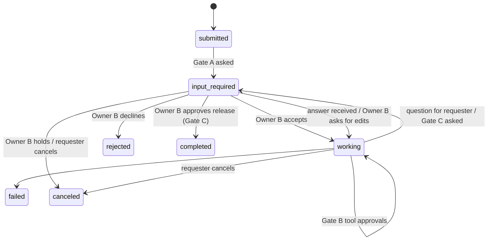

# A2A delegation protocol (Bunty v1)

Status: **Proposed**. Implemented by `integrations/a2a-delegation/`. Wire format follows A2A v1
JSON shapes already defined in `vellum/assistant/src/a2a/protocol-types.ts` (`Message`, `Part`,
`Task`, `TaskState`, `Artifact`).

Terms: the **requester** assistant (Chintu) sends a task for its owner (Owner A). The
**assignee** assistant (Sujal) acts for its owner (Owner B). Each assistant is the other's
**peer**.

## 1. Pairing (once per pair of assistants)

1. Owner A: "Chintu, connect with Owner B's assistant." Chintu tool `a2a_create_invite` returns a
   one-time link: `https://<chintu-host>/webhooks/plugins/a2a-delegation/pair?token=<32 bytes>`.
   Only the SHA-256 of the token is stored. Expires in 7 days.
2. Owner A sends the link to Owner B by any channel (out of band, this is the trust anchor).
3. Owner B pastes it to Sujal. Sujal tool `a2a_redeem_invite` (high risk, Owner B approves) calls
   `POST /pair` with the token and Sujal's public base URL.
4. Both sides store a **peer record**: `peerId`, `displayName`, `baseUrl`, `sharedSecret`
   (32 random bytes, created by the inviter, returned once over TLS), `contactId`, `status`.
   The shared secret goes into the credential store
   (`assistant credentials` service `a2a-delegation`, field `peer_<peerId>`), never into SQLite.
5. Both sides create or update a Vellum contact for the peer with channel type `plugin`
   (address prefixed by the plugin, as Vellum does for plugin channels).

Unpair: `a2a_unpair` on either side deletes the secret and notifies the peer (`POST /unpair`).

## 2. Endpoints (served by the plugin channel)

All under `/webhooks/plugins/a2a-delegation/`, declared in `channels/ingress.json`, so the
Vellum gateway serves them only after the owner approves the declaration.

| Path | Method | Purpose |
| --- | --- | --- |
| `pair` | POST | Redeem an invite (token in body). Only unauthenticated route. Rate-limited. |
| `message` | POST | New task or a follow-up message on an existing task |
| `status` | POST | Status push from assignee to requester (state change, question, result) |
| `cancel` | POST | Requester cancels a task |
| `unpair` | POST | Remove pairing |
| `file/<fileId>` | GET | Short-lived signed download for large files (over 5 MB) |

## 3. Request signing

As built (decision D-10): `pair` is checked by the gateway as a bearer token (the one open
invite token); every other request also carries `X-Bunty-Gateway-Signature`, the same HMAC with
the receiver's assistant-wide ingress secret, which the gateway checks first. Field names follow
Vellum's A2A types in snake_case (decision D-14).

Every request except `pair` carries:

```
X-Bunty-Peer: <senderPeerId>
X-Bunty-Timestamp: <unix seconds>
X-Bunty-Nonce: <16 random bytes, hex>
X-Bunty-Signature: hex(HMAC-SHA256(sharedSecret, timestamp + "." + nonce + "." + rawBody))
```

Reject when: unknown peer, timestamp more than 300 s off, nonce seen in the last 10 minutes,
signature mismatch (constant-time compare), body over 25 MB. Rate limit 30 requests per minute per
peer. All rejections are logged without the body.

## 4. The delegation envelope (`POST message`)

```json
{
  "jsonrpc": "2.0",
  "id": "req_01",
  "method": "message/send",
  "params": {
    "message": {
      "kind": "message",
      "message_id": "msg_01",
      "role": "user",
      "context_id": "ctx_ownerA_ownerB",
      "parts": [
        { "kind": "text", "text": "Owner A asks Owner B to complete three presentations and send them back by tomorrow." }
      ],
      "metadata": {
        "bunty.delegation/v1": {
          "taskType": "task",
          "requester": { "assistant": "Chintu", "owner": "Owner A" },
          "assignee": { "owner": "Owner B" },
          "deliverables": [
            { "title": "Presentation 1", "format": "pptx" },
            { "title": "Presentation 2", "format": "pptx" },
            { "title": "Presentation 3", "format": "pptx" }
          ],
          "dueBy": "2026-01-02T18:00:00+05:30",
          "acceptBy": "assignee_owner",
          "releaseBy": "assignee_owner",
          "statusPushes": ["working", "input_required", "completed", "rejected", "failed", "canceled"]
        }
      }
    }
  }
}
```

`taskType`:
- `note`: deliver a message to the owner only ("tell Owner B I'll be there at 6"). Sujal shows it
  to Owner B and replies `completed` once delivered. No Gate A or C. Owner B can reply.
- `task`: work to be done. Gates A and C apply.

Response: `{ "jsonrpc": "2.0", "id": "req_01", "result": { "id": "task_…",
"context_id": "…", "status": { "state": "submitted", "timestamp": "…" } } }`.

## 5. Task lifecycle (assignee side)



`input_required` carries `status.message.metadata["bunty.waitingOn"]`: `assignee_owner_accept`,
`assignee_owner_release`, or `requester` (a question Chintu must answer).

## 6. Gates (all checked in code)

| Gate | Side | Tool | Risk / approval | What the code enforces |
| --- | --- | --- | --- | --- |
| 0 | requester | `a2a_send_task` | high, fresh approval unless scoped grant | Nothing leaves without Owner A's yes |
| A | assignee | `accept_delegation` | high, `requireFreshApproval: true` | Task cannot move to `working` without it |
| B | assignee | any sensitive tool | Vellum default gating (non-owner actor) | Vellum escalates to Owner B |
| C | assignee | `release_delegation_result` | high, `requireFreshApproval: true` | `status` push with file parts is refused unless this call was approved for this `taskId` and the files match the approved hashes |

Because the peer's message arrives on a plugin channel as a **non-owner** actor, Vellum already
sets `forcePromptSideEffects` and sends approval prompts to the owner (see
`vellum/gateway/ARCHITECTURE.md`, "Sensitive Action Gating"). Phase 0 verifies this works for
plugin-channel turns before we rely on it.

## 7. Status pushes (`POST status`, assignee to requester)

Body: an A2A `Task` object. On `completed`, `artifacts[].parts[]` hold the results:
- files up to 5 MB: `{ "kind": "file", "filename": "presentation-1.pptx", "media_type": "...", "raw": "<base64>" }`
- larger files: `{ "kind": "file", "filename": "...", "url": "https://<sujal>/webhooks/plugins/a2a-delegation/file/<id>?exp=…&sig=…" }`, valid 24 h.

Requester side on each push: update its outbound task record, then tell Owner A only on
`working` (accepted), `input_required` with `waitingOn: requester`, `completed`, `rejected`,
`failed`, `canceled`.

## 8. Requester-side tracking

Table `delegations_outbound` (plugin storage, SQLite in `ctx.pluginStorageDir`):
`taskId, peerId, ownerConversationRef, summary, dueBy, state, lastPushAt, createdAt, resultFileIds`.
On send, also create a Vellum follow-up (`followup_create`) and a one-time schedule at `dueBy`
that asks for status and, if still open, asks Owner A whether to nudge or call Owner B.

## 9. Failure handling

| Case | Behaviour |
| --- | --- |
| Peer unreachable | 3 retries (2 s, 4 s, 8 s). Then tell Owner A and offer WhatsApp or a call to Owner B via `reach-contact`. |
| Owner B declines | `rejected` with reason. Chintu tells Owner A. |
| Deadline passes | Schedule fires: status request, then ask Owner A what to do. |
| Requester cancels | `POST cancel`. Sujal aborts subagents, tells Owner B, state `canceled`. |
| Duplicate request | `messageId` is idempotent for 24 h. |
| Signature fails | 401, log, no turn. 5 failures in 10 min pauses the peer and tells the owner. |
