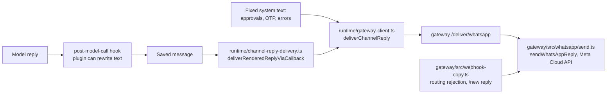
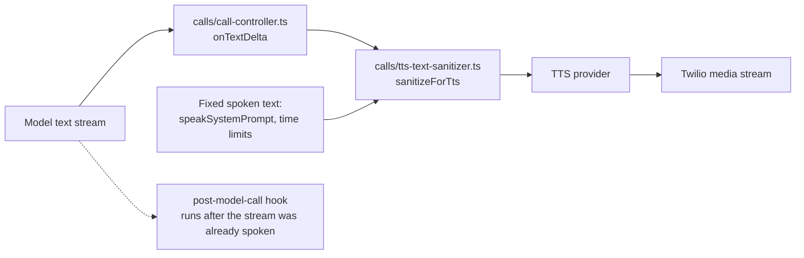

# Bunty branding inventory

Status: **Phase 1, read only. Nothing in `vellum/` has been changed.** Date: 2026-10-22. Person: Vivek.

Goal: a user on WhatsApp, a phone call, the web dashboard or the command line never sees or hears
"Vellum". Agreed in Step 0: scope is everything (Groups A, B and C); the answer to "who made you /
what AI are you" is "I'm Bunty, your personal assistant. The Bunty team built me to help with
reminders, calls and messages." (no model or platform named, never deny being an AI); scripts:
बंटी (Hindi), બંટી (Gujarati).

## 1. How this list was made

1. `grep -rnI Vellum` over `vellum/assistant/src`, `vellum/gateway/src`, `vellum/skills`,
   `vellum/credential-executor/src`, `vellum/cli/src`, `vellum/clients/web/src` and `integrations/`,
   in `.ts`, `.tsx`, `.md` and `.json` files. Tests, stories and `node_modules` skipped.
   That gives about 10,500 lines, almost all identifiers.
2. Kept only lines where "Vellum" is a standalone word (not `@vellumai`, `VELLUM_`, `vellum-…`,
   `X-Vellum-…`, `VellumProvider`, a path or URL), and dropped comment, import and logger lines.
   That leaves **1,266 candidate lines**, each classified by hand or by a reviewed rule.
3. The web client was also checked for lowercase `vellum` in visible text, for `index.html` and
   `capacitor.config.ts`, and for logo files (25 extra rows).
4. `credential-executor/src` has 57 raw hits and none are user-facing (all identifiers).

Proposed text in the tables below is a draft. Long lines are cut at 160 characters. Final wording
for every `vellum/` edit will be shown to you before it is applied (Phases 5 and 6).

## 2. Counts

| Area | A (AI text) | B (WhatsApp / call) | C (screens / CLI) | Internal | Unsure | Lines |
| --- | --- | --- | --- | --- | --- | --- |
| Core: assistant, gateway, CLI, integrations | 28 | 36 | 165 | 95 | 16 | 340 |
| Skills (`vellum/skills`) | 222 | 0 | 0 | 147 | 5 | 374 |
| Web dashboard (`vellum/clients/web`) | 0 | 0 | 466 | 15 | 96 | 577 |
| **Total** | **250** | **36** | **631** | **257** | **117** | **1,291** |

## 3. Where outgoing text can be changed (reply path trace)

### WhatsApp reply

### Spoken call reply

What this means:

| Text | Plugin hook that can change it | Choke point inside `vellum/` |
| --- | --- | --- |
| System prompt (name, rules) | `pre-model-call` (`ctx.systemPrompt`, self-gate on `ctx.callSite`) | none needed |
| AI reply on WhatsApp / chat | `post-model-call` (`ctx.content`, "the loop adopts the hook's result as the persisted and streamed message") | none needed |
| AI reply spoken on a call | `post-model-call` only if `pre-model-call` sets `deferAssistantOutput`, which waits for the full reply before speaking (adds latency on calls) | `calls/tts-text-sanitizer.ts` `sanitizeForTts` (also used by live-voice and `tts/synthesize-text.ts`) |
| Fixed text to a channel (approvals, OTP, errors) | **none** (no outbound-message hook exists; hooks are init, shutdown, user-prompt-submit, pre/post-model-call, post-tool-use, post-compact, stop, conversation/message deleted) | `runtime/gateway-client.ts` `deliverChannelReply` and `deliverApprovalPrompt` |
| Gateway's own WhatsApp replies (`webhook-copy.ts`: routing rejection, "Starting a new conversation!") | **none** | `gateway/src/whatsapp/send.ts`. No "Vellum" in them today, but the rejection text is technical ("check your gateway routing configuration"); plain-language follow-up |
| Fixed spoken text | **none** | `sanitizeForTts` / `calls/call-speech-output.ts` |

Phase 3 plan follows from this: the `pre-model-call` hook is the proven place for "Your name is
Bunty". Phase 4 needs a decision (see section 5).

## 4. Findings that change the plan

1. **`IDENTITY.md` name fixes many fallbacks for free.** `daemon/identity-helpers.ts`
   `getAssistantName()` reads `**Name:**` from the workspace `IDENTITY.md`. A2A cards, MCP OAuth
   client name, the desktop wallpaper and home feed only fall back to "Vellum" / "Vellum Assistant"
   when that is empty. Phase 2 sets it to Bunty.
2. **First-conversation bootstrap.** `prompts/templates/BOOTSTRAP.md` runs on a new assistant's first
   conversation and lets the user pick a name. Phase 2 must pre-fill identity and make sure the
   bootstrap does not ask the user to rename Bunty.
3. **Call disclosure conflicts with AGENTS.md section 10.** Vellum's default
   `calls.disclosure.text` (`config/schemas/calls.ts:19`) says *"introduce yourself as an assistant
   calling on behalf of the person you represent. Do not say 'AI assistant'."* Our rule says the
   assistant must say it is an AI. This is a config value, so we can override it per assistant
   without a `vellum/` edit. Not part of branding, but it is spoken on every outbound call.
4. **Many B strings are about Vellum's paid managed platform** ("Vellum credits", "Vellum platform
   connection"). Bunty uses AICredits and its own provider keys, so these fire only if a managed
   (`vellum`) provider is selected. They are still listed as B because they would be spoken or sent
   if that happens.
5. **No central product-name constant in the web client.** About 504 of 552 hits are in i18n JSON
   (`clients/web/src/i18n/locales/{en,es,ru,zh,zh-TW}/*.json`, mostly `settings.json`). One
   `defaultVariables: { brand: "Bunty" }` in `clients/web/src/i18n/config.ts` plus `{{brand}}` in the
   locale values would make the brand one value (check the interpolation prefix first: catalogs use
   `{name}`).
6. **Logos are images, not text:** `clients/web/public/vellum-logo.svg`, `vellum-logo-white.svg`,
   `favicon.svg`, `vellum-scene-cut.mp4`, `src/components/ios-widget-previews/vellum-app-icon-mark.tsx`,
   and the remote share image `https://www.vellum.ai/og-cover-v2.jpg` in `index.html`. Need Bunty
   artwork.
7. **Some text cannot be true after a rename** because the real thing is still Vellum: the Chrome
   Web Store extension name, the macOS app bundle name in System Settings, Vellum's OAuth app name on
   third-party consent screens (managed mode), and the `vellum-self-knowledge` skill, which fetches
   Vellum's public docs live. These are in Unsure.
8. **`compatibility: "Designed for Vellum personal assistants"`** appears in 134 skill files and
   `catalog.json`. Nothing in `assistant/src` reads it and it is not sent to the LLM, so it is
   Internal (cosmetic only).

## 5. Decisions needed before Phase 3 and 4

1. **Calls safety net.** Options:
   (a) one small `vellum/` edit in `sanitizeForTts` to call a shared `applyBrand()` (no added latency,
   also covers fixed spoken text); (b) plugin-only `deferAssistantOutput` on voice turns (no
   `vellum/` edit, but Bunty waits for the full reply before speaking); (c) rely on prompt rules only
   for calls. **Recommendation: (a).**
2. **Fixed WhatsApp text.** Options: (a) edit the strings at their source behind one brand constant
   (Phase 5 as planned); (b) also add the safety net in `deliverChannelReply`. **Recommendation:
   (a) plus (b)**, both small.
3. **Unsure items** in section 9: confirm per item (rename, reword, leave, or remove).
4. **Low-relevance skills** (49, for example Vercel deploy, macOS automation, assistant migration):
   rename their text too, or leave them and block them from Bunty assistants? **Recommendation:**
   rename only the 23 high-relevance skills now; check whether the low ones can be disabled.

## 5a. Decisions taken (2026-10-22, Vivek)

- Scope: Groups A, B and C (WhatsApp, calls, dashboard, settings, command line).
- "Who made you": "I'm Bunty, your personal assistant. The Bunty team built me to help with
  reminders, calls and messages." Scripts: बंटी, બંટી.
- Small `vellum/` edits allowed; each one is shown before it is applied.
- Recommendations in section 5 accepted: calls safety net in `sanitizeForTts`, fixed strings
  fixed at source plus a net in `deliverChannelReply`, the 23 high-relevance skills first.
- Unsure items:
  - Chrome Web Store extension, Google / GitHub OAuth consent screens, macOS wording: rename to
    Bunty (Bunty will publish its own extension and OAuth apps; there is no macOS app today).
  - `vellum-self-knowledge`: rename to Bunty; a Bunty self-knowledge skill and Bunty docs will
    replace the Vellum docs it fetches. Until then it still fetches Vellum docs (open item).
  - A2A agent card description: "Bunty AI assistant".
  - Real-company items (open-source links, staff debug bundle, terms, copyright, `.vellum`
    extension, vellum.ai share image): still to confirm one by one in Phase 6.

## 5c. Changes made inside `vellum/` (for the Notion "Changes we made to Vellum" list)

| Phase | File | What changed | Why |
| --- | --- | --- | --- |
| 4 | `assistant/src/util/brand.ts` (new) + `brand.test.ts` | `BRAND_NAME = "Bunty"` and `applyBrand(text)`: whole-word Vellum / वेलम / વેલમ to Bunty in prose; code, URLs, domains, identifiers and lowercase `vellum` untouched | One shared brand constant and safety net |
| 4 | `assistant/src/messaging/providers/whatsapp/send.ts` | `sendWhatsAppReply` runs `applyBrand` on the text before sending | Every WhatsApp text (AI replies, approvals, fixed messages) passes here |
| 4 | `assistant/src/calls/tts-text-sanitizer.ts` | `sanitizeForTts` starts from `applyBrand(text)` | AI speech on calls, live voice and read-aloud passes here |
| 4 | `assistant/src/calls/call-speech-output.ts` | `speakSystemPrompt` runs `applyBrand` on the text | Fixed spoken prompts skip `sanitizeForTts` |
| 5 | `assistant/src/runtime/verification-templates.ts`, `verification-outbound-actions.ts` | Verification codes (Telegram, Slack, Discord, email, voice) and the email subject use `BRAND_NAME` | OTP and verification text reaches users |
| 5 | `assistant/src/tts/providers/vellum-provider.ts`, `providers/speech-to-text/vellum-managed.ts`, `vellum-speech-relay-connection.ts`, `resolve.ts`, `platform/managed-speech.ts` | Speech and transcription errors say Bunty credits / Bunty account; em dashes replaced | Can surface in chat or on a call |
| 5 | `assistant/src/calls/telephony-credential-preflight.ts`, `live-voice/live-voice-credential-preflight.ts` | "a Bunty account connection for managed speech" | Why a call cannot start |
| 5 | `assistant/src/daemon/conversation-error.ts` | Managed route, GPU route, platform login, rate-limit and credential errors use `BRAND_NAME` | Errors delivered to the chat |
| 5 | `assistant/src/a2a/agent-card.ts`, `daemon/handlers/config-a2a.ts`, `gateway/src/http/routes/a2a-routes.ts` | Agent card description "{name} - a Bunty AI assistant", fallback name Bunty (gateway has its own `BRAND_NAME` const, no cross-package import) | Decided: "Bunty AI assistant" |
| 5 | 6 test files (`conversation-error`, `agent-card`, gateway `a2a-routes`, `live-voice-credential-preflight`, `tts vellum-provider`, `stt vellum-managed`) | Expected text only | Wording changed, no logic changed |

| 6 | `clients/web/src/i18n/locales/{en,es,ru,zh,zh-TW}/*.json` (45 files) | 507 translated strings say Bunty (keys unchanged) | Dashboard text |
| 6 | 23 `clients/web` code files, `index.html`, `capacitor.config.ts`, new `clients/web/src/lib/brand.ts` | Hard-coded labels, page title, share tags, app name use `BRAND_NAME` / Bunty | Dashboard text |
| 6 | 25 `assistant/src` files (provider catalogs, settings labels, health and setup errors, routes) | Settings and status text use `BRAND_NAME` | Settings labels |
| 6 | 18 `assistant/src/cli` help files, 15 `cli/src` files, new `cli/src/lib/brand.ts` | CLI output and help say Bunty; `vellum` / `assistant` commands unchanged | Command line |
| 6 | 4 `gateway/src` files, new `gateway/src/brand.ts` | Push-registration, speech-relay and approval-command text | Gateway text |
| 6 | `meta/feature-flags/feature-flag-registry.json`, `meta/tts-provider-catalog.json`, generated `meta/llm-provider-catalog.json`, `meta/web-search-provider-catalog.json` | Canonical catalogs; copies regenerated with Vellum's own sync scripts | Keep parity tests passing |
| 6 | `assistant/src/util/brand.ts` + test | Word boundary checks ASCII only, so "登录Vellum" is replaced too | Chinese dashboard text |
| 6 | `clients/web/public/vellum-logo.svg`, `vellum-logo-white.svg`, `favicon.svg` | Placeholder "Bunty" wordmark and "B" mark (same file names) | Until real artwork |
| 6 | 40 test files | Expected text and text lookups; mock catalog rows that mirror the real labels | Wording changed, no logic changed |
| 6 | Kept on purpose | About-page copyright line, one log message, comments, JSON keys, URLs, `@vellum_ai`, `.vellum` extension, app icon mark (mascot eyes, iOS preview only) | Licence and identifiers |

Note found in Phase 5: `gateway/src/http/routes/a2a-routes.ts` reads `<workspace>/prompts/IDENTITY.md`, but the assistant keeps it at `<workspace>/IDENTITY.md`, so the gateway card always uses the fallback name. Not changed (logic). With the new fallback it reads "Bunty" anyway.

## 5d. Phase 6 plan (Group C): applied 2026-10-22 (choices: edit language files, Bunty everywhere, text placeholder logos, keep the name field)

### Web dashboard translations (about 420 strings in 5 languages)

The catalogs are ICU MessageFormat (`i18next-icu`), so a `{brand}` placeholder would need the same
~420 line edits plus a value passed into every `t()` call. Instead: one i18next **post-processor**
that runs the brand swap on every translated string. Proven in a scratch run with the real
`i18next` 26.3.6 + `i18next-icu`: ICU arguments, plurals and Chinese text next to the name all
work, URLs stay, and a skipped key stays.

Edits: new `clients/web/src/lib/brand.ts` (a copy of `assistant/src/util/brand.ts`; the web client
cannot import assistant code) + test, and `clients/web/src/i18n/i18n.ts` registers the processor
with a skip list of keys that state facts about the real Vellum company (see below).

### Web code and page shell (48 lines in 25 files)

`index.html` title and share tags, `capacitor.config.ts` `appName`, and hard-coded strings in
`status-banner.tsx`, `startup-failure.tsx`, `notifications.ts`, `pairing-page.tsx`,
`hosting-screen.tsx`, `signup-shell.tsx` (logo alt), `native-biometric.ts`, `about-page.tsx`
(fallback app name), `provider-catalogs.ts`, `managed-voice-catalog.ts`, `mock-suggestions.ts`,
`skill-origin-badge.tsx`, `superpowers-filters.tsx`, `lifecycle.ts`, `local-platform-identity.ts`,
`platform-loopback-page.tsx`, `catch-up-widget-preview.tsx`, `tts-provider-form.tsx`,
`select-assistant-screen.tsx`. Each uses `BRAND_NAME` from `lib/brand.ts`. Web tests that assert
these exact strings get their expected text updated.

### Settings labels from the assistant

Canonical catalogs live in `vellum/meta/` and are copied into the assistant, gateway and web by
sync scripts, with parity tests: `meta/tts-provider-catalog.json`, `llm-provider-catalog.json`,
`web-search-provider-catalog.json`, `feature-flags/feature-flag-registry.json`. Edit the canonical
file, run the matching sync script, so parity tests keep passing. Plus direct label edits in
`tts/providers/vellum-provider.ts` (display name, subtitle, placeholder, link label),
`tts/tts-voice-field.ts` ("Vellum managed voice"), `speech-to-text/provider-catalog.ts`,
`fetch-provider-catalog.ts`, `inference/connections.ts`, `vellum/client.ts`,
`connection-availability.ts`, `credential-health-service.ts`, `daemon/handlers/skills.ts`
(skill source label), `mcp-oauth-provider.ts`, `home/relationship-state-writer.ts`,
`desktop-wallpaper-renderer.ts`, `desktop-session-manager.ts`, `secret-routes.ts`,
`platform-managed-credentials.ts`, `oauth-commands-routes.ts`, gateway `platform-push-proxy.ts`.
(`daemon/host-browser-proxy.ts` was mis-sorted as C: it is the `Vellum.` CDP method prefix, Internal.)

### Command line

`vellum` CLI (`cli/src`, 36 lines in 17 files: main-screen header "── Vellum", "Vellum Setup",
"Vellum web interface", login/logout help, tunnel, pair, voice, hatch) and `assistant` CLI help
(`assistant/src/cli`, 60 lines in 17 files). The `vellum` and `assistant` command names stay.
The `cli/` package gets its own `BRAND_NAME` const (no cross-package import).

### Text about the real Vellum company or its services (decide)

Rename would state something false, because these really go to Vellum: public roadmap and
"Vellum staff" (roadmap CLI/routes), debug bundle "sent to Vellum staff", plugin marketplace
"reviewed by the Vellum team", "Log in to the Vellum platform" / "Vellum Cloud" hosting, open-source
/ GitHub / Discord links, terms and billing wording, copyright line, `.vellum` export extension,
`vellum.ai` share image and `@vellum_ai` Twitter tags, third-party plugin descriptions in
`bundled-marketplace.json`.

### Other

- `assistant/src/util/brand.ts`: word boundary only checks Latin letters, so "登录Vellum" (CJK
  next to the name) is also replaced. One-line regex change plus a test case.
- Logos: `vellum-logo.svg`, `vellum-logo-white.svg`, `favicon.svg`, app icon mark, signup video.
- Web onboarding has a "Name your assistant" field that writes `IDENTITY.md`.

One row per candidate line, grouped by category. Inside each group: core first, then skills, then web. Proposed text has em dashes replaced, per `vellum/AGENTS.md`.

## 6. Group A: text the AI reads and may repeat

250 lines.

| File:line | Current text | Proposed text | Note | Relevance |
| --- | --- | --- | --- | --- |
| `vellum/assistant/src/tools/capability-offer.ts:10` | export const DESKTOP_APP_INSTALL_HINT = `Download the Vellum desktop app: ${DESKTOP_APP_DOWNLOAD_URL}. Open it, then retry.`; | export const DESKTOP_APP_INSTALL_HINT = `Download the Bunty desktop app: ${DESKTOP_APP_DOWNLOAD_URL}. Open it, then retry.`; | tool result / instruction text the AI may repeat |  |
| `vellum/assistant/src/tools/capability-offer.ts:24` | return `Error: The Vellum desktop app is needed to ${DESKTOP_APP_CAPABILITY_ACTION[capability]}. ${DESKTOP_APP_INSTALL_HINT}`; | return `Error: The Bunty desktop app is needed to ${DESKTOP_APP_CAPABILITY_ACTION[capability]}. ${DESKTOP_APP_INSTALL_HINT}`; | tool result / instruction text the AI may repeat |  |
| `vellum/assistant/src/tools/capability-offer.ts:28` | export const CHROME_EXTENSION_INSTALL_HINT = `Install the Vellum Assistant Chrome extension from the Chrome Web Store: ${CHROME_WEB_STORE_INSTALL_URL}`; | export const CHROME_EXTENSION_INSTALL_HINT = `Install the Bunty Chrome extension from the Chrome Web Store: ${CHROME_WEB_STORE_INSTALL_URL}`; | tool result / instruction text the AI may repeat |  |
| `vellum/assistant/src/tools/ask-question/ask-question-tool.ts:314` | "This channel cannot show the virtual desktop preview or Step In. Ask the user to continue in the Vellum app to complete this step. The obstacle remains unresol | "This channel cannot show the virtual desktop preview or Step In. Ask the user to continue in the Bunty app to complete this step. The obstacle remains unresolv | tool result / instruction text the AI may repeat |  |
| `vellum/assistant/src/tools/network/web-search.ts:1243` | "Managed Brave Search is not authenticated correctly. This is a Vellum platform configuration issue.", | "Managed Brave Search is not authenticated correctly. This is a Bunty account configuration issue.", | tool result / instruction text the AI may repeat |  |
| `vellum/assistant/src/tools/network/web-search.ts:1274` | return `${result.message} Log in to Vellum or choose a different web search provider in Settings.`; | return `${result.message} Log in to Bunty or choose a different web search provider in Settings.`; | tool result / instruction text the AI may repeat |  |
| `vellum/assistant/src/tools/network/web-search.ts:1278` | return "Managed web search is unavailable because your Vellum account balance is too low. Add funds or choose a different web search provider in Settings."; | return "Managed web search is unavailable because your Bunty account balance is too low. Add funds or choose a different web search provider in Settings."; | tool result / instruction text the AI may repeat |  |
| `vellum/assistant/src/tools/browser/browser-execution.ts:213` | "This is the second-best approach for all things browser-use, after the native Vellum Assistant Chrome Extension.", | "This is the second-best approach for all things browser-use, after the native Bunty Chrome Extension.", | tool result / instruction text the AI may repeat |  |
| `vellum/assistant/src/tools/browser/browser-execution.ts:311` | "Make sure Chrome is open with the Vellum extension enabled, or that the desktop app is running.", | "Make sure Chrome is open with the Bunty extension enabled, or that the desktop app is running.", | tool result / instruction text the AI may repeat |  |
| `vellum/assistant/src/tools/browser/browser-execution.ts:2552` | "Tell the user to make sure a browser is open with the Vellum Chrome extension on.", | "Tell the user to make sure a browser is open with the Bunty Chrome extension on.", | tool result / instruction text the AI may repeat |  |
| `vellum/assistant/src/oauth/connection-resolver.ts:114` | `Log in to the Vellum platform or switch to using your own OAuth app.`, | `Log in to the Bunty account or switch to using your own OAuth app.`, | tool result / instruction text the AI may repeat |  |
| `vellum/assistant/src/oauth/platform-connection.ts:39` | message = "Your Vellum account balance is too low to use this managed OAuth connection. " + | message = "Your Bunty account balance is too low to use this managed OAuth connection. " + | tool result / instruction text the AI may repeat |  |
| `vellum/assistant/src/oauth/platform-connection.ts:121` | `Log in to the Vellum platform or switch to using your own OAuth app.`, | `Log in to the Bunty account or switch to using your own OAuth app.`, | tool result / instruction text the AI may repeat |  |
| `vellum/assistant/src/config/bundled-skills/settings/TOOLS.json:6` | "description": "Update a voice configuration setting. Use tts_provider / stt_provider to switch the active TTS / STT provider. Provider \"vellum\" is Vellum-man | "description": "Update a voice configuration setting. Use tts_provider / stt_provider to switch the active TTS / STT provider. Provider \"vellum\" is Bunty-mana | skill or tool text read by the AI |  |
| `vellum/assistant/src/config/bundled-skills/settings/TOOLS.json:60` | "description": "Open the Vellum settings panel to a specific tab (e.g. General, Models & Services, Voice). Use this when the user needs to review or adjust sett | "description": "Open the Bunty settings panel to a specific tab (e.g. General, Models & Services, Voice). Use this when the user needs to review or adjust setti | skill or tool text read by the AI |  |
| `vellum/assistant/src/config/bundled-skills/settings/tools/voice-config-update.ts:466` | "Error: managed speech requires a Vellum platform connection. Run 'assistant platform connect' first.", | "Error: managed speech requires a Bunty account connection. Run 'assistant platform connect' first.", | skill or tool text read by the AI |  |
| `vellum/assistant/src/config/bundled-skills/schedule/SKILL.md:203` | ### In-app links (Vellum chat) | ### In-app links (Bunty chat) | skill or tool text read by the AI |  |
| `vellum/assistant/src/config/bundled-skills/schedule/SKILL.md:205` | When you mention a schedule or a conversation it owns in Vellum chat, write a markdown link so the name is clickable: | When you mention a schedule or a conversation it owns in Bunty chat, write a markdown link so the name is clickable: | skill or tool text read by the AI |  |
| `vellum/assistant/src/config/bundled-skills/schedule/SKILL.md:210` | Use these paths only in Vellum chat. Do not use them in Slack, Telegram, Discord, email, or notifications. Those surfaces cannot navigate `/assistant/...` route | Use these paths only in Bunty chat. Do not use them in Slack, Telegram, Discord, email, or notifications. Those surfaces cannot navigate `/assistant/...` routes | skill or tool text read by the AI |  |
| `vellum/assistant/src/config/bundled-skills/schedule/SKILL.md:263` | - **The user's notification surfaces** (Vellum inbox, Telegram, platform push): Use `assistant notifications send` via `bash`. Pass `--source-channel scheduler` | - **The user's notification surfaces** (Bunty inbox, Telegram, platform push): Use `assistant notifications send` via `bash`. Pass `--source-channel scheduler`  | skill or tool text read by the AI |  |
| `vellum/assistant/src/config/bundled-skills/conversation-groups/SKILL.md:24` | - When mentioning a conversation in Vellum chat, link it as `[Title](/assistant/conversations/<id>)`. Use that path only in Vellum chat. Do not use it in Slack, | - When mentioning a conversation in Bunty chat, link it as `[Title](/assistant/conversations/<id>)`. Use that path only in Bunty chat. Do not use it in Slack, T | skill or tool text read by the AI |  |
| `vellum/assistant/src/daemon/conversation-surfaces.ts:3535` | content: `The channel setup panel could not be opened by the connected client (reason: ${reason}). Do NOT tell the user the panel is open. Troubleshoot with the | content: `The channel setup panel could not be opened by the connected client (reason: ${reason}). Do NOT tell the user the panel is open. Troubleshoot with the | tool result / instruction text the AI may repeat |  |
| `vellum/assistant/src/daemon/conversation-surfaces.ts:3543` | "No connected client confirmed opening the channel setup panel. Do NOT tell the user the panel is open. The user's app may be closed, viewing a different conver | "No connected client confirmed opening the channel setup panel. Do NOT tell the user the panel is open. The user's app may be closed, viewing a different conver | tool result / instruction text the AI may repeat |  |
| `vellum/assistant/src/daemon/conversation-surfaces.ts:3551` | "The channel setup panel could not be opened — no connected client can render interactive UI. Do NOT tell the user the panel is open. Ask the user to open the V | "The channel setup panel could not be opened, no connected client can render interactive UI. Do NOT tell the user the panel is open. Ask the user to open the B | tool result / instruction text the AI may repeat |  |
| `vellum/assistant/src/daemon/conversation-surfaces.ts:3883` | "app_open needs a connected client that can display app surfaces (the Vellum macOS or web app), and none is available for this conversation. The app is saved —  | "app_open needs a connected client that can display app surfaces (the Bunty macOS or web app), and none is available for this conversation. The app is saved, t | tool result / instruction text the AI may repeat |  |
| `vellum/assistant/src/prompts/templates/system-sections.ts:350` | Use \`assistant platform status\` to check the current Vellum platform connection state, and \`assistant platform --help\` to see all platform management subcom | Use \`assistant platform status\` to check the current Bunty account connection state, and \`assistant platform --help\` to see all platform management subcomma | system prompt |  |
| `vellum/assistant/src/channels/types.ts:189` | guardian: "Connect with other Vellum assistants via the A2A protocol.", | guardian: "Connect with other Buntys via the A2A protocol.", | channel description read by AI and UI |  |
| `vellum/assistant/src/media/image-credentials.ts:82` | "Managed proxy is not available. Please log in to Vellum or switch to Your Own mode.", | "Managed proxy is not available. Please log in to Bunty or switch to Your Own mode.", | tool result / instruction text the AI may repeat |  |
| `vellum/skills/catalog.json:41` | "description": "Migrate from ChatGPT, Claude, OpenClaw, Hermes, Manus, and other AI assistants into Vellum by inspecting their data exports, conversation archiv... | "description": "Migrate from ChatGPT, Claude, OpenClaw, Hermes, Manus, and other AI assistants into Bunty by inspecting their data exports, conversation archives, files, prompts, c... |  | low |
| `vellum/skills/catalog.json:51` | "User wants to migrate from ChatGPT, Claude, OpenClaw, Hermes, Manus, or another AI assistant into Vellum", | "User wants to migrate from ChatGPT, Claude, OpenClaw, Hermes, Manus, or another AI assistant into Bunty", |  | low |
| `vellum/skills/catalog.json:52` | "User wants to migrate from ChatGPT or Claude into Vellum", | "User wants to migrate from ChatGPT or Claude into Bunty", |  | low |
| `vellum/skills/catalog.json:58` | "User is moving an existing Vellum assistant between Vellum homes; use backup/restore or teleport workflows instead" | "User is moving an existing assistant between homes; use backup/restore or teleport workflows instead" |  | low |
| `vellum/skills/catalog.json:92` | "description": "Import conversation history from ChatGPT into Vellum", | "description": "Import conversation history from ChatGPT into Bunty", |  | low |
| `vellum/skills/catalog.json:163` | "description": "Build and deploy a full-stack app (React frontend + Python/FastAPI backend) or a Vellum app to Vercel as a serverless demo with seeded data", | "description": "Build and deploy a full-stack app (React frontend + Python/FastAPI backend) or a Bunty app to Vercel as a serverless demo with seeded data", |  | low |
| `vellum/skills/catalog.json:407` | "Setting up or authenticating Claude Code inside a Vellum assistant: the ACP skill owns that path" | "Setting up or authenticating Claude Code inside Bunty: the ACP skill owns that path" |  | low |
| `vellum/skills/catalog.json:744` | "description": "Use when the user wants to build, scaffold, ship, or edit a Vellum plugin that bundles multiple surfaces (hooks, tools, skills, and more) into o... | "description": "Use when the user wants to build, scaffold, ship, or edit a Bunty plugin that bundles multiple surfaces (hooks, tools, skills, and more) into one installable packag... |  | low |
| `vellum/skills/catalog.json:751` | "User wants to build, scaffold, or author a Vellum plugin", | "User wants to build, scaffold, or author a Bunty plugin", |  | low |
| `vellum/skills/catalog.json:757` | "User wants to publish a plugin to the Vellum marketplace catalog", | "User wants to publish a plugin to the plugin marketplace catalog", |  | low |
| `vellum/skills/catalog.json:758` | "User asks how to ship or distribute extensions for Vellum" | "User asks how to ship or distribute extensions for Bunty" |  | low |
| `vellum/skills/catalog.json:888` | "description": "Connect a Slack app to the Vellum Assistant via Socket Mode. Use whenever the user wants to set up Slack for their assistant, connect a workspac... | "description": "Connect a Slack app to Bunty via Socket Mode. Use whenever the user wants to set up Slack for their assistant, connect a workspace, or get the assistant talking in ... |  | low |
| `vellum/skills/catalog.json:1000` | "description": "Connect a Telegram bot to the Vellum Assistant gateway with automated webhook registration and credential storage", | "description": "Connect a Telegram bot to the assistant's gateway with automated webhook registration and credential storage", |  | low |
| `vellum/skills/catalog.json:1086` | "description": "Truthful answers about what the Vellum client apps can and cannot do on the user's device. Device location and GPS are unavailable in every clie... | "description": "Truthful answers about what the Bunty client apps can and cannot do on the user's device. Device location and GPS are unavailable in every client and there is no lo... |  | high |
| `vellum/skills/catalog.json:1091` | "display-name": "Vellum Client Capabilities", | "display-name": "Bunty Client Capabilities", |  | high |
| `vellum/skills/catalog.json:1211` | "display-name": "Vellum OAuth Integrations" | "display-name": "Bunty OAuth Integrations" |  | high |
| `vellum/skills/catalog.json:1220` | "description": "Answer questions about Vellum, its config, billing, and hosting from live sources of truth", | "description": "Answer questions about Bunty, its config, billing, and hosting from live sources of truth", |  | high |
| `vellum/skills/catalog.json:1225` | "display-name": "Vellum Self-Knowledge", | "display-name": "Bunty Self-Knowledge", |  | high |
| `vellum/skills/catalog.json:1228` | "how Vellum works or its architecture", | "how Bunty works or its architecture", |  | high |
| `vellum/skills/vellum-self-knowledge/SKILL.md:3` | description: Answer questions about Vellum, its config, billing, and hosting from live sources of truth | description: Answer questions about Bunty, its config, billing, and hosting from live sources of truth |  | high |
| `vellum/skills/vellum-self-knowledge/SKILL.md:9` | display-name: "Vellum Self-Knowledge" | display-name: "Bunty Self-Knowledge" |  | high |
| `vellum/skills/vellum-self-knowledge/SKILL.md:12` | - "how Vellum works or its architecture" | - "how Bunty works or its architecture" |  | high |
| `vellum/skills/vellum-self-knowledge/SKILL.md:24` | **Never answer from memory or general knowledge about Vellum.** Always go to a source of truth. | **Never answer from memory or general knowledge.** Always go to a source of truth. |  | high |
| `vellum/skills/llm-cost-optimizer/SKILL.md:13` | This skill walks through analyzing and reducing LLM spend on a Vellum assistant. There are three layers: | This skill walks through analyzing and reducing LLM spend on Bunty. There are three layers: |  | low |
| `vellum/skills/llm-cost-optimizer/SKILL.md:160` | 1. **Check for a managed route first.** `assistant inference providers list` — managed entries (`auth=platform`, e.g. `anthropic-managed`) need no API key, and ... | 1. **Check for a managed route first.** `assistant inference providers list`, managed entries (`auth=platform`, e.g. `anthropic-managed`) need no API key, and when the user is sig... |  | low |
| `vellum/skills/llm-provider-setup/SKILL.md:13` | This skill is the canonical procedure for adding a new LLM provider, model, or inference profile to a Vellum assistant. Follow the steps in order — each step's ... | This skill is the canonical procedure for adding a new LLM provider, model, or inference profile to Bunty. Follow the steps in order, each step's output feeds the next, and the fi... |  | low |
| `vellum/skills/llm-provider-setup/SKILL.md:27` | **Managed first.** If the user is signed in to Vellum and the model they asked for is served by the managed route, build the profile on it — `--provider vellum ... | **Managed first.** If the user is signed in to Bunty and the model they asked for is served by the managed route, build the profile on it, `--provider vellum --model <model-id>`, ... |  | low |
| `vellum/skills/llm-provider-setup/SKILL.md:29` | Collect an API key only when there is genuinely no managed option: the user is not signed in to Vellum, the model is not served by the managed route, or the use... | Collect an API key only when there is genuinely no managed option: the user is not signed in to Bunty, the model is not served by the managed route, or the user explicitly wants to... |  | low |
| `vellum/skills/llm-provider-setup/SKILL.md:73` | For a local, keyless endpoint (e.g. LM Studio, vLLM) use `--auth none` and drop `--credential`. The managed Vellum connection is not editable — create a new nam... | For a local, keyless endpoint (e.g. LM Studio, vLLM) use `--auth none` and drop `--credential`. The managed Bunty connection is not editable, create a new named connection instead... |  | low |
| `vellum/skills/guardian-verify-setup/SKILL.md:130` | - **Slack**: The response includes a `secret` field with the verification code. Show it in the current chat: "Your verification code is **[secret]**. I've also ... | - **Slack**: The response includes a `secret` field with the verification code. Show it in the current chat: "Your verification code is **[secret]**. I've also sent it to you as a ... |  | high |
| `vellum/skills/slack-app-setup/SKILL.md:3` | description: Connect a Slack app to the Vellum Assistant via Socket Mode. Use whenever the user wants to set up Slack for their assistant, connect a workspace, ... | description: Connect a Slack app to Bunty via Socket Mode. Use whenever the user wants to set up Slack for their assistant, connect a workspace, or get the assistant talking in Sla... |  | low |
| `vellum/skills/deploy-fullstack-vercel/SKILL.md:3` | description: Build and deploy a full-stack app (React frontend + Python/FastAPI backend) or a Vellum app to Vercel as a serverless demo with seeded data | description: Build and deploy a full-stack app (React frontend + Python/FastAPI backend) or a Bunty app to Vercel as a serverless demo with seeded data |  | low |
| `vellum/skills/deploy-fullstack-vercel/SKILL.md:20` | - User wants to deploy a Vellum app that uses backend features (data store, custom routes) | - User wants to deploy a Bunty app that uses backend features (data store, custom routes) |  | low |
| `vellum/skills/deploy-fullstack-vercel/SKILL.md:25` | ### Vellum App Publishing | ### Bunty App Publishing |  | low |
| `vellum/skills/deploy-fullstack-vercel/SKILL.md:27` | For publishing Vellum apps from the library, use the built-in `publish_page` tool. This is the preferred path — it uses the stored Vercel API token (`vercel/api... | For publishing Bunty apps from the library, use the built-in `publish_page` tool. This is the preferred path, it uses the stored Vercel API token (`vercel/api_token`) via the brok... |  | low |
| `vellum/skills/deploy-fullstack-vercel/SKILL.md:33` | For custom projects that need Vercel deployment (not Vellum app publishing): | For custom projects that need Vercel deployment (not Bunty app publishing): |  | low |
| `vellum/skills/deploy-fullstack-vercel/SKILL.md:39` | ## Deploying a Vellum App | ## Deploying a Bunty App |  | low |
| `vellum/skills/deploy-fullstack-vercel/SKILL.md:41` | When the user asks to deploy a Vellum app from their library (from `/workspace/data/apps/<app-name>/`): | When the user asks to deploy a Bunty app from their library (from `/workspace/data/apps/<app-name>/`): |  | low |
| `vellum/skills/deploy-fullstack-vercel/SKILL.md:43` | ### 1. Detect Vellum Bridge Usage | ### 1. Detect Bunty Bridge Usage |  | low |
| `vellum/skills/deploy-fullstack-vercel/SKILL.md:45` | Check the compiled app for Vellum bridge API usage: | Check the compiled app for Bunty bridge API usage: |  | low |
| `vellum/skills/deploy-fullstack-vercel/SKILL.md:51` | If found, the app depends on the Vellum bridge and needs a shim to work standalone. | If found, the app depends on the Bunty bridge and needs a shim to work standalone. |  | low |
| `vellum/skills/deploy-fullstack-vercel/SKILL.md:53` | ### 2. Create Vellum Bridge Shim | ### 2. Create Bunty Bridge Shim |  | low |
| `vellum/skills/deploy-fullstack-vercel/SKILL.md:55` | The app uses `window.vellum.*` APIs that are normally injected by the Vellum viewer. For standalone deployment, create a `vellum-shim.js` file in the app's `dis... | The app uses `window.vellum.*` APIs that are normally injected by the app viewer. For standalone deployment, create a `vellum-shim.js` file in the app's `dist/` directory that prov... |  | low |
| `vellum/skills/deploy-fullstack-vercel/SKILL.md:102` | Then deploy using the `publish_page` tool (preferred). For Vellum apps, use the built-in app publish flow rather than raw Vercel API calls from shell. | Then deploy using the `publish_page` tool (preferred). For Bunty apps, use the built-in app publish flow rather than raw Vercel API calls from shell. |  | low |
| `vellum/skills/deploy-fullstack-vercel/SKILL.md:254` | \| Vellum bridge APIs          \| Use the vellum-shim.js to provide localStorage-backed data + no-op stubs \| | \| Bunty bridge APIs          \| Use the vellum-shim.js to provide localStorage-backed data + no-op stubs \| |  | low |
| `vellum/skills/vercel-token-setup/SKILL.md:54` | > 2. Set the token name to **"Vellum Assistant"** | > 2. Set the token name to **"Bunty"** |  | low |
| `vellum/skills/vercel-token-setup/SKILL.md:159` | **Goal:** A new API token named "Vellum Assistant" is created. | **Goal:** A new API token named "Bunty" is created. |  | low |
| `vellum/skills/vercel-token-setup/SKILL.md:170` | - Token name: **"Vellum Assistant"** | - Token name: **"Bunty"** |  | low |
| `vellum/skills/telegram-setup/SKILL.md:3` | description: Connect a Telegram bot to the Vellum Assistant gateway with automated webhook registration and credential storage | description: Connect a Telegram bot to the assistant's gateway with automated webhook registration and credential storage |  | low |
| `vellum/skills/daily-briefing/SKILL.md:72` | 4. The notification routes to all your connected channels — the same pipeline as any other Vellum notification. | 4. The notification routes to all your connected channels, the same pipeline as any other Bunty notification. |  | high |
| `vellum/skills/plugin-builder/references/distribution.md:5` | A plugin does not have to live in your workspace to be installed. Vellum keeps a curated catalog of external plugins, and the CLI installs any of them by name. ... | A plugin does not have to live in your workspace to be installed. Bunty keeps a curated catalog of external plugins, and the CLI installs any of them by name. The catalog is a sing... |  | low |
| `vellum/skills/plugin-builder/references/distribution.md:11` | Once your plugin works locally, you can list it in the marketplace catalog so anyone can install it by name. The catalog is a curated allowlist: you open a PR a... | Once your plugin works locally, you can list it in the marketplace catalog so anyone can install it by name. The catalog is a curated allowlist: you open a PR adding an entry, the ... |  | low |
| `vellum/skills/plugin-builder/references/distribution.md:50` | The Vellum team reviews each entry before it lands in the catalog. The review checks that: | The platform team reviews each entry before it lands in the catalog. The review checks that: |  | low |
| `vellum/skills/plugin-builder/references/distribution.md:61` | The catalog is computed live from [`plugins/marketplace.json`](https://github.com/vellum-ai/vellum-assistant/blob/main/plugins/marketplace.json) in the assistan... | The catalog is computed live from [`plugins/marketplace.json`](https://github.com/vellum-ai/vellum-assistant/blob/main/plugins/marketplace.json) in the assistant repo. It lets Bunt... |  | low |
| `vellum/skills/plugin-builder/references/distribution.md:63` | - **Curation is the allowlist.** Only repositories listed in the manifest appear in the catalog. There is no open registry, and the Vellum team reviews each ent... | - **Curation is the allowlist.** Only repositories listed in the manifest appear in the catalog. There is no open registry, and the platform team reviews each entry before it lands... |  | low |
| `vellum/skills/plugin-builder/references/distribution.md:317` | Listing a plugin makes it install by name, but a plugin authored for another ecosystem may not match this loader's conventions and so contribute nothing on boot... | Listing a plugin makes it install by name, but a plugin authored for another ecosystem may not match this loader's conventions and so contribute nothing on boot. A **postinstall ad... |  | low |
| `vellum/skills/plugin-builder/SKILL.md:3` | description: "Use when the user wants to build, scaffold, ship, or edit a Vellum plugin that bundles multiple surfaces (hooks, tools, skills, and more) into one... | description: "Use when the user wants to build, scaffold, ship, or edit a Bunty plugin that bundles multiple surfaces (hooks, tools, skills, and more) into one installable package.... |  | low |
| `vellum/skills/plugin-builder/SKILL.md:11` | - "User wants to build, scaffold, or author a Vellum plugin" | - "User wants to build, scaffold, or author a Bunty plugin" |  | low |
| `vellum/skills/plugin-builder/SKILL.md:17` | - "User wants to publish a plugin to the Vellum marketplace catalog" | - "User wants to publish a plugin to the plugin marketplace catalog" |  | low |
| `vellum/skills/plugin-builder/SKILL.md:18` | - "User asks how to ship or distribute extensions for Vellum" | - "User asks how to ship or distribute extensions for Bunty" |  | low |
| `vellum/skills/plugin-builder/SKILL.md:27` | Build on top of Vellum with plugins. A plugin bundles multiple surfaces into a single installable package that extends what an assistant can do. | Build on top of Bunty with plugins. A plugin bundles multiple surfaces into a single installable package that extends what an assistant can do. |  | low |
| `vellum/skills/plugin-builder/SKILL.md:29` | Plugins are in beta. The peer-dep range you declare is what gets you load. Treat everything you write as something that can break between Vellum releases until ... | Plugins are in beta. The peer-dep range you declare is what gets you load. Treat everything you write as something that can break between Bunty releases until 1.0 ships, and pin a ... |  | low |
| `vellum/skills/plugin-builder/SKILL.md:39` | Plugins can also be discovered and managed from the Plugins tab in the app, or searched from the CLI with `assistant plugins search`. The catalog is a curated a... | Plugins can also be discovered and managed from the Plugins tab in the app, or searched from the CLI with `assistant plugins search`. The catalog is a curated allowlist that the pl... |  | low |
| `vellum/skills/plugin-builder/SKILL.md:118` | - A `marketplace.json` entry exists with a full SHA in `source.ref`, and the Vellum team's review is in flight. | - A `marketplace.json` entry exists with a full SHA in `source.ref`, and the platform team's review is in flight. |  | low |
| `vellum/skills/notion/SKILL.md:300` | - **403 Forbidden**: The integration doesn't have access to the requested page or database. Remind the user that they need to share the page/database with the "... | - **403 Forbidden**: The integration doesn't have access to the requested page or database. Remind the user that they need to share the page/database with the "Bunty" integration i... |  | low |
| `vellum/skills/self-upgrade/SKILL.md:12` | You are performing a self-upgrade of the Vellum assistant. Follow these steps **in order**. Use the `bash` tool to run each command. Confirm each step succeeds ... | You are performing a self-upgrade of Bunty. Follow these steps **in order**. Use the `bash` tool to run each command. Confirm each step succeeds before moving to the next. |  | low |
| `vellum/skills/email-setup/SKILL.md:69` | - **No API key prompting.** Email is handled through the Vellum platform — no provider API keys or DNS configuration needed. | - **No API key prompting.** Email is handled through the Bunty platform, no provider API keys or DNS configuration needed. |  | low |
| `vellum/skills/vellum-oauth-integrations/references/CONNECTING_ACCOUNTS.md:46` | Managed apps only accept scopes the provider approved for Vellum's OAuth app, so your-own scope names do not carry over. For managed Google, Gmail access is the... | Managed apps only accept scopes the provider approved for Bunty's OAuth app, so your-own scope names do not carry over. For managed Google, Gmail access is the single scope `https:... |  | high |
| `vellum/skills/vellum-oauth-integrations/references/CONFIGURING_APPLICATIONS.md:11` | Your user will need to manually create the OAuth application in the third party's web UI. This process is typically more technical in nature. Before embarking o... | Your user will need to manually create the OAuth application in the third party's web UI. This process is typically more technical in nature. Before embarking on it, check to see i... |  | high |
| `vellum/skills/vellum-oauth-integrations/references/provider-app-setups/spotify-path-b.md:39` | > 2. Set the app name to **Vellum Assistant** | > 2. Set the app name to **Bunty** |  | high |
| `vellum/skills/vellum-oauth-integrations/references/MAKING_REQUESTS.md:122` | **Fidelity depends on the connection's mode.** On a bring-your-own connection the passthrough is byte-exact: the provider's response bytes and the query string ... | **Fidelity depends on the connection's mode.** On a bring-your-own connection the passthrough is byte-exact: the provider's response bytes and the query string arrive as written. A... |  | high |
| `vellum/skills/plugin-builder/references/tools.md:105` | 4. **Built-in default plugin tools.** Vellum ships a set of default plugins alongside the Assistant. Their tools register during bootstrap, before any user-inst... | 4. **Built-in default plugin tools.** Bunty ships a set of default plugins alongside the Assistant. Their tools register during bootstrap, before any user-installed plugin tools. |  | low |
| `vellum/skills/vellum-oauth-integrations/references/provider-app-setups/todoist.md:40` | > Set the app name to **Vellum Assistant** and click **Create app**. | > Set the app name to **Bunty** and click **Create app**. |  | high |
| `vellum/skills/vellum-oauth-integrations/references/provider-app-setups/todoist.md:70` | > I'll start the Todoist authorization flow now. You should see a Todoist consent page asking you to allow **Vellum Assistant** to access your account. | > I'll start the Todoist authorization flow now. You should see a Todoist consent page asking you to allow **Bunty** to access your account. |  | high |
| `vellum/skills/vellum-oauth-integrations/references/provider-app-setups/github-path-b.md:41` | >    - **Application name:** `Vellum Assistant` | >    - **Application name:** `Bunty` | backticked value is a suggested app name the user types, not code | high |
| `vellum/skills/vellum-oauth-integrations/references/provider-app-setups/figma-path-b.md:39` | > 2. Set the app name to **Vellum Assistant** | > 2. Set the app name to **Bunty** |  | high |
| `vellum/skills/vellum-oauth-integrations/references/provider-app-setups/dropbox.md:44` | > 3. **Name your app:** Enter **Vellum Assistant** | > 3. **Name your app:** Enter **Bunty** |  | high |
| `vellum/skills/vellum-oauth-integrations/references/provider-app-setups/dropbox.md:52` | - App names must be globally unique on Dropbox - if "Vellum Assistant" is taken, suggest adding a suffix like "Vellum Assistant - Personal" | - App names must be globally unique on Dropbox - if "Bunty" is taken, suggest adding a suffix like "Bunty - Personal" |  | high |
| `vellum/skills/vellum-oauth-integrations/references/provider-app-setups/dropbox.md:110` | > I'll start the Dropbox authorization flow now. You should see a Dropbox consent page asking you to allow **Vellum Assistant** to access your Dropbox. | > I'll start the Dropbox authorization flow now. You should see a Dropbox consent page asking you to allow **Bunty** to access your Dropbox. |  | high |
| `vellum/skills/vellum-oauth-integrations/SKILL.md:9` | display-name: "Vellum OAuth Integrations" | display-name: "Bunty OAuth Integrations" |  | high |
| `vellum/skills/vellum-oauth-integrations/SKILL.md:26` | Vellum assistants can natively integrate with any application that supports OAuth 2.0. Many OAuth providers come pre-configured and ready to use. You can view t... | Bunty assistants can natively integrate with any application that supports OAuth 2.0. Many OAuth providers come pre-configured and ready to use. You can view them by running: |  | high |
| `vellum/skills/vellum-oauth-integrations/SKILL.md:44` | "managed" mode relies on a first-class integration with the Vellum Platform. Managed mode is typically easier to set up and get going, often only requiring the ... | "managed" mode relies on a first-class integration with the Bunty platform. Managed mode is typically easier to set up and get going, often only requiring the user to log in with n... |  | high |
| `vellum/skills/vellum-oauth-integrations/SKILL.md:50` | - Requires an account with the Vellum Platform | - Requires an account with the Bunty platform |  | high |
| `vellum/skills/vellum-oauth-integrations/SKILL.md:52` | - Requires that requests to the third party are sent through Vellum's servers | - Requires that requests to the third party are sent through Bunty's servers |  | high |
| `vellum/skills/vellum-oauth-integrations/SKILL.md:56` | "your-own" mode requires that the user creates their own OAuth application directly with the third-party and then enter the application's Client ID and Client S... | "your-own" mode requires that the user creates their own OAuth application directly with the third-party and then enter the application's Client ID and Client Secret into Bunty. |  | high |
| `vellum/skills/vellum-oauth-integrations/SKILL.md:60` | - Vellum does not have a first-party integration with the provider and managed mode is not supported | - Bunty does not have a first-party integration with the provider and managed mode is not supported |  | high |
| `vellum/skills/vellum-oauth-integrations/SKILL.md:62` | - The user does not want to create an account with the Vellum Platform | - The user does not want to create an account with the Bunty platform |  | high |
| `vellum/skills/vellum-oauth-integrations/SKILL.md:64` | - The user is sensitive to their data going to the Vellum Platform | - The user is sensitive to their data going to the Bunty platform |  | high |
| `vellum/skills/vellum-oauth-integrations/SKILL.md:116` | - **[Registering New OAuth Providers](references/REGISTERING_PROVIDERS.md)** - How to register a new OAuth provider that doesn't come with Vellum's defaults | - **[Registering New OAuth Providers](references/REGISTERING_PROVIDERS.md)** - How to register a new OAuth provider that doesn't come with Bunty's defaults |  | high |
| `vellum/skills/vellum-oauth-integrations/references/provider-app-setups/quickbooks.md:88` | > Click **Create an app**, choose **QuickBooks Online and Payments**, and give it a name such as **Vellum Assistant**. When asked which scopes the app needs, pi... | > Click **Create an app**, choose **QuickBooks Online and Payments**, and give it a name such as **Bunty**. When asked which scopes the app needs, pick **Accounting** (`com.intuit.... |  | high |
| `vellum/skills/vellum-oauth-integrations/references/provider-app-setups/quickbooks.md:124` | > I'll start the QuickBooks authorization flow now. Intuit will ask you to sign in, then to **pick the company** to connect and to allow **Vellum Assistant** to... | > I'll start the QuickBooks authorization flow now. Intuit will ask you to sign in, then to **pick the company** to connect and to allow **Bunty** to access it. |  | high |
| `vellum/skills/vellum-oauth-integrations/references/provider-app-setups/discord-path-b.md:39` | > 2. Set the name to **Vellum Assistant** | > 2. Set the name to **Bunty** |  | high |
| `vellum/skills/vellum-oauth-integrations/references/provider-app-setups/asana-path-b.md:39` | > 2. Set the app name to **Vellum Assistant** | > 2. Set the app name to **Bunty** |  | high |
| `vellum/skills/vellum-oauth-integrations/references/REGISTERING_PROVIDERS.md:3` | Vellum comes pre-configured with a number of providers, ready to use. However, you have the tools you need to register _any_ third-party software as a new OAuth... | Bunty comes pre-configured with a number of providers, ready to use. However, you have the tools you need to register _any_ third-party software as a new OAuth provider, as long as... |  | high |
| `vellum/skills/vellum-oauth-integrations/references/provider-app-setups/hubspot-path-b.md:40` | > 3. Set the app name to **Vellum Assistant** | > 3. Set the app name to **Bunty** |  | high |
| `vellum/skills/vellum-oauth-integrations/references/provider-app-setups/notion.md:25` | > "Notion can connect through Vellum's managed integration — no developer console setup needed, just a login. Want to use that, or do you want to create your ow... | > "Notion can connect through Bunty's managed integration, no developer console setup needed, just a login. Want to use that, or do you want to create your own integration?" |  | high |
| `vellum/skills/vellum-oauth-integrations/references/provider-app-setups/notion.md:68` | > 1. Set the name to **Vellum Assistant** | > 1. Set the name to **Bunty** |  | high |
| `vellum/skills/vellum-oauth-integrations/references/provider-app-setups/notion.md:76` | - If they already have an integration named "Vellum Assistant", ask if they'd like to reuse it - skip ahead to Step 3 | - If they already have an integration named "Bunty", ask if they'd like to reuse it - skip ahead to Step 3 |  | high |
| `vellum/skills/vellum-oauth-integrations/references/provider-app-setups/notion.md:107` | > 4. Search for **Vellum Assistant** and select it | > 4. Search for **Bunty** and select it |  | high |
| `vellum/skills/vellum-oauth-integrations/references/provider-app-setups/twitter.md:49` | > 1. **Project name:** `Vellum Assistant` (or whatever you prefer) | > 1. **Project name:** `Bunty` (or whatever you prefer) | backticked value is a suggested app name the user types, not code | high |
| `vellum/skills/vellum-oauth-integrations/references/provider-app-setups/twitter.md:69` | > Set the app name to **Vellum Assistant** and click **Next** or **Create**. | > Set the app name to **Bunty** and click **Next** or **Create**. |  | high |
| `vellum/skills/vellum-oauth-integrations/references/provider-app-setups/twitter.md:137` | > You should see a Twitter consent page asking you to authorize **Vellum Assistant** to access your account. | > You should see a Twitter consent page asking you to authorize **Bunty** to access your account. |  | high |
| `vellum/skills/vellum-oauth-integrations/references/provider-app-setups/todoist-path-b.md:39` | > 2. Set the app name to **Vellum Assistant** | > 2. Set the app name to **Bunty** |  | high |
| `vellum/skills/vellum-oauth-integrations/references/provider-app-setups/notion-non-admin.md:7` | 1. **Ask a workspace admin to create the integration** — The admin creates an Internal integration named "Vellum Assistant", copies the secret token (`ntn_...`)... | 1. **Ask a workspace admin to create the integration**, The admin creates an Internal integration named "Bunty", copies the secret token (`ntn_...`), and shares it with the user. ... |  | high |
| `vellum/skills/vellum-oauth-integrations/references/provider-app-setups/notion-non-admin.md:17` | > 1. **Ask your admin** to create an Internal integration named "Vellum Assistant" and share the secret token with you | > 1. **Ask your admin** to create an Internal integration named "Bunty" and share the secret token with you |  | high |
| `vellum/skills/vellum-oauth-integrations/references/provider-app-setups/linear-path-b.md:40` | > 3. Set the application name to **Vellum Assistant** | > 3. Set the application name to **Bunty** |  | high |
| `vellum/skills/vellum-oauth-integrations/references/provider-app-setups/quickbooks-path-b.md:41` | > 3. Name it **Vellum Assistant** | > 3. Name it **Bunty** |  | high |
| `vellum/skills/vellum-oauth-integrations/references/provider-app-setups/hubspot.md:58` | > Set the app name to **Vellum Assistant**. You can leave the other fields (description, logo, etc.) blank for now. Click **Save**. | > Set the app name to **Bunty**. You can leave the other fields (description, logo, etc.) blank for now. Click **Save**. |  | high |
| `vellum/skills/vellum-oauth-integrations/references/provider-app-setups/hubspot.md:108` | > I'll start the HubSpot authorization flow now. You should see a HubSpot consent page asking you to allow **Vellum Assistant** to access your account. | > I'll start the HubSpot authorization flow now. You should see a HubSpot consent page asking you to allow **Bunty** to access your account. |  | high |
| `vellum/skills/vellum-oauth-integrations/references/provider-app-setups/airtable-path-b.md:39` | > 2. Set the name to **Vellum Assistant** | > 2. Set the name to **Bunty** |  | high |
| `vellum/skills/vellum-oauth-integrations/references/provider-app-setups/figma.md:56` | > - **App name:** Vellum Assistant | > - **App name:** Bunty |  | high |
| `vellum/skills/vellum-oauth-integrations/references/provider-app-setups/figma.md:147` | > I'll start the Figma authorization flow now. You should see a Figma consent page asking you to allow **Vellum Assistant** to access your account. | > I'll start the Figma authorization flow now. You should see a Figma consent page asking you to allow **Bunty** to access your account. |  | high |
| `vellum/skills/vellum-oauth-integrations/references/provider-app-setups/google-path-b.md:38` | > Set the name to **Vellum Assistant** and click **Create**. Then send me the project ID. | > Set the name to **Bunty** and click **Create**. Then send me the project ID. |  | high |
| `vellum/skills/vellum-oauth-integrations/references/provider-app-setups/google-path-b.md:66` | > 1. **App Information:** Set app name to **Vellum Assistant** | > 1. **App Information:** Set app name to **Bunty** |  | high |
| `vellum/skills/vellum-oauth-integrations/references/provider-app-setups/google-path-b.md:76` | >   - App name: **Vellum Assistant** | >   - App name: **Bunty** |  | high |
| `vellum/skills/vellum-oauth-integrations/references/provider-app-setups/google-path-b.md:119` | > 2. Name: **Vellum Assistant** | > 2. Name: **Bunty** |  | high |
| `vellum/skills/vellum-oauth-integrations/references/provider-app-setups/google-path-b.md:142` | Send the returned auth URL to the user. If they see **This app isn't verified**, tell them to click **Advanced** and continue to **Vellum Assistant**. | Send the returned auth URL to the user. If they see **This app isn't verified**, tell them to click **Advanced** and continue to **Bunty**. |  | high |
| `vellum/skills/vellum-oauth-integrations/references/provider-app-setups/twitter-path-b.md:40` | > 3. Set the project name to **Vellum Assistant** | > 3. Set the project name to **Bunty** |  | high |
| `vellum/skills/vellum-oauth-integrations/references/provider-app-setups/twitter-path-b.md:43` | > 6. When prompted, create a new app named **Vellum Assistant** | > 6. When prompted, create a new app named **Bunty** |  | high |
| `vellum/skills/vellum-oauth-integrations/references/provider-app-setups/github.md:41` | > - **Application name:** `Vellum Assistant` | > - **Application name:** `Bunty` | backticked value is a suggested app name the user types, not code | high |
| `vellum/skills/vellum-oauth-integrations/references/provider-app-setups/github.md:87` | > I'll start the GitHub authorization flow now. You should see a GitHub consent page asking you to allow **Vellum Assistant** to access your account. | > I'll start the GitHub authorization flow now. You should see a GitHub consent page asking you to allow **Bunty** to access your account. |  | high |
| `vellum/skills/vellum-oauth-integrations/references/provider-app-setups/spotify.md:41` | > - **App name:** Vellum Assistant | > - **App name:** Bunty |  | high |
| `vellum/skills/vellum-oauth-integrations/references/provider-app-setups/spotify.md:88` | > I'll start the Spotify authorization flow now. You should see a Spotify consent page asking you to allow **Vellum Assistant** to access your account. | > I'll start the Spotify authorization flow now. You should see a Spotify consent page asking you to allow **Bunty** to access your account. |  | high |
| `vellum/skills/vellum-oauth-integrations/references/provider-app-setups/dropbox-path-b.md:41` | > 4. Name it **Vellum Assistant** | > 4. Name it **Bunty** |  | high |
| `vellum/skills/vellum-oauth-integrations/references/provider-app-setups/notion-path-b.md:34` | > 2. Set the name to **Vellum Assistant** | > 2. Set the name to **Bunty** |  | high |
| `vellum/skills/vellum-oauth-integrations/references/provider-app-setups/notion-path-b.md:80` | > 4. Search for **Vellum Assistant** and select it | > 4. Search for **Bunty** and select it |  | high |
| `vellum/skills/vellum-skills-catalog/SKILL.md:49` | - **Vellum-owned** (`vellum-ai/*`): First-party skills published by the Vellum team. Install these directly without prompting - they are vetted and trusted. | - **First-party** (`vellum-ai/*`): Skills published by the platform team. Install these directly without prompting - they are vetted and trusted. |  | low |
| `vellum/skills/vellum-oauth-integrations/references/provider-app-setups/asana.md:40` | > Set the app name to **Vellum Assistant**. You'll also need to select a purpose - pick whichever fits best (e.g., "Build an integration" or "Personal use"). Th... | > Set the app name to **Bunty**. You'll also need to select a purpose - pick whichever fits best (e.g., "Build an integration" or "Personal use"). Then click **Create app**. |  | high |
| `vellum/skills/vellum-oauth-integrations/references/provider-app-setups/asana.md:74` | > I'll start the Asana authorization flow now. You should see an Asana consent page asking you to allow **Vellum Assistant** to access your account. | > I'll start the Asana authorization flow now. You should see an Asana consent page asking you to allow **Bunty** to access your account. |  | high |
| `vellum/skills/vellum-oauth-integrations/references/provider-app-setups/linear.md:41` | > Set the **Application name** to **Vellum Assistant**. | > Set the **Application name** to **Bunty**. |  | high |
| `vellum/skills/vellum-oauth-integrations/references/provider-app-setups/linear.md:49` | - If the user sees an error about duplicate application names, suggest a variant like "Vellum Assistant (Personal)" | - If the user sees an error about duplicate application names, suggest a variant like "Bunty (Personal)" |  | high |
| `vellum/skills/vellum-oauth-integrations/references/provider-app-setups/linear.md:95` | > I'll start the Linear authorization flow now. You should see a Linear consent page asking you to allow **Vellum Assistant** to access your workspace. | > I'll start the Linear authorization flow now. You should see a Linear consent page asking you to allow **Bunty** to access your workspace. |  | high |
| `vellum/skills/vellum-oauth-integrations/references/provider-app-setups/google.md:26` | > "Google can connect through Vellum's managed integration — no Google Cloud Console setup needed, just a login. The custom-app path takes a few minutes and inv... | > "Google can connect through Bunty's managed integration, no Google Cloud Console setup needed, just a login. The custom-app path takes a few minutes and involves several develop... |  | high |
| `vellum/skills/vellum-oauth-integrations/references/provider-app-setups/google.md:151` | > **Step 1 - App Information:** App name: `Vellum Assistant`, leave the rest | > **Step 1 - App Information:** App name: `Bunty`, leave the rest | backticked value is a suggested app name the user types, not code | high |
| `vellum/skills/vellum-oauth-integrations/references/provider-app-setups/google.md:161` | If needs setup: fill in App name (`Vellum Assistant`), User support email, Developer contact email -> Save. If already filled, skip to Step 5b. | If needs setup: fill in App name (`Bunty`), User support email, Developer contact email -> Save. If already filled, skip to Step 5b. | backticked value is a suggested app name the user types, not code | high |
| `vellum/skills/vellum-oauth-integrations/references/provider-app-setups/google.md:211` | > Select **Desktop app** as the application type. You can name it "Vellum Assistant" or leave the default. Click **Create**. | > Select **Desktop app** as the application type. You can name it "Bunty" or leave the default. Click **Create**. |  | high |
| `vellum/skills/vellum-oauth-integrations/references/provider-app-setups/google.md:215` | > **Heads up:** Google sometimes has a slight delay, so the modal may only show your Client ID without the Client Secret. If that happens, don't worry - close t... | > **Heads up:** Google sometimes has a slight delay, so the modal may only show your Client ID without the Client Secret. If that happens, don't worry - close the modal and navigat... |  | high |
| `vellum/skills/vellum-oauth-integrations/references/provider-app-setups/google.md:234` | > If you see **"This app isn't verified"**, click **Advanced** then **Go to Vellum Assistant (unsafe)**. This is normal for apps in testing mode. | > If you see **"This app isn't verified"**, click **Advanced** then **Go to Bunty (unsafe)**. This is normal for apps in testing mode. |  | high |
| `vellum/skills/vellum-oauth-integrations/references/provider-app-setups/discord.md:39` | > Set the application name to **Vellum Assistant**, accept the Developer Terms of Service and Developer Policy, then click **Create**. | > Set the application name to **Bunty**, accept the Developer Terms of Service and Developer Policy, then click **Create**. |  | high |
| `vellum/skills/vellum-oauth-integrations/references/provider-app-setups/discord.md:43` | - If the user already has an application named "Vellum Assistant", they can either reuse it or pick a different name | - If the user already has an application named "Bunty", they can either reuse it or pick a different name |  | high |
| `vellum/skills/vellum-oauth-integrations/references/provider-app-setups/discord.md:106` | > I'll start the Discord authorization flow now. You should see a Discord consent page asking you to authorize **Vellum Assistant** to access your account. | > I'll start the Discord authorization flow now. You should see a Discord consent page asking you to authorize **Bunty** to access your account. |  | high |
| `vellum/skills/public-ingress/SKILL.md:17` | You are setting up and managing a public ingress tunnel so that external services (Telegram webhooks, OAuth callbacks, etc.) can reach the local Vellum gateway.... | You are setting up and managing a public ingress tunnel so that external services (Telegram webhooks, OAuth callbacks, etc.) can reach the local Bunty gateway. This skill uses ngro... |  | low |
| `vellum/skills/public-ingress/SKILL.md:23` | The Vellum gateway listens locally and needs a publicly reachable URL for: | The Bunty gateway listens locally and needs a publicly reachable URL for: |  | low |
| `vellum/skills/vellum-oauth-integrations/references/provider-app-setups/airtable.md:40` | > Set the name to **Vellum Assistant**. Then click **Register integration**. | > Set the name to **Bunty**. Then click **Register integration**. |  | high |
| `vellum/skills/vellum-oauth-integrations/references/provider-app-setups/airtable.md:90` | > I'll start the Airtable authorization flow now. You should see a consent page asking you to allow **Vellum Assistant** to access your Airtable data. | > I'll start the Airtable authorization flow now. You should see a consent page asking you to allow **Bunty** to access your Airtable data. |  | high |
| `vellum/skills/vellum-client-capabilities/SKILL.md:3` | description: Truthful answers about what the Vellum client apps can and cannot do on the user's device. Device location and GPS are unavailable in every client ... | description: Truthful answers about what the Bunty client apps can and cannot do on the user's device. Device location and GPS are unavailable in every client and there is no locat... |  | high |
| `vellum/skills/vellum-client-capabilities/SKILL.md:9` | display-name: "Vellum Client Capabilities" | display-name: "Bunty Client Capabilities" |  | high |
| `vellum/skills/vellum-client-capabilities/SKILL.md:25` | No Vellum client can read the device's location. Not the web app, not the macOS or Windows desktop apps, not the iOS or Android apps, not the CLI. There is no G... | No Bunty client can read the device's location. Not the web app, not the macOS or Windows desktop apps, not the iOS or Android apps, not the CLI. There is no GPS access, no geoloca... |  | high |
| `vellum/skills/vellum-client-capabilities/SKILL.md:33` | Do not stall the task waiting for a permission grant that cannot arrive, and do not send the user to OS settings; there is no Vellum entry there to enable. | Do not stall the task waiting for a permission grant that cannot arrive, and do not send the user to OS settings; there is no Bunty entry there to enable. |  | high |
| `vellum/skills/headless-claude-code/SKILL.md:11` | - "Setting up or authenticating Claude Code inside a Vellum assistant: the ACP skill owns that path" | - "Setting up or authenticating Claude Code inside Bunty: the ACP skill owns that path" |  | low |
| `vellum/skills/assistant-migration/references/claude.md:1` | # Claude → Vellum | # Claude → Bunty |  | low |
| `vellum/skills/assistant-migration/references/claude.md:37` | - Map non-conversation material per the Vellum Primitive Map in SKILL.md: identity/preferences → Identity and Personality; durable instructions → Memory; descri... | - Map non-conversation material per the Bunty Primitive Map in SKILL.md: identity/preferences → Identity and Personality; durable instructions → Memory; described tools/MCP → Skill... |  | low |
| `vellum/skills/assistant-migration/references/claude.md:43` | - **Anthropic / Claude account login**: not migrated. The creator signs into Vellum independently. | - **Anthropic / Claude account login**: not migrated. The creator signs into Bunty independently. |  | low |
| `vellum/skills/assistant-migration/references/claude.md:44` | - **Connected MCP servers and integrations**: reconnect through Vellum's MCP setup and OAuth connect flows. Any tokens present in an export or pasted config are... | - **Connected MCP servers and integrations**: reconnect through Bunty's MCP setup and OAuth connect flows. Any tokens present in an export or pasted config are ignored. |  | low |
| `vellum/skills/assistant-migration/SKILL.md:3` | description: Migrate from ChatGPT, Claude, OpenClaw, Hermes, Manus, and other AI assistants into Vellum by inspecting their data exports, conversation archives,... | description: Migrate from ChatGPT, Claude, OpenClaw, Hermes, Manus, and other AI assistants into Bunty by inspecting their data exports, conversation archives, files, prompts, cust... |  | low |
| `vellum/skills/assistant-migration/SKILL.md:12` | - "User wants to migrate from ChatGPT, Claude, OpenClaw, Hermes, Manus, or another AI assistant into Vellum" | - "User wants to migrate from ChatGPT, Claude, OpenClaw, Hermes, Manus, or another AI assistant into Bunty" |  | low |
| `vellum/skills/assistant-migration/SKILL.md:13` | - "User wants to migrate from ChatGPT or Claude into Vellum" | - "User wants to migrate from ChatGPT or Claude into Bunty" |  | low |
| `vellum/skills/assistant-migration/SKILL.md:18` | - "User is moving an existing Vellum assistant between Vellum homes; use backup/restore or teleport workflows instead" | - "User is moving an existing assistant between homes; use backup/restore or teleport workflows instead" |  | low |
| `vellum/skills/assistant-migration/SKILL.md:23` | Help the creator migrate from another AI assistant into Vellum. Preserve as much of the source assistant as can be understood safely. Non-Vellum systems (OpenCl... | Help the creator migrate from another AI assistant into Bunty. Preserve as much of the source assistant as can be understood safely. Non-Bunty systems (OpenClaw, Hermes, Manus, and... |  | low |
| `vellum/skills/assistant-migration/SKILL.md:29` | - Never import secrets from chat, logs, config dumps, browser profiles, or exported files. Secrets must be reconnected through Vellum's credential vault, OAuth ... | - Never import secrets from chat, logs, config dumps, browser profiles, or exported files. Secrets must be reconnected through Bunty's credential vault, OAuth flows, or setup skill... |  | low |
| `vellum/skills/assistant-migration/SKILL.md:48` | When internals are hard to access, fall back to an interview-style migration: ask the creator and source assistant for high-signal summaries, then rebuild in Ve... | When internals are hard to access, fall back to an interview-style migration: ask the creator and source assistant for high-signal summaries, then rebuild in Bunty with review. |  | low |
| `vellum/skills/assistant-migration/SKILL.md:50` | Before copying large folders or attachments, estimate source size and check available space in the current Vellum workspace. Use available storage diagnostics o... | Before copying large folders or attachments, estimate source size and check available space in the current Bunty workspace. Use available storage diagnostics or shell filesystem pr... |  | low |
| `vellum/skills/assistant-migration/SKILL.md:56` | - [ChatGPT → Vellum](references/chatgpt.md) | - [ChatGPT → Bunty](references/chatgpt.md) |  | low |
| `vellum/skills/assistant-migration/SKILL.md:57` | - [Claude → Vellum](references/claude.md) | - [Claude → Bunty](references/claude.md) |  | low |
| `vellum/skills/assistant-migration/SKILL.md:58` | - [Hermes → Vellum](references/hermes.md) | - [Hermes → Bunty](references/hermes.md) |  | low |
| `vellum/skills/assistant-migration/SKILL.md:59` | - [OpenClaw → Vellum](references/openclaw.md) | - [OpenClaw → Bunty](references/openclaw.md) |  | low |
| `vellum/skills/assistant-migration/SKILL.md:78` | Build an inventory grouped by Vellum primitive. For each candidate item, capture: | Build an inventory grouped by Bunty primitive. For each candidate item, capture: |  | low |
| `vellum/skills/assistant-migration/SKILL.md:82` | - Suggested Vellum destination. | - Suggested Bunty destination. |  | low |
| `vellum/skills/assistant-migration/SKILL.md:87` | Do not mutate Vellum state until the creator has reviewed the inventory unless they explicitly asked for an immediate best-effort migration. | Do not mutate Bunty state until the creator has reviewed the inventory unless they explicitly asked for an immediate best-effort migration. |  | low |
| `vellum/skills/assistant-migration/SKILL.md:91` | When the creator names more than one source ("I used ChatGPT and Claude", "ChatGPT plus my old OpenClaw box"), build **one unified inventory**, not one per sour... | When the creator names more than one source ("I used ChatGPT and Claude", "ChatGPT plus my old OpenClaw box"), build **one unified inventory**, not one per source. Each inventory r... |  | low |
| `vellum/skills/assistant-migration/SKILL.md:95` | - When the same fact, memory, identity trait, contact, or skill appears from multiple sources, collapse it to a **single Vellum item**. | - When the same fact, memory, identity trait, contact, or skill appears from multiple sources, collapse it to a **single Bunty item**. |  | low |
| `vellum/skills/assistant-migration/SKILL.md:113` | - **Port**: bring it into Vellum now. | - **Port**: bring it into Bunty now. |  | low |
| `vellum/skills/assistant-migration/SKILL.md:115` | - **Re-setup**: recreate through Vellum setup flows because direct import is unsafe or impossible. | - **Re-setup**: recreate through Bunty setup flows because direct import is unsafe or impossible. |  | low |
| `vellum/skills/assistant-migration/SKILL.md:136` | Use the most native Vellum primitive available. Prefer existing Vellum setup/import flows over custom conversion. Keep source provenance in notes when useful so... | Use the most native Bunty primitive available. Prefer existing Bunty setup/import flows over custom conversion. Keep source provenance in notes when useful so the creator can audit... |  | low |
| `vellum/skills/assistant-migration/SKILL.md:146` | - Foreign approval policies whose semantics do not match Vellum trust rules. | - Foreign approval policies whose semantics do not match Bunty trust rules. |  | low |
| `vellum/skills/assistant-migration/SKILL.md:149` | - Capabilities that depend on a foreign tool runtime unavailable in Vellum. | - Capabilities that depend on a foreign tool runtime unavailable in Bunty. |  | low |
| `vellum/skills/assistant-migration/SKILL.md:151` | When rebuilding, explain the Vellum equivalent and ask whether the creator wants to re-set it up now. | When rebuilding, explain the Bunty equivalent and ask whether the creator wants to re-set it up now. |  | low |
| `vellum/skills/assistant-migration/SKILL.md:153` | ## Vellum Primitive Map | ## Bunty Primitive Map |  | low |
| `vellum/skills/assistant-migration/SKILL.md:155` | \| Source assistant concept                              \| Vellum primitive                                             \| Migration guidance                     ... | \| Source assistant concept                              \| Bunty primitive                                             \| Migration guidance                                          ... |  | low |
| `vellum/skills/assistant-migration/SKILL.md:161` | \| Tools, skills, commands, plugins, playbooks           \| Skills                                                       \| Recreate as Vellum skills when the capa... | \| Tools, skills, commands, plugins, playbooks           \| Skills                                                       \| Recreate as Bunty skills when the capability is still usefu... |  | low |
| `vellum/skills/assistant-migration/SKILL.md:162` | \| MCP servers                                           \| MCP                                                          \| Recreate server registrations and requi... | \| MCP servers                                           \| MCP                                                          \| Recreate server registrations and required environment thro... |  | low |
| `vellum/skills/assistant-migration/SKILL.md:164` | \| Computer-use automations                              \| Computer Use capability                                      \| Recreate task intent and permission exp... | \| Computer-use automations                              \| Computer Use capability                                      \| Recreate task intent and permission expectations. Verify ho... |  | low |
| `vellum/skills/assistant-migration/SKILL.md:166` | \| Slack, Telegram, email, phone, webhooks               \| Channels and Integrations                                    \| Reconnect channels through Vellum setup... | \| Slack, Telegram, email, phone, webhooks               \| Channels and Integrations                                    \| Reconnect channels through Bunty setup skills. Expect some ... |  | low |
| `vellum/skills/assistant-migration/SKILL.md:171` | \| Timed jobs and reminders                              \| Schedules                                                    \| Recreate one-shot and recurring tasks u... | \| Timed jobs and reminders                              \| Schedules                                                    \| Recreate one-shot and recurring tasks using Bunty schedules... |  | low |
| `vellum/skills/assistant-migration/SKILL.md:173` | \| Periodic self-checks                                  \| Heartbeats                                                   \| Use Vellum heartbeats for agenda-free s... | \| Periodic self-checks                                  \| Heartbeats                                                   \| Use Bunty heartbeats for agenda-free self-checking, not for... |  | low |
| `vellum/skills/assistant-migration/SKILL.md:177` | \| Files, projects, notes, attachments                   \| Workspace                                                    \| Copy useful, non-secret artifacts into ... | \| Files, projects, notes, attachments                   \| Workspace                                                    \| Copy useful, non-secret artifacts into the Bunty workspace ... |  | low |
| `vellum/skills/assistant-migration/SKILL.md:254` | - Needs re-setup in Vellum. | - Needs re-setup in Bunty. |  | low |
| `vellum/skills/stripe-link-wallet/SKILL.md:365` | \| Link API call returns 402 on the connection path                                               \| The Vellum platform balance is exhausted, not the wallet. Tel... | \| Link API call returns 402 on the connection path                                               \| The Bunty platform balance is exhausted, not the wallet. Tell the user plainly an... |  | low |
| `vellum/skills/assistant-migration/references/openclaw.md:1` | # OpenClaw → Vellum | # OpenClaw → Bunty |  | low |
| `vellum/skills/assistant-migration/references/openclaw.md:3` | OpenClaw is a separately-installed CLI-based agent runtime. Vellum and OpenClaw share a number of primitives; some artifacts port directly, others are best extr... | OpenClaw is a separately-installed CLI-based agent runtime. Bunty and OpenClaw share a number of primitives; some artifacts port directly, others are best extracted via the OpenCla... |  | low |
| `vellum/skills/assistant-migration/references/openclaw.md:27` | \| Path / source                             \| Vellum destination            \| Bucket             \| | \| Path / source                             \| Bunty destination            \| Bucket             \| |  | low |
| `vellum/skills/assistant-migration/references/openclaw.md:33` | \| `~/.openclaw/skills/<name>/SKILL.md`      \| Vellum skills (same standard) \| Port               \| | \| `~/.openclaw/skills/<name>/SKILL.md`      \| Bunty skills (same standard) \| Port               \| |  | low |
| `vellum/skills/assistant-migration/references/openclaw.md:109` | - **`SPECIES` env var**: not migrated. Vellum sets `process.env.SPECIES` on its own daemon; the OpenClaw value is informational only. | - **`SPECIES` env var**: not migrated. Bunty sets `process.env.SPECIES` on its own daemon; the OpenClaw value is informational only. |  | low |
| `vellum/skills/assistant-migration/references/hermes.md:1` | # Hermes → Vellum | # Hermes → Bunty |  | low |
| `vellum/skills/assistant-migration/references/hermes.md:3` | Hermes is NousResearch's open-source self-hosted agent. It uses the same `agentskills.io` skill standard as Vellum, so most of its internals map cleanly. | Hermes is NousResearch's open-source self-hosted agent. It uses the same `agentskills.io` skill standard as Bunty, so most of its internals map cleanly. |  | low |
| `vellum/skills/assistant-migration/references/hermes.md:20` | \| Path inside the data directory   \| Vellum destination            \| Bucket             \| | \| Path inside the data directory   \| Bunty destination            \| Bucket             \| |  | low |
| `vellum/skills/assistant-migration/references/hermes.md:23` | \| `skills/<name>/SKILL.md`         \| Vellum skills (same standard) \| Port               \| | \| `skills/<name>/SKILL.md`         \| Bunty skills (same standard) \| Port               \| |  | low |
| `vellum/skills/assistant-migration/references/hermes.md:113` | The archive carries no secrets. Each of these must be re-established through Vellum before the migrated assistant can act: | The archive carries no secrets. Each of these must be re-established through Bunty before the migrated assistant can act: |  | low |
| `vellum/skills/vellum-terminal-sessions/references/sandbox-sessions.md:7` | In **Sandbox Mode**, the assistant runs tmux sessions inside its own sandbox environment. The user can attach to any of these sessions live via the Vellum termi... | In **Sandbox Mode**, the assistant runs tmux sessions inside its own sandbox environment. The user can attach to any of these sessions live via the app's terminal UI. |  | low |
| `vellum/skills/vellum-terminal-sessions/references/sandbox-sessions.md:23` | This opens a live, read-write terminal view of that session in the Vellum UI. | This opens a live, read-write terminal view of that session in the app UI. |  | low |
| `vellum/skills/chatgpt-import/SKILL.md:3` | description: Import conversation history from ChatGPT into Vellum | description: Import conversation history from ChatGPT into Bunty |  | low |
| `vellum/skills/chatgpt-import/SKILL.md:12` | Import ChatGPT conversation history into Vellum so users can keep their conversation context and memory when switching from ChatGPT. | Import ChatGPT conversation history into Bunty so users can keep their conversation context and memory when switching from ChatGPT. |  | low |
| `vellum/skills/assistant-migration/references/chatgpt.md:1` | # ChatGPT → Vellum | # ChatGPT → Bunty |  | low |
| `vellum/skills/assistant-migration/references/chatgpt.md:38` | The parser emits `MemoryImportItem[]` JSON on stdout (with `source: import:chatgpt` and `origin_date` where the export carries timestamps) and an entry-by-entry... | The parser emits `MemoryImportItem[]` JSON on stdout (with `source: import:chatgpt` and `origin_date` where the export carries timestamps) and an entry-by-entry inventory on stderr... |  | low |
| `vellum/skills/assistant-migration/references/chatgpt.md:42` | - GPT configs (names, descriptions, instructions, knowledge files) → Skills, recreated as portable Vellum skills. Connected actions become MCP / integration set... | - GPT configs (names, descriptions, instructions, knowledge files) → Skills, recreated as portable Bunty skills. Connected actions become MCP / integration setup tasks, not direct ... |  | low |
| `vellum/skills/assistant-migration/references/chatgpt.md:50` | - **ChatGPT / OpenAI account login**: not migrated. The creator signs into Vellum independently. | - **ChatGPT / OpenAI account login**: not migrated. The creator signs into Bunty independently. |  | low |
| `vellum/skills/assistant-migration/references/chatgpt.md:51` | - **Connected apps and custom-GPT actions** (Google Drive, GitHub, third-party action OAuth): reconnect through Vellum's vault / OAuth connect flows. Tokens fro... | - **Connected apps and custom-GPT actions** (Google Drive, GitHub, third-party action OAuth): reconnect through Bunty's vault / OAuth connect flows. Tokens from the export or from ... |  | low |
| `vellum/skills/notifications/SKILL.md:44` | \| `--preferred-channels` \| No              \| Additive channel hints. Vellum stays selected.                                                                     ... | \| `--preferred-channels` \| No \| Additive channel hints. The in-app channel (`vellum`) stays selected. \| |  | high |
| `vellum/skills/assistant-migration/references/README.md:20` | The migration skill is optimized for a **single archive** that moves from the source machine to the Vellum assistant. Each reference describes: | The migration skill is optimized for a **single archive** that moves from the source machine to Bunty. Each reference describes: |  | low |
| `vellum/skills/assistant-migration/references/README.md:24` | 3. **Transport** — the creator attaches the archive directly to the Vellum conversation. For archives that exceed the current channel's chat-attachment limit, s... | 3. **Transport**, the creator attaches the archive directly to the Bunty conversation. For archives that exceed the current channel's chat-attachment limit, split the bundle into ... |  | low |
| `vellum/skills/assistant-migration/references/README.md:25` | 4. **Inspect** — once the archive is in the assistant's workspace, the migration skill takes over: extract to a scratch directory, classify per the Vellum Primi... | 4. **Inspect**, once the archive is in the assistant's workspace, the migration skill takes over: extract to a scratch directory, classify per the Bunty Primitive Map, walk the cr... |  | low |
| `vellum/skills/voice-setup/SKILL.md:34` | - `navigate_settings_tab` opens Vellum settings. Use it for review, or when the desktop-owned Talk shortcut must be recorded in the app. | - `navigate_settings_tab` opens the app settings. Use it for review, or when the desktop-owned Talk shortcut must be recorded in the app. |  | high |
| `vellum/skills/voice-setup/SKILL.md:45` | Microphone permission is not reported in `<channel_capabilities>`. Ask whether Vellum shows a microphone permission warning or whether the user already granted ... | Microphone permission is not reported in `<channel_capabilities>`. Ask whether the app shows a microphone permission warning or whether the user already granted access. |  | high |
| `vellum/skills/voice-setup/SKILL.md:53` | - **Windows:** In **Settings > Privacy & security > Microphone**, turn on **Microphone access** and **Let desktop apps access your microphone**. Windows groups ... | - **Windows:** In **Settings > Privacy & security > Microphone**, turn on **Microphone access** and **Let desktop apps access your microphone**. Windows groups non-packaged desktop... |  | high |
| `vellum/skills/voice-setup/SKILL.md:66` | - **macOS:** Offer **Fn** or a custom global chord. Fn is the Mac-specific helper path and can require Input Monitoring. If macOS refuses Fn registration, direc... | - **macOS:** Offer **Fn** or a custom global chord. Fn is the Mac-specific helper path and can require Input Monitoring. If macOS refuses Fn registration, direct the user to **Syst... |  | high |
| `vellum/skills/voice-setup/SKILL.md:67` | - **Windows:** Fn is unavailable because Windows does not receive the hardware Fn key. Recommend a custom chord for system-wide Talk. The app also offers **Ctrl... | - **Windows:** Fn is unavailable because Windows does not receive the hardware Fn key. Recommend a custom chord for system-wide Talk. The app also offers **Ctrl+Shift** and **Alt**... |  | high |
| `vellum/skills/voice-setup/SKILL.md:114` | 1. Ask whether Vellum shows a microphone permission warning and whether the recording indicator appears. If access is denied or capture does not start, follow t... | 1. Ask whether the app shows a microphone permission warning and whether the recording indicator appears. If access is denied or capture does not start, follow the microphone permi... |  | high |
| `vellum/skills/voice-setup/SKILL.md:118` | - **Windows:** Fn cannot work. A Ctrl+Shift or Alt tap requires Vellum to be focused. For use from another app, record a custom global chord and make sure no ot... | - **Windows:** Fn cannot work. A Ctrl+Shift or Alt tap requires the app to be focused. For use from another app, record a custom global chord and make sure no other app owns it. |  | high |
| `vellum/skills/voice-setup/SKILL.md:120` | 5. If the Windows shortcut fires but capture does not start, choose **Restart** from the Vellum tray menu and retry. | 5. If the Windows shortcut fires but capture does not start, choose **Restart** from the app's tray menu and retry. |  | high |
| `vellum/skills/voice-setup/SKILL.md:138` | 5. On Windows, choose **Restart** from the Vellum tray menu and retry. This relaunches Vellum and its one-shot dictation helper. | 5. On Windows, choose **Restart** from the app's tray menu and retry. This relaunches the app and its one-shot dictation helper. |  | high |
| `vellum/skills/voice-setup/SKILL.md:144` | 3. If the displayed value is correct but behavior is stale, restart Vellum and retry. | 3. If the displayed value is correct but behavior is stale, restart the app and retry. |  | high |
| `vellum/skills/macos-automation/SKILL.md:70` | osascript -e 'display notification "Done!" with title "Vellum"' | osascript -e 'display notification "Done!" with title "Bunty"' | inside code block but the title is shown to the user as a macOS banner | low |

## 7. Group B: fixed text on WhatsApp or calls

36 lines.

| File:line | Current text | Proposed text | Note |
| --- | --- | --- | --- |
| `vellum/assistant/src/calls/telephony-credential-preflight.ts:114` | return `a Vellum platform connection for managed speech (run 'assistant platform connect')`; | return `a Bunty account connection for managed speech (run 'assistant platform connect')`; | call cannot start: reason shown or spoken |
| `vellum/assistant/src/calls/telephony-credential-preflight.ts:148` | reason: `Managed TTS has no usable Vellum platform connection and no playable fallback provider is available`, | reason: `Managed TTS has no usable Bunty account connection and no playable fallback provider is available`, | call cannot start: reason shown or spoken |
| `vellum/assistant/src/calls/telephony-credential-preflight.ts:150` | clause: `a Vellum platform connection for managed speech (run 'assistant platform connect'; no fallback provider has usable credentials)`, | clause: `a Bunty account connection for managed speech (run 'assistant platform connect'; no fallback provider has usable credentials)`, | call cannot start: reason shown or spoken |
| `vellum/assistant/src/providers/speech-to-text/vellum-managed.ts:64` | "Vellum credits are exhausted — add funds to your Vellum account to continue using managed transcription.", | "Bunty credits are exhausted, add funds to your Bunty account to continue using managed transcription.", | speech error can surface in chat or call |
| `vellum/assistant/src/providers/speech-to-text/vellum-managed.ts:78` | "Vellum couldn't authenticate with the platform while transcribing — reconnect your Vellum account, then retry.", | "Bunty couldn't authenticate with the platform while transcribing, reconnect your Bunty account, then retry.", | speech error can surface in chat or call |
| `vellum/assistant/src/providers/speech-to-text/resolve.ts:786` | return "No Vellum platform connection for managed speech — run 'assistant platform connect'"; | return "No Bunty account connection for managed speech, run 'assistant platform connect'"; | speech error can surface in chat or call |
| `vellum/assistant/src/providers/speech-to-text/vellum-speech-relay-connection.ts:107` | "The Vellum speech relay rejected this assistant's API key — the assistant's platform environment may not match the relay it is dialing (set VELAY_BASE_URL on t | "The Bunty speech relay rejected this assistant's API key, the assistant's platform environment may not match the relay it is dialing (set VELAY_BASE_URL on th | speech error can surface in chat or call |
| `vellum/assistant/src/providers/speech-to-text/vellum-speech-relay-connection.ts:113` | "Managed speech needs a working Vellum platform connection — reconnect with 'assistant platform connect'.", | "Managed speech needs a working Bunty account connection, reconnect with 'assistant platform connect'.", | speech error can surface in chat or call |
| `vellum/assistant/src/providers/speech-to-text/vellum-speech-relay-connection.ts:125` | "Managed speech is paused: your Vellum organization is out of credits. Top up credits to continue.", | "Managed speech is paused: your Bunty organization is out of credits. Top up credits to continue.", | speech error can surface in chat or call |
| `vellum/assistant/src/platform/managed-speech.ts:70` | "Managed speech is unavailable: no Vellum platform connection.", | "Managed speech is unavailable: no Bunty account connection.", | speech error can surface in chat or call |
| `vellum/assistant/src/runtime/verification-templates.ts:116` | return "Vellum assistant guardian verification requested. Reply with the 6-digit code you were given."; | return "Bunty guardian verification requested. Reply with the 6-digit code you were given."; | OTP / verification text sent on SMS, WhatsApp, email, voice |
| `vellum/assistant/src/runtime/verification-templates.ts:120` | return "Vellum assistant guardian verification requested. Reply with the 6-digit code you were given. (resent)"; | return "Bunty guardian verification requested. Reply with the 6-digit code you were given. (resent)"; | OTP / verification text sent on SMS, WhatsApp, email, voice |
| `vellum/assistant/src/runtime/verification-templates.ts:124` | return "Vellum assistant guardian verification requested. Reply with the 6-digit code you were given."; | return "Bunty guardian verification requested. Reply with the 6-digit code you were given."; | OTP / verification text sent on SMS, WhatsApp, email, voice |
| `vellum/assistant/src/runtime/verification-templates.ts:128` | return "Vellum assistant guardian verification requested. Reply with the 6-digit code you were given. (resent)"; | return "Bunty guardian verification requested. Reply with the 6-digit code you were given. (resent)"; | OTP / verification text sent on SMS, WhatsApp, email, voice |
| `vellum/assistant/src/runtime/verification-templates.ts:132` | return `Vellum assistant verification: your code is ${vars.code}. Reply with this code to verify your identity. It expires in ${vars.expiresInMinutes} minutes.` | return `Bunty verification: your code is ${vars.code}. Reply with this code to verify your identity. It expires in ${vars.expiresInMinutes} minutes.`; | OTP / verification text sent on SMS, WhatsApp, email, voice |
| `vellum/assistant/src/runtime/verification-templates.ts:136` | return `Vellum assistant verification: your code is ${vars.code}. Reply with this code to verify your identity. It expires in ${vars.expiresInMinutes} minutes.  | return `Bunty verification: your code is ${vars.code}. Reply with this code to verify your identity. It expires in ${vars.expiresInMinutes} minutes. (resent)`; | OTP / verification text sent on SMS, WhatsApp, email, voice |
| `vellum/assistant/src/runtime/verification-templates.ts:140` | return "Vellum assistant guardian verification requested. Reply with the 6-digit code you were given."; | return "Bunty guardian verification requested. Reply with the 6-digit code you were given."; | OTP / verification text sent on SMS, WhatsApp, email, voice |
| `vellum/assistant/src/runtime/verification-templates.ts:144` | return "Vellum assistant guardian verification requested. Reply with the 6-digit code you were given. (resent)"; | return "Bunty guardian verification requested. Reply with the 6-digit code you were given. (resent)"; | OTP / verification text sent on SMS, WhatsApp, email, voice |
| `vellum/assistant/src/runtime/verification-templates.ts:148` | return `Vellum assistant verification: your code is ${vars.code}. Reply with this code to verify your identity. It expires in ${vars.expiresInMinutes} minutes.` | return `Bunty verification: your code is ${vars.code}. Reply with this code to verify your identity. It expires in ${vars.expiresInMinutes} minutes.`; | OTP / verification text sent on SMS, WhatsApp, email, voice |
| `vellum/assistant/src/runtime/verification-templates.ts:152` | return `Vellum assistant verification: your code is ${vars.code}. Reply with this code to verify your identity. It expires in ${vars.expiresInMinutes} minutes.  | return `Bunty verification: your code is ${vars.code}. Reply with this code to verify your identity. It expires in ${vars.expiresInMinutes} minutes. (resent)`; | OTP / verification text sent on SMS, WhatsApp, email, voice |
| `vellum/assistant/src/runtime/verification-templates.ts:156` | return `Vellum assistant guardian verification requested.\n\nYour verification code is: ${vars.code}\n\nReply to this email with only the 6-digit code above to  | return `Bunty guardian verification requested.\n\nYour verification code is: ${vars.code}\n\nReply to this email with only the 6-digit code above to complete ve | OTP / verification text sent on SMS, WhatsApp, email, voice |
| `vellum/assistant/src/runtime/verification-templates.ts:160` | return `Vellum assistant guardian verification requested.\n\nYour new verification code is: ${vars.code}\n\nReply to this email with only the 6-digit code above | return `Bunty guardian verification requested.\n\nYour new verification code is: ${vars.code}\n\nReply to this email with only the 6-digit code above to complet | OTP / verification text sent on SMS, WhatsApp, email, voice |
| `vellum/assistant/src/runtime/verification-templates.ts:195` | `You are receiving a guardian verification call for your Vellum assistant. Please enter your ${vars.codeDigits}-digit verification code using your keypad.`, | `You are receiving a guardian verification call for your Bunty. Please enter your ${vars.codeDigits}-digit verification code using your keypad.`, | OTP / verification text sent on SMS, WhatsApp, email, voice |
| `vellum/assistant/src/runtime/verification-outbound-actions.ts:64` | const EMAIL_VERIFICATION_SUBJECT = "Vellum Assistant Guardian Verification"; | const EMAIL_VERIFICATION_SUBJECT = "Bunty Guardian Verification"; | OTP / verification text sent on SMS, WhatsApp, email, voice |
| `vellum/assistant/src/live-voice/live-voice-credential-preflight.ts:147` | ? `a Vellum platform connection for managed speech (run 'assistant platform connect')` | ? `a Bunty account connection for managed speech (run 'assistant platform connect')` | call cannot start: reason shown or spoken |
| `vellum/assistant/src/live-voice/live-voice-credential-preflight.ts:210` | reason: `TTS provider "${entry.id}" needs a Vellum platform connection for managed speech`, | reason: `TTS provider "${entry.id}" needs a Bunty account connection for managed speech`, | call cannot start: reason shown or spoken |
| `vellum/assistant/src/live-voice/live-voice-credential-preflight.ts:212` | clause: `a Vellum platform connection for managed speech (run 'assistant platform connect')`, | clause: `a Bunty account connection for managed speech (run 'assistant platform connect')`, | call cannot start: reason shown or spoken |
| `vellum/assistant/src/daemon/conversation-error.ts:363` | return `The model "${error.model ?? "<unset>"}"${usedBy} isn't served by the Vellum managed route. Pick a model from the Vellum catalog, or choose a concrete pr | return `The model "${error.model ?? "<unset>"}"${usedBy} isn't served by the Bunty managed route. Pick a model from the Bunty catalog, or choose a concrete prov | conversation error delivered to the channel |
| `vellum/assistant/src/daemon/conversation-error.ts:365` | return `${connection}${usedBy} could not serve model "${error.model ?? "<unset>"}". This model is only available on the Vellum GPU route and was not sent throug | return `${connection}${usedBy} could not serve model "${error.model ?? "<unset>"}". This model is only available on the Bunty GPU route and was not sent through | conversation error delivered to the channel |
| `vellum/assistant/src/daemon/conversation-error.ts:376` | return `${connection}${usedBy} is unavailable. If this persists, the platform credential may need to be re-provisioned on the Vellum platform.`; | return `${connection}${usedBy} is unavailable. If this persists, the platform credential may need to be re-provisioned on the Bunty account.`; | conversation error delivered to the channel |
| `vellum/assistant/src/daemon/conversation-error.ts:378` | return `${connection}${usedBy} requires a Vellum platform login. Log in, or pick a different provider in ${fixPath}.`; | return `${connection}${usedBy} requires a Bunty account login. Log in, or pick a different provider in ${fixPath}.`; | conversation error delivered to the channel |
| `vellum/assistant/src/daemon/conversation-error.ts:862` | "Vellum managed inference is rate limited. This is a Vellum-side usage limit, not an AI provider outage.", | "Bunty managed inference is rate limited. This is a Bunty-side usage limit, not an AI provider outage.", | conversation error delivered to the channel |
| `vellum/assistant/src/daemon/conversation-error.ts:882` | "Vellum's managed inference credential was rejected. This isn't a personal provider API key — Vellum provisions this one, so there's nothing to update in Settin | "Bunty's managed inference credential was rejected. This isn't a personal provider API key, Bunty provisions this one, so there's nothing to update in Settings | conversation error delivered to the channel |
| `vellum/assistant/src/tts/providers/vellum-provider.ts:74` | "Vellum credits are exhausted — add funds to your Vellum account to continue using managed speech.", | "Bunty credits are exhausted, add funds to your Bunty account to continue using managed speech.", | speech error can surface in chat or call |
| `vellum/assistant/src/tts/providers/vellum-provider.ts:79` | `Managed speech is unavailable: ${failure.message} Run 'assistant platform connect' to connect your Vellum account.`, | `Managed speech is unavailable: ${failure.message} Run 'assistant platform connect' to connect your Bunty account.`, | speech error can surface in chat or call |
| `vellum/assistant/src/tts/providers/vellum-provider.ts:122` | "Managed speech is unavailable: the assistant cannot reach its speech relay. Run 'assistant platform connect' to connect your Vellum account.", | "Managed speech is unavailable: the assistant cannot reach its speech relay. Run 'assistant platform connect' to connect your Bunty account.", | speech error can surface in chat or call |

## 8. Group C: dashboard, settings and command line

631 lines.

| File:line | Current text | Proposed text | Note |
| --- | --- | --- | --- |
| `vellum/assistant/src/home/relationship-state-writer.ts:75` | const DEFAULT_ASSISTANT_NAME = "Vellum"; | const DEFAULT_ASSISTANT_NAME = "Bunty"; | fallback name shown when IDENTITY has no name |
| `vellum/assistant/src/config/feature-flag-registry.json:97` | "label": "Vellum Hosted Inference", | "label": "Bunty Hosted Inference", | feature flag panel label |
| `vellum/assistant/src/config/feature-flag-registry.json:386` | "description": "Surface the Security settings page where users enroll and manage TOTP two-factor authentication for their Vellum (WorkOS) account. Applies to em | "description": "Surface the Security settings page where users enroll and manage TOTP two-factor authentication for their Bunty (WorkOS) account. Applies to ema | feature flag panel label |
| `vellum/assistant/src/config/feature-flag-registry.json:474` | "description": "Renders a conversation bound to an external channel (Slack, Telegram, Discord, phone, email, and any other channel adapter) as two lanes in web  | "description": "Renders a conversation bound to an external channel (Slack, Telegram, Discord, phone, email, and any other channel adapter) as two lanes in web  | feature flag panel label |
| `vellum/assistant/src/config/feature-flag-registry.json:583` | "label": "Vellum Trusted Contacts", | "label": "Bunty Trusted Contacts", | feature flag panel label |
| `vellum/assistant/src/config/feature-flag-registry.json:584` | "description": "Lets a guardian give another person access to talk to their assistant in the Vellum UI as a trusted contact. Gates contact-role token minting in | "description": "Lets a guardian give another person access to talk to their assistant in the Bunty UI as a trusted contact. Gates contact-role token minting in  | feature flag panel label |
| `vellum/assistant/src/providers/routing-identity.ts:74` | `provider "vellum" cannot route model "${model ?? "<unset>"}" — no managed upstream serves it. Pick a model from the Vellum catalog or set a concrete provider.` | `provider "vellum" cannot route model "${model ?? "<unset>"}", no managed upstream serves it. Pick a model from the Bunty catalog or set a concrete provider.`, | dashboard, settings or CLI text |
| `vellum/assistant/src/providers/model-catalog.ts:2862` | displayName: "Vellum", | displayName: "Bunty", | dashboard, settings or CLI text |
| `vellum/assistant/src/providers/model-catalog.ts:2864` | "Models served on Vellum GPU nodes through the managed connection.", | "Models served on Bunty GPU nodes through the managed connection.", | dashboard, settings or CLI text |
| `vellum/assistant/src/providers/model-catalog.ts:2867` | "Uses the assistant API key through the Vellum managed connection. These models cannot use a bring-your-own key.", | "Uses the assistant API key through the Bunty managed connection. These models cannot use a bring-your-own key.", | dashboard, settings or CLI text |
| `vellum/assistant/src/providers/search-provider-catalog.ts:93` | displayName: "Vellum", | displayName: "Bunty", | dashboard, settings or CLI text |
| `vellum/assistant/src/providers/search-provider-catalog.ts:94` | displayNameLong: "Vellum Managed Search", | displayNameLong: "Bunty Managed Search", | dashboard, settings or CLI text |
| `vellum/assistant/src/providers/connection-resolution.ts:714` | "This assistant's platform credential is missing and must be re-provisioned on the Vellum platform.", | "This assistant's platform credential is missing and must be re-provisioned on the Bunty account.", | dashboard, settings or CLI text |
| `vellum/assistant/src/providers/connection-resolution.ts:722` | `provider_connection "${connectionName}" routes through the Vellum platform, but no platform login is available — log in or pick a different provider`, | `provider_connection "${connectionName}" routes through the Bunty account, but no platform login is available, log in or pick a different provider`, | dashboard, settings or CLI text |
| `vellum/assistant/src/providers/speech-to-text/provider-catalog.ts:292` | displayName: "Vellum", | displayName: "Bunty", | dashboard, settings or CLI text |
| `vellum/assistant/src/providers/speech-to-text/provider-catalog.ts:294` | "Speech-to-text through your Vellum account — billed to Vellum credits, no separate API key needed.", | "Speech-to-text through your Bunty account, billed to Bunty credits, no separate API key needed.", | dashboard, settings or CLI text |
| `vellum/assistant/src/providers/speech-to-text/provider-catalog.ts:296` | setupHint: "Connect your Vellum account to enable managed transcription.", | setupHint: "Connect your Bunty account to enable managed transcription.", | dashboard, settings or CLI text |
| `vellum/assistant/src/providers/speech-to-text/provider-catalog.ts:317` | displayName: "Vellum (Flux)", | displayName: "Bunty (Flux)", | dashboard, settings or CLI text |
| `vellum/assistant/src/providers/speech-to-text/provider-catalog.ts:319` | "Conversational speech-to-text with model-native turn detection, through your Vellum account. No separate API key needed.", | "Conversational speech-to-text with model-native turn detection, through your Bunty account. No separate API key needed.", | dashboard, settings or CLI text |
| `vellum/assistant/src/providers/speech-to-text/provider-catalog.ts:321` | setupHint: "Connect your Vellum account to enable managed transcription.", | setupHint: "Connect your Bunty account to enable managed transcription.", | dashboard, settings or CLI text |
| `vellum/assistant/src/providers/fetch-provider-catalog.ts:63` | displayName: "Vellum", | displayName: "Bunty", | dashboard, settings or CLI text |
| `vellum/assistant/src/providers/fetch-provider-catalog.ts:64` | displayNameLong: "Vellum built-in fetcher", | displayNameLong: "Bunty built-in fetcher", | dashboard, settings or CLI text |
| `vellum/assistant/src/providers/inference/connections.ts:433` | label: "Vellum", | label: "Bunty", | dashboard, settings or CLI text |
| `vellum/assistant/src/providers/inference/connection-availability.ts:83` | message: "Not signed in to Vellum — the platform URL is not configured.", | message: "Not signed in to Bunty, the platform URL is not configured.", | dashboard, settings or CLI text |
| `vellum/assistant/src/providers/inference/connection-availability.ts:98` | "The credential store is unreachable, so Vellum sign-in could not be verified. Try again shortly.", | "The credential store is unreachable, so Bunty sign-in could not be verified. Try again shortly.", | dashboard, settings or CLI text |
| `vellum/assistant/src/providers/inference/connection-availability.ts:104` | "Not signed in to Vellum — no assistant API key is stored. Log in to use Vellum-managed inference.", | "Not signed in to Bunty, no assistant API key is stored. Log in to use Bunty-managed inference.", | dashboard, settings or CLI text |
| `vellum/assistant/src/providers/inference/connection-availability.ts:239` | message: `Connection "${resolvedConnectionName}" uses Vellum platform auth, which cannot serve provider "${provider}". Add an API-key connection for "${provider | message: `Connection "${resolvedConnectionName}" uses Bunty account auth, which cannot serve provider "${provider}". Add an API-key connection for "${provider}" | dashboard, settings or CLI text |
| `vellum/assistant/src/providers/vellum/client.ts:26` | providerLabel: "Vellum", | providerLabel: "Bunty", | dashboard, settings or CLI text |
| `vellum/assistant/src/runtime/routes/platform-managed-credentials.ts:47` | return `${name} is provisioned and owned by the Vellum platform. It cannot be ${verb} through the credentials API.`; | return `${name} is provisioned and owned by the Bunty account. It cannot be ${verb} through the credentials API.`; | dashboard, settings or CLI text |
| `vellum/assistant/src/runtime/routes/oauth-commands-routes.ts:104` | "Not connected to Vellum platform. Run `vellum platform connect` to connect first.", | "Not connected to Bunty account. Run `vellum platform connect` to connect first.", | dashboard, settings or CLI text |
| `vellum/assistant/src/runtime/routes/oauth-commands-routes.ts:109` | "Connected to Vellum platform but no assistant ID is configured. Ensure the assistant is registered on the platform.", | "Connected to Bunty account but no assistant ID is configured. Ensure the assistant is registered on the platform.", | dashboard, settings or CLI text |
| `vellum/assistant/src/runtime/routes/oauth-commands-routes.ts:525` | "Not connected to Vellum platform. Run `vellum platform connect` to connect first.", | "Not connected to Bunty account. Run `vellum platform connect` to connect first.", | dashboard, settings or CLI text |
| `vellum/assistant/src/runtime/routes/oauth-commands-routes.ts:768` | "When a provider is in managed mode, Vellum handles OAuth tokens on your behalf — " + | "When a provider is in managed mode, Bunty handles OAuth tokens on your behalf, " + | dashboard, settings or CLI text |
| `vellum/assistant/src/runtime/routes/secret-routes.ts:605` | throw new BadRequestError("Vellum credentials cannot be deleted"); | throw new BadRequestError("Bunty credentials cannot be deleted"); | dashboard, settings or CLI text |
| `vellum/assistant/src/runtime/routes/roadmap-routes.ts:132` | `The Vellum roadmap has no deployment for a ${getPlatformBaseUrl()} assistant. Set VELLUM_MARKETING_URL to the roadmap service for this environment.`, | `The Bunty roadmap has no deployment for a ${getPlatformBaseUrl()} assistant. Set VELLUM_MARKETING_URL to the roadmap service for this environment.`, | dashboard, settings or CLI text |
| `vellum/assistant/src/runtime/routes/roadmap-routes.ts:173` | "Not connected to the Vellum Platform, so there is no assistant identity to post as. " + | "Not connected to the Bunty account, so there is no assistant identity to post as. " + | dashboard, settings or CLI text |
| `vellum/assistant/src/runtime/routes/roadmap-routes.ts:228` | `The Vellum roadmap service did not answer within ${ROADMAP_REQUEST_TIMEOUT_MS / 1000}s.`, | `The Bunty roadmap service did not answer within ${ROADMAP_REQUEST_TIMEOUT_MS / 1000}s.`, | dashboard, settings or CLI text |
| `vellum/assistant/src/runtime/routes/roadmap-routes.ts:232` | `Could not reach the Vellum roadmap service: ${err instanceof Error ? err.message : String(err)}`, | `Could not reach the Bunty roadmap service: ${err instanceof Error ? err.message : String(err)}`, | dashboard, settings or CLI text |
| `vellum/assistant/src/runtime/routes/roadmap-routes.ts:399` | ? [`${listFields(staffOnly)} set by Vellum staff`] | ? [`${listFields(staffOnly)} set by Bunty staff`] | dashboard, settings or CLI text |
| `vellum/assistant/src/runtime/routes/roadmap-routes.ts:654` | "Lists items from the public Vellum roadmap. Authenticated as the assistant when a platform API key is stored, which fills in viewerUpvoted; anonymous otherwise | "Lists items from the public Bunty roadmap. Authenticated as the assistant when a platform API key is stored, which fills in viewerUpvoted; anonymous otherwise. | dashboard, settings or CLI text |
| `vellum/assistant/src/runtime/routes/roadmap-routes.ts:726` | "Updates the title or description of a roadmap item this assistant filed, while the item is still open. Status and tags are set by Vellum staff.", | "Updates the title or description of a roadmap item this assistant filed, while the item is still open. Status and tags are set by Bunty staff.", | dashboard, settings or CLI text |
| `vellum/assistant/src/desktop/desktop-session-manager.ts:919` | "Vellum", | "Bunty", | fallback name shown when IDENTITY has no name |
| `vellum/assistant/src/desktop/desktop-wallpaper-renderer.ts:22` | normalized && !isTemplatePlaceholder(normalized) ? normalized : "Vellum"; | normalized && !isTemplatePlaceholder(normalized) ? normalized : "Bunty"; | fallback name shown when IDENTITY has no name |
| `vellum/assistant/src/mcp/mcp-oauth-provider.ts:148` | clientName: assistantName ?? "Vellum Assistant", | clientName: assistantName ?? "Bunty", | fallback name shown when IDENTITY has no name |
| `vellum/assistant/src/cli/lib/publish-plugin.ts:571` | question: "Submit this entry to the Vellum marketplace? [y/N] ", | question: "Submit this entry to the Bunty marketplace? [y/N] ", | dashboard, settings or CLI text |
| `vellum/assistant/src/cli/lib/publish-plugin.ts:590` | "Not connected to Vellum platform. Run `assistant platform connect` to connect, or use --print to generate the entry without submitting."; | "Not connected to Bunty account. Run `assistant platform connect` to connect, or use --print to generate the entry without submitting."; | dashboard, settings or CLI text |
| `vellum/assistant/src/cli/lib/publish-plugin.ts:643` | "The Vellum team will review your plugin. The review checks:", | "The Bunty team will review your plugin. The review checks:", | dashboard, settings or CLI text |
| `vellum/assistant/src/cli/lib/bundled-marketplace.json:4` | "name": "Vellum", | "name": "Bunty", | plugin marketplace listing |
| `vellum/assistant/src/cli/lib/bundled-marketplace.json:28` | "description": "Your agent's year in review: conversations, days together, memories formed, swear count, top topics, and the receipt (total tokens + LLM calls). | "description": "Your agent's year in review: conversations, days together, memories formed, swear count, top topics, and the receipt (total tokens + LLM calls). | plugin marketplace listing |
| `vellum/assistant/src/cli/lib/bundled-marketplace.json:133` | "description": "Cognee knowledge graph memory for Vellum Assistant: session-aware storage, auto-routing recall, and persistent learning across sessions. Support | "description": "Cognee knowledge graph memory for Bunty: session-aware storage, auto-routing recall, and persistent learning across sessions. Supports local mod | plugin marketplace listing |
| `vellum/assistant/src/cli/lib/bundled-marketplace.json:185` | "description": "Creatorland turns your Vellum assistant into an influencer marketer in a box: find the right creators, benchmark rates, analyze competitors, bui | "description": "Creatorland turns your Bunty into an influencer marketer in a box: find the right creators, benchmark rates, analyze competitors, build campaign | plugin marketplace listing |
| `vellum/assistant/src/cli/lib/bundled-marketplace.json:198` | "description": "Put your Vellum assistant inside your MacBook's notch: click to chat, hold Ctrl+Option to talk, and get a floating task bulb while it works, wit | "description": "Put your Bunty inside your MacBook's notch: click to chat, hold Ctrl+Option to talk, and get a floating task bulb while it works, with live-stre | plugin marketplace listing |
| `vellum/assistant/src/cli/lib/bundled-marketplace.json:276` | "description": "iMessage and SMS channel for the Vellum assistant, backed by a Photon line.", | "description": "iMessage and SMS channel for the Bunty, backed by a Photon line.", | plugin marketplace listing |
| `vellum/assistant/src/cli/lib/bundled-marketplace.json:315` | "description": "Structured storage for Vellum agents: tables via JSON Schema, query/aggregate via JSON, named saved queries.", | "description": "Structured storage for Bunty agents: tables via JSON Schema, query/aggregate via JSON, named saved queries.", | plugin marketplace listing |
| `vellum/assistant/src/cli/lib/bundled-marketplace.json:354` | "description": "Convert workspace documents (PDF, DOCX, PPTX, XLSX, images, MSG, \u2026) to markdown via @cognipeer/to-markdown, with Vellum vision OCR or Tesse | "description": "Convert workspace documents (PDF, DOCX, PPTX, XLSX, images, MSG, \u2026) to markdown via @cognipeer/to-markdown, with Bunty vision OCR or Tesser | plugin marketplace listing |
| `vellum/assistant/src/cli/lib/bundled-marketplace.json:393` | "description": "Hosted MCP access to Natural payment operations for Vellum assistants.", | "description": "Hosted MCP access to Natural payment operations for Buntys.", | plugin marketplace listing |
| `vellum/assistant/src/cli/lib/bundled-marketplace.json:549` | "description": "Reference memory plugin that exercises the full plugin API with low-cost variants of Vellum's memory defaults.", | "description": "Reference memory plugin that exercises the full plugin API with low-cost variants of Bunty's memory defaults.", | plugin marketplace listing |
| `vellum/assistant/src/cli/commands/email.ts:90` | Registers a new email address on the Vellum platform for the current | Registers a new email address on the Bunty account for the current | dashboard, settings or CLI text |
| `vellum/assistant/src/cli/commands/auth.help.ts:20` | Vellum platform. It provides commands to inspect identity and connection | Bunty account. It provides commands to inspect identity and connection | dashboard, settings or CLI text |
| `vellum/assistant/src/cli/commands/auth.help.ts:32` | platformUrl         The Vellum platform base URL this assistant connects to | platformUrl         The Bunty account base URL this assistant connects to | dashboard, settings or CLI text |
| `vellum/assistant/src/cli/commands/notifications.help.ts:52` | visual flag in the Vellum Home feed. Source channel/event name fall back | visual flag in the Bunty Home feed. Source channel/event name fall back | dashboard, settings or CLI text |
| `vellum/assistant/src/cli/commands/notifications.help.ts:74` | "Mark this notification as urgent (fires push + visual flag in Vellum Home)", | "Mark this notification as urgent (fires push + visual flag in Bunty Home)", | dashboard, settings or CLI text |
| `vellum/assistant/src/cli/commands/notifications.help.ts:80` | "Keep this notification quiet: no OS banner even when the user banners every notification, and no mobile push added for a new From me chat. It still reaches its | "Keep this notification quiet: no OS banner even when the user banners every notification, and no mobile push added for a new From me chat. It still reaches its | dashboard, settings or CLI text |
| `vellum/assistant/src/cli/commands/notifications.help.ts:204` | "List Vellum Home feed notifications surfaced by the assistant. Excludes dismissed items by default.", | "List Bunty Home feed notifications surfaced by the assistant. Excludes dismissed items by default.", | dashboard, settings or CLI text |
| `vellum/assistant/src/cli/commands/notifications.help.ts:259` | Reads Vellum's Home feed at $VELLUM_WORKSPACE_DIR/data/home-feed.json. | Reads Bunty's Home feed at $VELLUM_WORKSPACE_DIR/data/home-feed.json. | dashboard, settings or CLI text |
| `vellum/assistant/src/cli/commands/notifications.help.ts:261` | in the macOS Home page. This is only the assistant's Vellum notification | in the macOS Home page. This is only the assistant's Bunty notification | dashboard, settings or CLI text |
| `vellum/assistant/src/cli/commands/changelog.help.ts:20` | "Show release notes of the Vellum Assistant to see what new capabilities you have!", | "Show release notes of the Bunty to see what new capabilities you have!", | dashboard, settings or CLI text |
| `vellum/assistant/src/cli/commands/image-generation.help.ts:10` | managed    — Uses platform-managed credentials (requires login to Vellum). | managed   , Uses platform-managed credentials (requires login to Bunty). | dashboard, settings or CLI text |
| `vellum/assistant/src/cli/commands/skills.help.ts:7` | description: "Browse and install skills from the Vellum catalog", | description: "Browse and install skills from the Bunty catalog", | dashboard, settings or CLI text |
| `vellum/assistant/src/cli/commands/skills.help.ts:9` | Manage skills from the Vellum catalog. Skills are instructions of | Manage skills from the Bunty catalog. Skills are instructions of | dashboard, settings or CLI text |
| `vellum/assistant/src/cli/commands/skills.help.ts:50` | "Search the Vellum catalog, skills.sh, and clawhub community registries", | "Search the Bunty catalog, skills.sh, and clawhub community registries", | dashboard, settings or CLI text |
| `vellum/assistant/src/cli/commands/skills.help.ts:68` | sentence. Searches the Vellum catalog, the skills.sh community | sentence. Searches the Bunty catalog, the skills.sh community | dashboard, settings or CLI text |
| `vellum/assistant/src/cli/commands/skills.help.ts:72` | exists in both the Vellum catalog and a community registry, a conflict | exists in both the Bunty catalog and a community registry, a conflict | dashboard, settings or CLI text |
| `vellum/assistant/src/cli/commands/skills.help.ts:97` | skill-id   Skill identifier from the Vellum catalog. Run 'assistant skills list' | skill-id   Skill identifier from the Bunty catalog. Run 'assistant skills list' | dashboard, settings or CLI text |
| `vellum/assistant/src/cli/commands/domain.ts:58` | for email and web presence. DNS managed by the Vellum platform. | for email and web presence. DNS managed by the Bunty account. | dashboard, settings or CLI text |
| `vellum/assistant/src/cli/commands/domain.ts:80` | Vellum platform — no manual DNS changes needed. | Bunty account, no manual DNS changes needed. | dashboard, settings or CLI text |
| `vellum/assistant/src/cli/commands/plugins.help.ts:17` | "Manage external plugins, which bundle apps, channels, MCPs, skills and more from other Vellum users", | "Manage external plugins, which bundle apps, channels, MCPs, skills and more from other Bunty users", | dashboard, settings or CLI text |
| `vellum/assistant/src/cli/commands/plugins.help.ts:20` | skills, tools, integrations, and so much more from other Vellum users. When the | skills, tools, integrations, and so much more from other Bunty users. When the | dashboard, settings or CLI text |
| `vellum/assistant/src/cli/commands/plugins.help.ts:28` | "Install a plugin by name from the Vellum platform (content is served as a verified tarball from the plugin's pinned commit), or directly from a GitHub URL (unt | "Install a plugin by name from the Bunty account (content is served as a verified tarball from the plugin's pinned commit), or directly from a GitHub URL (untru | dashboard, settings or CLI text |
| `vellum/assistant/src/cli/commands/plugins.help.ts:183` | "Validate and submit the plugin in the current directory to the Vellum marketplace catalog", | "Validate and submit the plugin in the current directory to the Bunty marketplace catalog", | dashboard, settings or CLI text |
| `vellum/assistant/src/cli/commands/plugins.help.ts:207` | git commit SHA and GitHub remote, and submits the entry to the Vellum | git commit SHA and GitHub remote, and submits the entry to the Bunty | dashboard, settings or CLI text |
| `vellum/assistant/src/cli/commands/plugins.help.ts:211` | Requires a connected Vellum platform account (run \`assistant platform connect\`). | Requires a connected Bunty account account (run \`assistant platform connect\`). | dashboard, settings or CLI text |
| `vellum/assistant/src/cli/commands/inference.help.ts:207` | Vellum entry routes through the platform's managed proxy, and everything | Bunty entry routes through the platform's managed proxy, and everything | dashboard, settings or CLI text |
| `vellum/assistant/src/cli/commands/email.help.ts:13` | Set up and manage this assistant's native email address on the Vellum | Set up and manage this assistant's native email address on the Bunty | dashboard, settings or CLI text |
| `vellum/assistant/src/cli/commands/email.help.ts:112` | Vellum runtime proxy. The "from" address is automatically resolved | Bunty runtime proxy. The "from" address is automatically resolved | dashboard, settings or CLI text |
| `vellum/assistant/src/cli/commands/plugins.ts:1124` | "  This plugin is NOT in the Vellum marketplace and has not been reviewed.", | "  This plugin is NOT in the Bunty marketplace and has not been reviewed.", | dashboard, settings or CLI text |
| `vellum/assistant/src/cli/commands/roadmap.help.ts:71` | when a Vellum employee did. | when a Bunty employee did. | dashboard, settings or CLI text |
| `vellum/assistant/src/cli/commands/roadmap.help.ts:96` | The item is public: it appears on the Vellum roadmap under the assistant's | The item is public: it appears on the Bunty roadmap under the assistant's | dashboard, settings or CLI text |
| `vellum/assistant/src/cli/commands/roadmap.help.ts:97` | name and notifies Vellum staff. Only title, description, and tags are | name and notifies Bunty staff. Only title, description, and tags are | dashboard, settings or CLI text |
| `vellum/assistant/src/cli/commands/roadmap.help.ts:98` | accepted, since status is assigned by Vellum. | accepted, since status is assigned by Bunty. | dashboard, settings or CLI text |
| `vellum/assistant/src/cli/commands/roadmap.help.ts:126` | Status and tags are set by Vellum staff, so an item's tags are chosen once, | Status and tags are set by Bunty staff, so an item's tags are chosen once, | dashboard, settings or CLI text |
| `vellum/assistant/src/cli/commands/roadmap.help.ts:141` | Permanent, and limited to items Vellum lets this assistant delete: typically | Permanent, and limited to items Bunty lets this assistant delete: typically | dashboard, settings or CLI text |
| `vellum/assistant/src/cli/commands/oauth/shared.ts:35` | "Not connected to Vellum platform. Run `vellum platform connect` to connect first.", | "Not connected to Bunty account. Run `vellum platform connect` to connect first.", | dashboard, settings or CLI text |
| `vellum/assistant/src/cli/commands/oauth/index.help.ts:15` | Requires a Vellum Platform account. For providers that support it, managed mode offloads the burden of needing to create and register an oauth app. | Requires a Bunty account account. For providers that support it, managed mode offloads the burden of needing to create and register an oauth app. | dashboard, settings or CLI text |
| `vellum/assistant/src/cli/commands/oauth/index.help.ts:16` | Vellum Platform manages oauth token management and refresh and proxies requests to the provier. | Bunty account manages oauth token management and refresh and proxies requests to the provier. | dashboard, settings or CLI text |
| `vellum/assistant/src/cli/commands/oauth/index.help.ts:18` | Provides ultimate control and removes dependency on Vellum Platform, but requires that you set up your own oauth app and register it | Provides ultimate control and removes dependency on Bunty account, but requires that you set up your own oauth app and register it | dashboard, settings or CLI text |
| `vellum/assistant/src/cli/commands/oauth/index.help.ts:517` | managed    OAuth credentials are managed by the Vellum platform. The | managed    OAuth credentials are managed by the Bunty account. The | dashboard, settings or CLI text |
| `vellum/assistant/src/cli/commands/platform/index.help.ts:7` | description: "Manage Vellum Platform integration", | description: "Manage Bunty account integration", | dashboard, settings or CLI text |
| `vellum/assistant/src/cli/commands/platform/index.help.ts:12` | The platform subsystem manages the connection to Vellum Platform. Use | The platform subsystem manages the connection to Bunty account. Use | dashboard, settings or CLI text |
| `vellum/assistant/src/cli/commands/platform/index.help.ts:34` | "Connect this assistant to the Vellum Platform by storing credentials", | "Connect this assistant to the Bunty account by storing credentials", | dashboard, settings or CLI text |
| `vellum/assistant/src/cli/commands/platform/index.help.ts:266` | "Disconnect from the Vellum Platform by removing stored credentials", | "Disconnect from the Bunty account by removing stored credentials", | dashboard, settings or CLI text |
| `vellum/assistant/src/cli/commands/channels/index.help.ts:32` | from other Vellum users. | from other Bunty users. | dashboard, settings or CLI text |
| `vellum/assistant/src/credential-health/credential-health-service.ts:460` | details: `No active managed connection for ${providerRow.provider}. Reconnect on the Vellum platform.`, | details: `No active managed connection for ${providerRow.provider}. Reconnect on the Bunty account.`, | health status shown in settings |
| `vellum/assistant/src/credential-health/credential-health-service.ts:557` | details: `${providerRow.provider} managed liveness check returned ${pingResp.status} from the upstream provider. The Vellum platform may not have refreshed the  | details: `${providerRow.provider} managed liveness check returned ${pingResp.status} from the upstream provider. The Bunty account may not have refreshed the to | health status shown in settings |
| `vellum/assistant/src/credential-health/credential-health-service.ts:584` | details: `${providerRow.provider} managed connection cannot be refreshed by the Vellum platform. Reconnect on the Vellum platform.`, | details: `${providerRow.provider} managed connection cannot be refreshed by the Bunty account. Reconnect on the Bunty account.`, | health status shown in settings |
| `vellum/assistant/src/credential-health/credential-health-service.ts:667` | "The credential store is unreachable, so Vellum's managed credentials could not be checked.", | "The credential store is unreachable, so Bunty's managed credentials could not be checked.", | health status shown in settings |
| `vellum/assistant/src/credential-health/credential-health-service.ts:686` | "No Vellum-managed credentials are stored yet. Log in to the Vellum platform to set them up.", | "No Bunty-managed credentials are stored yet. Log in to the Bunty account to set them up.", | health status shown in settings |
| `vellum/assistant/src/credential-health/credential-health-service.ts:698` | "The Vellum platform client could not be built, so Vellum's managed credentials could not be checked.", | "The Bunty account client could not be built, so Bunty's managed credentials could not be checked.", | health status shown in settings |
| `vellum/assistant/src/credential-health/credential-health-service.ts:714` | "Vellum's managed credentials stopped working, so chat and background tasks that use them are paused. Restoring takes a moment and will not affect anything else | "Bunty's managed credentials stopped working, so chat and background tasks that use them are paused. Restoring takes a moment and will not affect anything else. | health status shown in settings |
| `vellum/assistant/src/credential-health/credential-health-service.ts:723` | "Vellum did not answer the managed-credential check. Health is unknown until the next check.", | "Bunty did not answer the managed-credential check. Health is unknown until the next check.", | health status shown in settings |
| `vellum/assistant/src/credential-health/credential-health-service.ts:731` | details: "Vellum's managed credentials are working.", | details: "Bunty's managed credentials are working.", | health status shown in settings |
| `vellum/assistant/src/daemon/host-browser-proxy.ts:52` | return cdpMethod.startsWith("Vellum."); | return cdpMethod.startsWith("Bunty."); | dashboard, settings or CLI text |
| `vellum/assistant/src/daemon/handlers/skills.ts:512` | return "Vellum"; | return "Bunty"; | dashboard, settings or CLI text |
| `vellum/assistant/src/daemon/handlers/skills.ts:1323` | "Vellum catalog install failed, falling back to community registry", | "Bunty catalog install failed, falling back to community registry", | dashboard, settings or CLI text |
| `vellum/assistant/src/daemon/handlers/skills.ts:1331` | error: `Skill "${spec.slug}" not found in the Vellum catalog`, | error: `Skill "${spec.slug}" not found in the Bunty catalog`, | dashboard, settings or CLI text |
| `vellum/assistant/src/tts/providers/vellum-provider.ts:214` | displayName: "Vellum", | displayName: "Bunty", | dashboard, settings or CLI text |
| `vellum/assistant/src/tts/providers/vellum-provider.ts:216` | "Text-to-speech through your Vellum account — billed to Vellum credits, no separate API key needed.", | "Text-to-speech through your Bunty account, billed to Bunty credits, no separate API key needed.", | dashboard, settings or CLI text |
| `vellum/assistant/src/tts/providers/vellum-provider.ts:221` | apiKeyPlaceholder: "Connected via your Vellum account", | apiKeyPlaceholder: "Connected via your Bunty account", | dashboard, settings or CLI text |
| `vellum/assistant/src/tts/providers/vellum-provider.ts:224` | "Connect this assistant to your Vellum account; managed speech uses that connection instead of a provider API key.", | "Connect this assistant to your Bunty account; managed speech uses that connection instead of a provider API key.", | dashboard, settings or CLI text |
| `vellum/assistant/src/tts/providers/vellum-provider.ts:226` | linkLabel: "Open Vellum Platform", | linkLabel: "Open Bunty account", | dashboard, settings or CLI text |
| `vellum/assistant/src/tts/providers/vellum-provider.ts:239` | displayName: "Vellum account connection", | displayName: "Bunty account connection", | dashboard, settings or CLI text |
| `vellum/assistant/src/tts/tts-voice-field.ts:35` | label: "Vellum managed voice", | label: "Bunty managed voice", | dashboard, settings or CLI text |
| `vellum/gateway/src/feature-flag-registry.json:97` | "label": "Vellum Hosted Inference", | "label": "Bunty Hosted Inference", | feature flag panel label |
| `vellum/gateway/src/feature-flag-registry.json:386` | "description": "Surface the Security settings page where users enroll and manage TOTP two-factor authentication for their Vellum (WorkOS) account. Applies to em | "description": "Surface the Security settings page where users enroll and manage TOTP two-factor authentication for their Bunty (WorkOS) account. Applies to ema | feature flag panel label |
| `vellum/gateway/src/feature-flag-registry.json:474` | "description": "Renders a conversation bound to an external channel (Slack, Telegram, Discord, phone, email, and any other channel adapter) as two lanes in web  | "description": "Renders a conversation bound to an external channel (Slack, Telegram, Discord, phone, email, and any other channel adapter) as two lanes in web  | feature flag panel label |
| `vellum/gateway/src/feature-flag-registry.json:583` | "label": "Vellum Trusted Contacts", | "label": "Bunty Trusted Contacts", | feature flag panel label |
| `vellum/gateway/src/feature-flag-registry.json:584` | "description": "Lets a guardian give another person access to talk to their assistant in the Vellum UI as a trusted contact. Gates contact-role token minting in | "description": "Lets a guardian give another person access to talk to their assistant in the Bunty UI as a trusted contact. Gates contact-role token minting in  | feature flag panel label |
| `vellum/gateway/src/http/routes/pair.ts:282` | "origin does not match a known Vellum extension", | "origin does not match a known Bunty extension", | dashboard, settings or CLI text |
| `vellum/gateway/src/http/routes/platform-push-proxy.ts:47` | "This assistant is not registered with the Vellum platform, so push notifications are unavailable.", | "This assistant is not registered with the Bunty account, so push notifications are unavailable.", | dashboard, settings or CLI text |
| `vellum/gateway/src/http/routes/platform-push-proxy.ts:115` | "Could not reach the Vellum platform to register this device.", | "Could not reach the Bunty account to register this device.", | dashboard, settings or CLI text |
| `vellum/cli/src/index.ts:116` | console.log("  login    Log in to the Vellum platform"); | console.log("  login    Log in to the Bunty account"); | dashboard, settings or CLI text |
| `vellum/cli/src/index.ts:117` | console.log("  logout   Log out of the Vellum platform"); | console.log("  logout   Log out of the Bunty account"); | dashboard, settings or CLI text |
| `vellum/cli/src/index.ts:136` | "  debug-bundle  Send Vellum staff a debug bundle of a self-hosted assistant", | "  debug-bundle  Send Bunty staff a debug bundle of a self-hosted assistant", | dashboard, settings or CLI text |
| `vellum/cli/src/components/DefaultMainScreen.tsx:90` | const HEADER_PREFIX_UNICODE = "── Vellum "; | const HEADER_PREFIX_UNICODE = "── Bunty "; | dashboard, settings or CLI text |
| `vellum/cli/src/components/DefaultMainScreen.tsx:91` | const HEADER_PREFIX_ASCII = "-- Vellum "; | const HEADER_PREFIX_ASCII = "-- Bunty "; | dashboard, settings or CLI text |
| `vellum/cli/src/components/DefaultMainScreen.tsx:95` | const HEADER_TOP_BORDER_LINES = 1; // "── Vellum ───..." line | const HEADER_TOP_BORDER_LINES = 1; // "── Bunty ───..." line | dashboard, settings or CLI text |
| `vellum/cli/src/components/DefaultMainScreen.tsx:647` | const title = `Vellum ${config.hatchedEmoji} ${species}`; | const title = `Bunty ${config.hatchedEmoji} ${species}`; | dashboard, settings or CLI text |
| `vellum/cli/src/components/DefaultMainScreen.tsx:717` | const prefix = "── Vellum"; | const prefix = "── Bunty"; | dashboard, settings or CLI text |
| `vellum/cli/src/lib/nginx-ingress.ts:1051` | `Vellum could not stop ${target}, even with SIGKILL. ` + | `Bunty could not stop ${target}, even with SIGKILL. ` + | dashboard, settings or CLI text |
| `vellum/cli/src/lib/process.ts:268` | `Stale PID file (pid ${result.pid} is not a Vellum process) — cleaning up...`, | `Stale PID file (pid ${result.pid} is not a Bunty process), cleaning up...`, | dashboard, settings or CLI text |
| `vellum/cli/src/lib/live-voice/velay.ts:161` | `Could not reach the Vellum platform to authorize the voice session: ${ | `Could not reach the Bunty account to authorize the voice session: ${ | dashboard, settings or CLI text |
| `vellum/cli/src/lib/live-voice/velay.ts:181` | "The Vellum platform returned no voice session token.", | "The Bunty account returned no voice session token.", | dashboard, settings or CLI text |
| `vellum/cli/src/lib/live-voice/velay.ts:190` | return "Not signed in to the Vellum platform. Run 'vellum login' and try again."; | return "Not signed in to the Bunty account. Run 'vellum login' and try again."; | dashboard, settings or CLI text |
| `vellum/cli/src/lib/live-voice/velay.ts:196` | return "The Vellum platform does not offer voice session tokens. It may be running an older release."; | return "The Bunty account does not offer voice session tokens. It may be running an older release."; | dashboard, settings or CLI text |
| `vellum/cli/src/lib/live-voice/velay.ts:198` | return `The Vellum platform refused to authorize the voice session (HTTP ${status}).`; | return `The Bunty account refused to authorize the voice session (HTTP ${status}).`; | dashboard, settings or CLI text |
| `vellum/cli/src/lib/live-voice/connection.ts:144` | `${formatAssistantReference(entry)} is a Vellum cloud assistant, which ` + | `${formatAssistantReference(entry)} is a Bunty cloud assistant, which ` + | dashboard, settings or CLI text |
| `vellum/cli/src/commands/pair.ts:117` | Vellum app directly. The https link is still printed as a | Bunty app directly. The https link is still printed as a | dashboard, settings or CLI text |
| `vellum/cli/src/commands/pair.ts:486` | console.log("The QR opens the Vellum app. App link:"); | console.log("The QR opens the Bunty app. App link:"); | dashboard, settings or CLI text |
| `vellum/cli/src/commands/login.ts:305` | console.log("Log in to the Vellum platform."); | console.log("Log in to the Bunty account."); | dashboard, settings or CLI text |
| `vellum/cli/src/commands/login.ts:314` | console.log("  --token <token>    Session token from the Vellum platform"); | console.log("  --token <token>    Session token from the Bunty account"); | dashboard, settings or CLI text |
| `vellum/cli/src/commands/login.ts:487` | "Log out of the Vellum platform, remove the stored session token,", | "Log out of the Bunty account, remove the stored session token,", | dashboard, settings or CLI text |
| `vellum/cli/src/commands/login.ts:515` | console.log("Show the currently logged-in Vellum platform user."); | console.log("Show the currently logged-in Bunty account user."); | dashboard, settings or CLI text |
| `vellum/cli/src/commands/setup.ts:135` | console.log("Vellum Setup"); | console.log("Bunty Setup"); | dashboard, settings or CLI text |
| `vellum/cli/src/commands/logs.ts:626` | "View logs in the Vellum platform dashboard.", | "View logs in the Bunty account dashboard.", | dashboard, settings or CLI text |
| `vellum/cli/src/commands/tunnel.ts:133` | "  vellum       Managed tunnel via Vellum Cloud (not yet available)", | "  vellum       Managed tunnel via Bunty Cloud (not yet available)", | dashboard, settings or CLI text |
| `vellum/cli/src/commands/tunnel.ts:287` | ? `Assistant '${reference}' runs on Vellum Cloud and needs no tunnel.` | ? `Assistant '${reference}' runs on Bunty Cloud and needs no tunnel.` | dashboard, settings or CLI text |
| `vellum/cli/src/commands/client.ts:1243` | console.log(`Vellum web interface: http://localhost:${port}${SPA_BASE}`); | console.log(`Bunty web interface: http://localhost:${port}${SPA_BASE}`); | dashboard, settings or CLI text |
| `vellum/cli/src/commands/client.ts:1469` | console.log(`Vellum web interface: ${webInterfaceUrl}`); | console.log(`Bunty web interface: ${webInterfaceUrl}`); | dashboard, settings or CLI text |
| `vellum/cli/src/commands/debug-bundle.ts:51` | Send Vellum staff a debug bundle of a self-hosted assistant so they can | Send Bunty staff a debug bundle of a self-hosted assistant so they can | dashboard, settings or CLI text |
| `vellum/cli/src/commands/debug-bundle.ts:68` | - Uploads the bundle to Vellum's debug-bundle storage, where it is | - Uploads the bundle to Bunty's debug-bundle storage, where it is | dashboard, settings or CLI text |
| `vellum/cli/src/commands/debug-bundle.ts:91` | `${reference} is hosted by Vellum, so staff can clone it directly. No bundle is needed.`, | `${reference} is hosted by Bunty, so staff can clone it directly. No bundle is needed.`, | dashboard, settings or CLI text |
| `vellum/cli/src/commands/debug-bundle.ts:153` | description: "debug bundle for Vellum staff", | description: "debug bundle for Bunty staff", | dashboard, settings or CLI text |
| `vellum/cli/src/commands/debug-bundle.ts:182` | "Debug bundle sent to Vellum. Staff can open it for the next 7 days.", | "Debug bundle sent to Bunty. Staff can open it for the next 7 days.", | dashboard, settings or CLI text |
| `vellum/cli/src/commands/voice.ts:56` | Works with local, self-hosted, and Vellum cloud assistants. A cloud | Works with local, self-hosted, and Bunty cloud assistants. A cloud | dashboard, settings or CLI text |
| `vellum/cli/src/commands/hatch.ts:355` | console.log("   Hatching assistant on Vellum platform..."); | console.log("   Hatching assistant on Bunty account..."); | dashboard, settings or CLI text |
| `vellum/clients/web/src/assistant/lifecycle.ts:128` | "We are at capacity for Vellum Managed Assistants, more will be available soon!"; | "We are at capacity for Bunty managed assistants, more will be available soon!"; |  |
| `vellum/clients/web/src/assistant/generated/web-search-provider-catalog.gen.ts:24` | vellum: "Vellum", | vellum: "Bunty", |  |
| `vellum/clients/web/src/assistant/llm-model-catalog.ts:1324` | vellum: "Vellum", | vellum: "Bunty", |  |
| `vellum/clients/web/src/assistant/generated/web-fetch-provider-catalog.gen.ts:16` | default: "Vellum", | default: "Bunty", |  |
| `vellum/clients/web/src/domains/chat/suggestions/mock-suggestions.ts:160` | title: "Vellum picks", | title: "Bunty picks", |  |
| `vellum/clients/web/src/domains/chat/suggestions/mock-suggestions.ts:178` | label: "Vellum assistant", | label: "Bunty", |  |
| `vellum/clients/web/src/domains/chat/suggestions/mock-suggestions.ts:207` | label: "Vellum assistant", | label: "Bunty", |  |
| `vellum/clients/web/src/domains/chat/suggestions/mock-suggestions.ts:233` | label: "Vellum assistant", | label: "Bunty", |  |
| `vellum/clients/web/src/domains/chat/suggestions/mock-suggestions.ts:261` | label: "Vellum assistant", | label: "Bunty", |  |
| `vellum/clients/web/src/domains/chat/suggestions/mock-suggestions.ts:289` | label: "Vellum assistant", | label: "Bunty", |  |
| `vellum/clients/web/src/domains/intelligence/components/skills/skill-origin-badge.tsx:23` | return "Vellum"; | return "Bunty"; |  |
| `vellum/clients/web/src/domains/intelligence/components/superpowers/superpowers-filters.tsx:59` | return "Vellum"; | return "Bunty"; |  |
| `vellum/clients/web/src/domains/remote-web/pairing-page.tsx:57` | title: "Open in the Vellum app", | title: "Open in the Bunty app", |  |
| `vellum/clients/web/src/domains/remote-web/pairing-page.tsx:58` | body: "Scanning from a phone with the Vellum app installed? Hand this pairing to the app.", | body: "Scanning from a phone with the Bunty app installed? Hand this pairing to the app.", |  |
| `vellum/clients/web/src/domains/account/pages/platform-loopback-page.tsx:68` | "Login failed: couldn't reach the local Vellum server to store the " + | "Login failed: couldn't reach the local Bunty server to store the " + |  |
| `vellum/clients/web/src/domains/account/components/signup-shell.tsx:32` | alt="Vellum" | alt="Bunty" |  |
| `vellum/clients/web/src/domains/onboarding/pages/hosting-screen.tsx:48` | label: "Vellum Cloud", | label: "Bunty Cloud", |  |
| `vellum/clients/web/src/domains/onboarding/pages/hosting-screen.tsx:50` | "Always on, 24/7, even when your computer is off. Runs on Vellum's secure infrastructure.", | "Always on, 24/7, even when your computer is off. Runs on Bunty's secure infrastructure.", |  |
| `vellum/clients/web/src/domains/onboarding/pages/select-assistant-screen.tsx:195` | ? { url: cloudOriginUrl, name: "Vellum Cloud" } | ? { url: cloudOriginUrl, name: "Bunty Cloud" } |  |
| `vellum/clients/web/src/runtime/native-biometric.ts:124` | reason: "Sign in to Vellum", | reason: "Sign in to Bunty", |  |
| `vellum/clients/web/src/runtime/notifications.ts:1184` | title: text(notification.title) ?? text(data.title) ?? "Vellum", | title: text(notification.title) ?? text(data.title) ?? "Bunty", |  |
| `vellum/clients/web/src/components/status-banner.tsx:876` | "Open the Vellum desktop app or run vellum wake in your terminal to start it.", | "Open the Bunty desktop app or run vellum wake in your terminal to start it.", |  |
| `vellum/clients/web/src/components/status-banner.tsx:929` | title: "Trying to reach Vellum…", | title: "Trying to reach Bunty…", |  |
| `vellum/clients/web/src/components/startup-failure.tsx:6` | export const STARTUP_FAILURE_TITLE = "Vellum couldn't start"; | export const STARTUP_FAILURE_TITLE = "Bunty couldn't start"; |  |
| `vellum/clients/web/src/components/about-page.tsx:86` | appName: "Vellum", | appName: "Bunty", |  |
| `vellum/clients/web/src/components/speech/tts-provider-form.tsx:548` | providers. The managed (Vellum) provider needs no key — the assistant | providers. The managed (Bunty) provider needs no key, the assistant |  |
| `vellum/clients/web/src/components/ios-widget-previews/catch-up-widget-preview.tsx:215` | Open Vellum to see your recent chats. | Open Bunty to see your recent chats. |  |
| `vellum/clients/web/src/lib/local-platform-identity.ts:498` | "Sign in to Vellum and select an organization to register this local assistant.", | "Sign in to Bunty and select an organization to register this local assistant.", |  |
| `vellum/clients/web/src/lib/local-platform-identity.ts:750` | throw new Error("Sign in to Vellum to register this local assistant."); | throw new Error("Sign in to Bunty to register this local assistant."); |  |
| `vellum/clients/web/src/lib/provider-catalogs.ts:36` | displayName: "Vellum", | displayName: "Bunty", |  |
| `vellum/clients/web/src/lib/provider-catalogs.ts:38` | "Text-to-speech through your Vellum account — billed to Vellum credits, no separate API key needed.", | "Text-to-speech through your Bunty account, billed to Bunty credits, no separate API key needed.", |  |
| `vellum/clients/web/src/lib/provider-catalogs.ts:44` | apiKeyPlaceholder: "Connected via your Vellum account", | apiKeyPlaceholder: "Connected via your Bunty account", |  |
| `vellum/clients/web/src/lib/provider-catalogs.ts:47` | "Connect this assistant to your Vellum account; managed speech uses that connection instead of a provider API key.", | "Connect this assistant to your Bunty account; managed speech uses that connection instead of a provider API key.", |  |
| `vellum/clients/web/src/lib/provider-catalogs.ts:49` | linkLabel: "Open Vellum Platform", | linkLabel: "Open Bunty Platform", |  |
| `vellum/clients/web/src/lib/provider-catalogs.ts:151` | displayName: "Vellum", | displayName: "Bunty", |  |
| `vellum/clients/web/src/lib/provider-catalogs.ts:153` | "Transcription through your Vellum account — billed to Vellum credits, no separate API key needed.", | "Transcription through your Bunty account, billed to Bunty credits, no separate API key needed.", |  |
| `vellum/clients/web/src/lib/provider-catalogs.ts:265` | vellum: "Vellum", | vellum: "Bunty", |  |
| `vellum/clients/web/src/lib/feature-flags/feature-flag-registry.json:97` | "label": "Vellum Hosted Inference", | "label": "Bunty Hosted Inference", |  |
| `vellum/clients/web/src/lib/tts/managed-voice-catalog.ts:24` | "Uses Vellum credits, through providers like ElevenLabs and Deepgram."; | "Uses Bunty credits, through providers like ElevenLabs and Deepgram."; |  |
| `vellum/clients/web/src/i18n/locales/ru/onboarding.json:22` | "title": "Добро пожаловать в Vellum", | "title": "Добро пожаловать в Bunty", |  |
| `vellum/clients/web/src/i18n/locales/ru/intelligence.json:375` | "defaultSubtitle": "Проверка связи с каталогом Vellum.", | "defaultSubtitle": "Проверка связи с каталогом Bunty.", |  |
| `vellum/clients/web/src/i18n/locales/ru/intelligence.json:385` | "vellumSubtitle": "Встроенных навыков Vellum нет.", | "vellumSubtitle": "Встроенных навыков Bunty нет.", |  |
| `vellum/clients/web/src/i18n/locales/ru/intelligence.json:386` | "vellumTitle": "Нет навыков Vellum" | "vellumTitle": "Нет навыков Bunty" |  |
| `vellum/clients/web/src/i18n/locales/ru/channels.json:150` | "connecting": "Подключение к платформе Vellum…", | "connecting": "Подключение к платформе Bunty…", |  |
| `vellum/clients/web/src/i18n/locales/ru/channels.json:152` | "platformLoginNotice": "Вход на платформу Vellum для управления настройками почты.", | "platformLoginNotice": "Вход на платформу Bunty для управления настройками почты.", |  |
| `vellum/clients/web/src/i18n/locales/ru/chat.json:270` | "permissionDenied": "Доступ к камере для Vellum отключён.", | "permissionDenied": "Доступ к камере для Bunty отключён.", |  |
| `vellum/clients/web/src/i18n/locales/ru/chat.json:335` | "emptyNoMessageDetail": "{channel} не передаёт Vellum данные по отдельным сообщениям, которые нужны этому виду, поэтому показывать здесь нечего. Откройте разгов | "emptyNoMessageDetail": "{channel} не передаёт Bunty данные по отдельным сообщениям, которые нужны этому виду, поэтому показывать здесь нечего. Откройте разговор в {channel}, чтобы прочитать его целик |  |
| `vellum/clients/web/src/i18n/locales/ru/chat.json:343` | "readOnlyNote": "Это разговор в том виде, в каком он есть в {channel}. Писать можно только в поле ввода Vellum.", | "readOnlyNote": "Это разговор в том виде, в каком он есть в {channel}. Писать можно только в поле ввода Bunty.", |  |
| `vellum/clients/web/src/i18n/locales/ru/chat.json:344` | "reference": "Сослаться в Vellum", | "reference": "Сослаться в Bunty", |  |
| `vellum/clients/web/src/i18n/locales/ru/chat.json:345` | "referenceAria": "Сослаться на это сообщение из {channel} в Vellum", | "referenceAria": "Сослаться на это сообщение из {channel} в Bunty", |  |
| `vellum/clients/web/src/i18n/locales/ru/chat.json:347` | "removeReferenceAria": "Убрать эту ссылку из поля ввода Vellum", | "removeReferenceAria": "Убрать эту ссылку из поля ввода Bunty", |  |
| `vellum/clients/web/src/i18n/locales/ru/chat.json:1151` | "restored": "Восстановлено. Модели под управлением Vellum снова работают.", | "restored": "Восстановлено. Модели под управлением Bunty снова работают.", |  |
| `vellum/clients/web/src/i18n/locales/ru/chat.json:1154` | "failedReplacementRejected": "Vellum отклонил новые учётные данные. Войдите на платформу Vellum и повторите попытку.", | "failedReplacementRejected": "Bunty отклонил новые учётные данные. Войдите на платформу Bunty и повторите попытку.", |  |
| `vellum/clients/web/src/i18n/locales/ru/chat.json:1155` | "failedUnconfirmed": "Новые учётные данные сохранены, но Vellum не смог их подтвердить. Возможно, они заработают через некоторое время.", | "failedUnconfirmed": "Новые учётные данные сохранены, но Bunty не смог их подтвердить. Возможно, они заработают через некоторое время.", |  |
| `vellum/clients/web/src/i18n/locales/ru/logs.json:33` | "platformLoginNotice": "Вход на платформу Vellum для просмотра писем." | "platformLoginNotice": "Вход на платформу Bunty для просмотра писем." |  |
| `vellum/clients/web/src/i18n/locales/ru/logs.json:36` | "platformLoginNotice": "Вход на платформу Vellum для просмотра системных событий.", | "platformLoginNotice": "Вход на платформу Bunty для просмотра системных событий.", |  |
| `vellum/clients/web/src/i18n/locales/ru/common.json:89` | "body": "Я остаюсь на рабочем столе, даже когда Vellum не видно." | "body": "Я остаюсь на рабочем столе, даже когда Bunty не видно." |  |
| `vellum/clients/web/src/i18n/locales/ru/common.json:113` | "microphoneSettingsHint": "Включите доступ Vellum к микрофону в Системных настройках, затем вернитесь сюда.", | "microphoneSettingsHint": "Включите доступ Bunty к микрофону в Системных настройках, затем вернитесь сюда.", |  |
| `vellum/clients/web/src/i18n/locales/ru/common.json:222` | "body": "Управляемые сервисы тарифицируются и списываются с баланса аккаунта Vellum. <link>Смотреть цены</link>" | "body": "Управляемые сервисы тарифицируются и списываются с баланса аккаунта Bunty. <link>Смотреть цены</link>" |  |
| `vellum/clients/web/src/i18n/locales/ru/common.json:226` | "bannerAriaGeneric": "Скачать приложение Vellum", | "bannerAriaGeneric": "Скачать приложение Bunty", |  |
| `vellum/clients/web/src/i18n/locales/ru/common.json:229` | "downloadAppAriaGeneric": "Скачать приложение Vellum", | "downloadAppAriaGeneric": "Скачать приложение Bunty", |  |
| `vellum/clients/web/src/i18n/locales/ru/common.json:232` | "titleGeneric": "Приложение Vellum" | "titleGeneric": "Приложение Bunty" |  |
| `vellum/clients/web/src/i18n/locales/ru/remote-web.json:3` | "openInApp": "Открыть в приложении Vellum", | "openInApp": "Открыть в приложении Bunty", |  |
| `vellum/clients/web/src/i18n/locales/zh/chat.json:381` | "permissionDenied": "Vellum 未获得相机访问权限。", | "permissionDenied": "Bunty 未获得相机访问权限。", |  |
| `vellum/clients/web/src/i18n/locales/zh/chat.json:470` | "emptyNoMessageDetail": "{channel} 不会向 Vellum 发送此视图所需的每条消息详细信息，因此此处没有可列出的内容。请在 {channel} 中打开对话以阅读完整内容。", | "emptyNoMessageDetail": "{channel} 不会向 Bunty 发送此视图所需的每条消息详细信息，因此此处没有可列出的内容。请在 {channel} 中打开对话以阅读完整内容。", |  |
| `vellum/clients/web/src/i18n/locales/zh/chat.json:478` | "readOnlyNote": "这是 {channel} 中的对话现状。Vellum 的编辑器是您唯一可以写入的地方。", | "readOnlyNote": "这是 {channel} 中的对话现状。Bunty 的编辑器是您唯一可以写入的地方。", |  |
| `vellum/clients/web/src/i18n/locales/zh/chat.json:479` | "reference": "在 Vellum 中引用", | "reference": "在 Bunty 中引用", |  |
| `vellum/clients/web/src/i18n/locales/zh/chat.json:480` | "referenceAria": "在 Vellum 中引用此 {channel} 消息", | "referenceAria": "在 Bunty 中引用此 {channel} 消息", |  |
| `vellum/clients/web/src/i18n/locales/zh/chat.json:482` | "removeReferenceAria": "从 Vellum 编辑器中移除此引用", | "removeReferenceAria": "从 Bunty 编辑器中移除此引用", |  |
| `vellum/clients/web/src/i18n/locales/zh/chat.json:816` | "loginToAddCredits": "登录Vellum平台以添加积分。" | "loginToAddCredits": "登录Vellum平台以添加积分。" |  |
| `vellum/clients/web/src/i18n/locales/zh/chat.json:827` | "subtitle": "Vellum积分消费已暂停，直到您的限制在{resetPhrase}重置。", | "subtitle": "Vellum积分消费已暂停，直到您的限制在{resetPhrase}重置。", |  |
| `vellum/clients/web/src/i18n/locales/zh/chat.json:1131` | "loginHint": "登录 Vellum 平台以退出恢复模式。", | "loginHint": "登录 Bunty 平台以退出恢复模式。", |  |
| `vellum/clients/web/src/i18n/locales/zh/chat.json:2173` | "restored": "已恢复。由 Vellum 托管的模型重新可用。", | "restored": "已恢复。由 Bunty 托管的模型重新可用。", |  |
| `vellum/clients/web/src/i18n/locales/zh/chat.json:2176` | "failedReplacementRejected": "Vellum 拒绝了新的凭据。请登录 Vellum 平台后重试。", | "failedReplacementRejected": "Bunty 拒绝了新的凭据。请登录 Bunty 平台后重试。", |  |
| `vellum/clients/web/src/i18n/locales/zh/chat.json:2177` | "failedUnconfirmed": "新凭据已保存，但无法与 Vellum 确认。它可能很快就会生效。", | "failedUnconfirmed": "新凭据已保存，但无法与 Bunty 确认。它可能很快就会生效。", |  |
| `vellum/clients/web/src/i18n/locales/zh/common.json:188` | "body": "我会在您的桌面上，即使 Vellum 不可见。" | "body": "我会在您的桌面上，即使 Bunty 不可见。" |  |
| `vellum/clients/web/src/i18n/locales/zh/common.json:212` | "microphoneSettingsHint": "在系统设置中打开 Vellum 的麦克风开关，然后返回这里。", | "microphoneSettingsHint": "在系统设置中打开 Bunty 的麦克风开关，然后返回这里。", |  |
| `vellum/clients/web/src/i18n/locales/zh/common.json:241` | "openApp": "打开 Vellum", | "openApp": "打开 Bunty", |  |
| `vellum/clients/web/src/i18n/locales/zh/common.json:280` | "offerUse": "使用 Vellum 的版本", | "offerUse": "使用 Bunty 的版本", |  |
| `vellum/clients/web/src/i18n/locales/zh/common.json:281` | "offerVersion": "Vellum 听到的是", | "offerVersion": "Bunty 听到的是", |  |
| `vellum/clients/web/src/i18n/locales/zh/common.json:282` | "openVellum": "打开 Vellum", | "openVellum": "打开 Bunty", |  |
| `vellum/clients/web/src/i18n/locales/zh/common.json:489` | "bannerAriaGeneric": "下载 Vellum 移动应用", | "bannerAriaGeneric": "下载 Bunty 移动应用", |  |
| `vellum/clients/web/src/i18n/locales/zh/common.json:492` | "downloadAppAriaGeneric": "下载 Vellum 移动应用", | "downloadAppAriaGeneric": "下载 Bunty 移动应用", |  |
| `vellum/clients/web/src/i18n/locales/zh/common.json:495` | "titleGeneric": "获取 Vellum 应用" | "titleGeneric": "获取 Bunty 应用" |  |
| `vellum/clients/web/src/i18n/locales/zh/common.json:541` | "logoAlt": "Vellum", | "logoAlt": "Bunty", |  |
| `vellum/clients/web/src/i18n/locales/zh/common.json:542` | "placeholder": "向 Vellum 提问...", | "placeholder": "向 Bunty 提问...", |  |
| `vellum/clients/web/src/i18n/locales/zh/common.json:747` | "vellumTranscription": "转录通过您的 Vellum 账户运行。", | "vellumTranscription": "转录通过您的 Bunty 账户运行。", |  |
| `vellum/clients/web/src/i18n/locales/zh/common.json:872` | "ready": "Vellum {version} 已准备就绪。", | "ready": "Bunty {version} 已准备就绪。", |  |
| `vellum/clients/web/src/i18n/locales/zh/common.json:987` | "body": "托管服务按量计费，并从您的 Vellum 账户余额中扣除。<link>查看定价</link>" | "body": "托管服务按量计费，并从您的 Bunty 账户余额中扣除。<link>查看定价</link>" |  |
| `vellum/clients/web/src/i18n/locales/zh/settings.json:9` | "loginNotice": "登录 Vellum 平台以管理管理员数据访问权限。", | "loginNotice": "登录 Bunty 平台以管理管理员数据访问权限。", |  |
| `vellum/clients/web/src/i18n/locales/zh/settings.json:88` | "description": "选择 Vellum 在您主屏幕上显示的图标。", | "description": "选择 Bunty 在您主屏幕上显示的图标。", |  |
| `vellum/clients/web/src/i18n/locales/zh/settings.json:217` | "loginNotice": "登录 Vellum 平台以打开终端会话。", | "loginNotice": "登录 Bunty 平台以打开终端会话。", |  |
| `vellum/clients/web/src/i18n/locales/zh/settings.json:339` | "platformLoginNotice": "登录 Vellum 平台以管理账单和用量。", | "platformLoginNotice": "登录 Bunty 平台以管理账单和用量。", |  |
| `vellum/clients/web/src/i18n/locales/zh/settings.json:609` | "subtitleManaged": "通过您的 Vellum 托管集成提供。此处为只读。", | "subtitleManaged": "通过您的 Bunty 托管集成提供。此处为只读。", |  |
| `vellum/clients/web/src/i18n/locales/zh/settings.json:658` | "inputLabel": "Vellum 积分支出达到此额度后停止", | "inputLabel": "Bunty 积分支出达到此额度后停止", |  |
| `vellum/clients/web/src/i18n/locales/zh/settings.json:662` | "reachedNotice": "今日 Vellum 积分支出已达到此限额。生成将在 {time} 恢复，或在您提高限额后恢复。", | "reachedNotice": "今日 Bunty 积分支出已达到此限额。生成将在 {time} 恢复，或在您提高限额后恢复。", |  |
| `vellum/clients/web/src/i18n/locales/zh/settings.json:681` | "useDesktopApp": "请在运行此助手的电脑上，通过 Vellum 桌面应用导出。" | "useDesktopApp": "请在运行此助手的电脑上，通过 Bunty 桌面应用导出。" |  |
| `vellum/clients/web/src/i18n/locales/zh/settings.json:687` | "loginNotice": "登录 Vellum 平台以管理备份。", | "loginNotice": "登录 Bunty 平台以管理备份。", |  |
| `vellum/clients/web/src/i18n/locales/zh/settings.json:692` | "replayTitle": "重播新手引导（仅限 Vellum）", | "replayTitle": "重播新手引导（仅限 Bunty）", |  |
| `vellum/clients/web/src/i18n/locales/zh/settings.json:704` | "platformLoginNotice": "登录 Vellum 平台以删除您的账户。", | "platformLoginNotice": "登录 Bunty 平台以删除您的账户。", |  |
| `vellum/clients/web/src/i18n/locales/zh/settings.json:795` | "toastNoWorkosAccount": "双重身份验证仅适用于 Vellum 平台账户。", | "toastNoWorkosAccount": "双重身份验证仅适用于 Bunty 平台账户。", |  |
| `vellum/clients/web/src/i18n/locales/zh/settings.json:843` | "computeResourcesLoginNotice": "登录 Vellum 平台以管理计算资源。", | "computeResourcesLoginNotice": "登录 Bunty 平台以管理计算资源。", |  |
| `vellum/clients/web/src/i18n/locales/zh/settings.json:849` | "preferencesSubtitle": "自定义 Vellum 在此设备上的外观和行为。", | "preferencesSubtitle": "自定义 Bunty 在此设备上的外观和行为。", |  |
| `vellum/clients/web/src/i18n/locales/zh/settings.json:852` | "retireAssistantLoginNotice": "登录 Vellum 平台以停用此助手。", | "retireAssistantLoginNotice": "登录 Bunty 平台以停用此助手。", |  |
| `vellum/clients/web/src/i18n/locales/zh/settings.json:854` | "sleepPolicyLoginNotice": "登录 Vellum 平台以管理休眠策略。", | "sleepPolicyLoginNotice": "登录 Bunty 平台以管理休眠策略。", |  |
| `vellum/clients/web/src/i18n/locales/zh/settings.json:860` | "twoFactorLoginNotice": "登录 Vellum 平台以管理双重身份验证。", | "twoFactorLoginNotice": "登录 Bunty 平台以管理双重身份验证。", |  |
| `vellum/clients/web/src/i18n/locales/zh/settings.json:863` | "updatesLoginNotice": "登录 Vellum 平台以管理软件更新。", | "updatesLoginNotice": "登录 Bunty 平台以管理软件更新。", |  |
| `vellum/clients/web/src/i18n/locales/zh/settings.json:888` | "vellumNote": "图像生成通过您的 Vellum 账户运行。" | "vellumNote": "图像生成通过您的 Bunty 账户运行。" |  |
| `vellum/clients/web/src/i18n/locales/zh/settings.json:1144` | "subtitle": "Vellum {appName} 应用为您提供原生体验。", | "subtitle": "Bunty {appName} 应用为您提供原生体验。", |  |
| `vellum/clients/web/src/i18n/locales/zh/settings.json:1145` | "subtitleGeneric": "Vellum 移动应用为您提供原生体验。", | "subtitleGeneric": "Bunty 移动应用为您提供原生体验。", |  |
| `vellum/clients/web/src/i18n/locales/zh/settings.json:1147` | "titleGeneric": "获取 Vellum 移动应用" | "titleGeneric": "获取 Bunty 移动应用" |  |
| `vellum/clients/web/src/i18n/locales/zh/settings.json:1150` | "description": "管理 Vellum 在此设备上通知您的方式。", | "description": "管理 Bunty 在此设备上通知您的方式。", |  |
| `vellum/clients/web/src/i18n/locales/zh/settings.json:1333` | "description": "自定义快捷方式以及 Vellum 在此设备上的行为。", | "description": "自定义快捷方式以及 Bunty 在此设备上的行为。", |  |
| `vellum/clients/web/src/i18n/locales/zh/settings.json:1334` | "keyboardShortcutsDescription": "自定义 Vellum 命令的快捷方式。", | "keyboardShortcutsDescription": "自定义 Bunty 命令的快捷方式。", |  |
| `vellum/clients/web/src/i18n/locales/zh/settings.json:1337` | "launchAtLoginDescription": "登录 Mac 时自动启动 Vellum。", | "launchAtLoginDescription": "登录 Mac 时自动启动 Bunty。", |  |
| `vellum/clients/web/src/i18n/locales/zh/settings.json:1338` | "launchAtLoginDescriptionWindows": "登录 Windows 时自动启动 Vellum。", | "launchAtLoginDescriptionWindows": "登录 Windows 时自动启动 Bunty。", |  |
| `vellum/clients/web/src/i18n/locales/zh/settings.json:1443` | "managedTag": "由 Vellum 管理", | "managedTag": "由 Bunty 管理", |  |
| `vellum/clients/web/src/i18n/locales/zh/settings.json:1528` | "managedByVellum": "由 Vellum 管理", | "managedByVellum": "由 Bunty 管理", |  |
| `vellum/clients/web/src/i18n/locales/zh/settings.json:1634` | "managedTagTitle": "在 Vellum 的托管凭据上运行。", | "managedTagTitle": "在 Bunty 的托管凭据上运行。", |  |
| `vellum/clients/web/src/i18n/locales/zh/settings.json:1683` | "loginNoticeEnter": "登录 Vellum 平台以进入恢复模式。", | "loginNoticeEnter": "登录 Bunty 平台以进入恢复模式。", |  |
| `vellum/clients/web/src/i18n/locales/zh/settings.json:1684` | "loginNoticeExit": "登录 Vellum 平台以退出恢复模式。", | "loginNoticeExit": "登录 Bunty 平台以退出恢复模式。", |  |
| `vellum/clients/web/src/i18n/locales/zh/settings.json:1786` | "appDescription": "当 Vellum 窗口处于焦点时生效。", | "appDescription": "当 Bunty 窗口处于焦点时生效。", |  |
| `vellum/clients/web/src/i18n/locales/zh/settings.json:1792` | "globalDescription": "在任何地方生效，即使 Vellum 在后台运行。", | "globalDescription": "在任何地方生效，即使 Bunty 在后台运行。", |  |
| `vellum/clients/web/src/i18n/locales/zh/settings.json:1884` | "loginNotice": "登录 Vellum 平台以传送此助手。", | "loginNotice": "登录 Bunty 平台以传送此助手。", |  |
| `vellum/clients/web/src/i18n/locales/zh/settings.json:1890` | "platformDescription": "在由 Vellum 平台管理的云端运行您的助手。", | "platformDescription": "在由 Bunty 平台管理的云端运行您的助手。", |  |
| `vellum/clients/web/src/i18n/locales/zh/settings.json:2072` | "platformLoginNotice": "登录 Vellum 平台以管理账单和使用情况。", | "platformLoginNotice": "登录 Bunty 平台以管理账单和使用情况。", |  |
| `vellum/clients/web/src/i18n/locales/zh/settings.json:2084` | "platformLoginNotice": "登录 Vellum 平台以管理账单和使用情况。", | "platformLoginNotice": "登录 Bunty 平台以管理账单和使用情况。", |  |
| `vellum/clients/web/src/i18n/locales/zh/settings.json:2193` | "focusedTabNote": "按键说话仅在此标签页处于焦点时有效，并且浏览器可能会在页面识别之前拦截某些快捷方式（例如 Ctrl+T）。如需始终开启按键说话功能，请使用 Vellum 桌面应用。", | "focusedTabNote": "按键说话仅在此标签页处于焦点时有效，并且浏览器可能会在页面识别之前拦截某些快捷方式（例如 Ctrl+T）。如需始终开启按键说话功能，请使用 Bunty 桌面应用。", |  |
| `vellum/clients/web/src/i18n/locales/zh/settings.json:2251` | "creditsNote": "通过 ElevenLabs 和 Deepgram 等提供商使用 Vellum 积分。", | "creditsNote": "通过 ElevenLabs 和 Deepgram 等提供商使用 Bunty 积分。", |  |
| `vellum/clients/web/src/i18n/locales/zh/settings.json:2286` | "vellumNote": "搜索通过您的 Vellum 账户运行。" | "vellumNote": "搜索通过您的 Bunty 账户运行。" |  |
| `vellum/clients/web/src/i18n/locales/zh/settings.json:2497` | "managed": "通过 Vellum 登录", | "managed": "通过 Bunty 登录", |  |
| `vellum/clients/web/src/i18n/locales/zh/settings.json:2505` | "attemptFailed": "Vellum 无法连接至 {name}。", | "attemptFailed": "Bunty 无法连接至 {name}。", |  |
| `vellum/clients/web/src/i18n/locales/zh/settings.json:2515` | "connectDescription": "授予 Vellum 访问你 {name} 数据的权限。", | "connectDescription": "授予 Bunty 访问你 {name} 数据的权限。", |  |
| `vellum/clients/web/src/i18n/locales/zh/settings.json:2520` | "connectionsDescription": "管理 Vellum 与 {name} 的连接方式。", | "connectionsDescription": "管理 Bunty 与 {name} 的连接方式。", |  |
| `vellum/clients/web/src/i18n/locales/zh/settings.json:2523` | "disconnectFailedToast": "Vellum 无法断开 {name} 账号的连接。", | "disconnectFailedToast": "Bunty 无法断开 {name} 账号的连接。", |  |
| `vellum/clients/web/src/i18n/locales/zh/settings.json:2529` | "loginRequired": "登录 Vellum 以连接 {name}。Vellum 托管应用将为你处理登录流程。", | "loginRequired": "登录 Bunty 以连接 {name}。Bunty 托管应用将为你处理登录流程。", |  |
| `vellum/clients/web/src/i18n/locales/zh/settings.json:2537` | "removeFailedToast": "Vellum 无法移除 {name}。请重试。", | "removeFailedToast": "Bunty 无法移除 {name}。请重试。", |  |
| `vellum/clients/web/src/i18n/locales/zh/settings.json:2550` | "tagVellum": "Vellum", | "tagVellum": "Bunty", |  |
| `vellum/clients/web/src/i18n/locales/zh/settings.json:2577` | "openTabDescription": "请保持 Vellum 标签页打开以接收提醒。关闭或暂停标签页以及断网会暂停通知发送。", | "openTabDescription": "请保持 Bunty 标签页打开以接收提醒。关闭或暂停标签页以及断网会暂停通知发送。", |  |
| `vellum/clients/web/src/i18n/locales/zh/logs.json:36` | "platformLoginNotice": "登录 Vellum 平台以查看电子邮件。" | "platformLoginNotice": "登录 Bunty 平台以查看电子邮件。" |  |
| `vellum/clients/web/src/i18n/locales/zh/logs.json:39` | "platformLoginNotice": "登录 Vellum 平台以查看系统事件。", | "platformLoginNotice": "登录 Bunty 平台以查看系统事件。", |  |
| `vellum/clients/web/src/i18n/locales/zh/account.json:27` | "welcomeTitle": "欢迎使用 Vellum", | "welcomeTitle": "欢迎使用 Bunty", |  |
| `vellum/clients/web/src/i18n/locales/zh/account.json:52` | "signupClosedSubtitle": "抱歉，Vellum 目前不接受新用户注册。欢迎稍后再试。", | "signupClosedSubtitle": "抱歉，Bunty 目前不接受新用户注册。欢迎稍后再试。", |  |
| `vellum/clients/web/src/i18n/locales/zh/account.json:82` | "signupClosed": "抱歉，Vellum 目前不接受新用户注册。欢迎稍后再试。", | "signupClosed": "抱歉，Bunty 目前不接受新用户注册。欢迎稍后再试。", |  |
| `vellum/clients/web/src/i18n/locales/zh/account.json:83` | "providerSignup": "该登录尚未关联 Vellum 账户。请先注册，然后登录。", | "providerSignup": "该登录尚未关联 Bunty 账户。请先注册，然后登录。", |  |
| `vellum/clients/web/src/i18n/locales/zh/account.json:85` | "desktopUpdateRequired": "此版本的 Vellum 桌面应用无法登录。请更新应用，然后重试。", | "desktopUpdateRequired": "此版本的 Bunty 桌面应用无法登录。请更新应用，然后重试。", |  |
| `vellum/clients/web/src/i18n/locales/zh/remote-web.json:3` | "openInApp": "在 Vellum 应用中打开", | "openInApp": "在 Bunty 应用中打开", |  |
| `vellum/clients/web/src/i18n/locales/ru/settings.json:9` | "loginNotice": "Вход на платформу Vellum для управления доступом администраторов к данным.", | "loginNotice": "Вход на платформу Bunty для управления доступом администраторов к данным.", |  |
| `vellum/clients/web/src/i18n/locales/ru/settings.json:203` | "loginNotice": "Вход на платформу Vellum для открытия сессии терминала.", | "loginNotice": "Вход на платформу Bunty для открытия сессии терминала.", |  |
| `vellum/clients/web/src/i18n/locales/ru/settings.json:325` | "platformLoginNotice": "Вход на платформу Vellum для управления оплатой и использованием.", | "platformLoginNotice": "Вход на платформу Bunty для управления оплатой и использованием.", |  |
| `vellum/clients/web/src/i18n/locales/ru/settings.json:503` | "openSourceSubtitle": "Исходный код Vellum.", | "openSourceSubtitle": "Исходный код Bunty.", |  |
| `vellum/clients/web/src/i18n/locales/ru/settings.json:595` | "subtitleManaged": "Выдаются через управляемые интеграции Vellum. Здесь они только для чтения.", | "subtitleManaged": "Выдаются через управляемые интеграции Bunty. Здесь они только для чтения.", |  |
| `vellum/clients/web/src/i18n/locales/ru/settings.json:644` | "inputLabel": "Перестать тратить кредиты Vellum после", | "inputLabel": "Перестать тратить кредиты Bunty после", |  |
| `vellum/clients/web/src/i18n/locales/ru/settings.json:648` | "reachedNotice": "Сегодняшний расход кредитов Vellum достиг этого лимита. Генерация возобновится в {time} или после повышения лимита.", | "reachedNotice": "Сегодняшний расход кредитов Bunty достиг этого лимита. Генерация возобновится в {time} или после повышения лимита.", |  |
| `vellum/clients/web/src/i18n/locales/ru/settings.json:667` | "useDesktopApp": "Экспортируйте из настольного приложения Vellum на компьютере, где работает этот ассистент." | "useDesktopApp": "Экспортируйте из настольного приложения Bunty на компьютере, где работает этот ассистент." |  |
| `vellum/clients/web/src/i18n/locales/ru/settings.json:673` | "loginNotice": "Вход на платформу Vellum для управления резервными копиями.", | "loginNotice": "Вход на платформу Bunty для управления резервными копиями.", |  |
| `vellum/clients/web/src/i18n/locales/ru/settings.json:678` | "replayTitle": "Повторить онбординг (только Vellum)", | "replayTitle": "Повторить онбординг (только Bunty)", |  |
| `vellum/clients/web/src/i18n/locales/ru/settings.json:690` | "platformLoginNotice": "Вход на платформу Vellum для удаления аккаунта.", | "platformLoginNotice": "Вход на платформу Bunty для удаления аккаунта.", |  |
| `vellum/clients/web/src/i18n/locales/ru/settings.json:781` | "toastNoWorkosAccount": "Двухфакторная аутентификация доступна только для аккаунтов платформы Vellum.", | "toastNoWorkosAccount": "Двухфакторная аутентификация доступна только для аккаунтов платформы Bunty.", |  |
| `vellum/clients/web/src/i18n/locales/ru/settings.json:829` | "computeResourcesLoginNotice": "Вход на платформу Vellum для управления вычислительными ресурсами.", | "computeResourcesLoginNotice": "Вход на платформу Bunty для управления вычислительными ресурсами.", |  |
| `vellum/clients/web/src/i18n/locales/ru/settings.json:838` | "retireAssistantLoginNotice": "Вход на платформу Vellum для удаления этого ассистента.", | "retireAssistantLoginNotice": "Вход на платформу Bunty для удаления этого ассистента.", |  |
| `vellum/clients/web/src/i18n/locales/ru/settings.json:840` | "sleepPolicyLoginNotice": "Вход на платформу Vellum для управления политикой сна.", | "sleepPolicyLoginNotice": "Вход на платформу Bunty для управления политикой сна.", |  |
| `vellum/clients/web/src/i18n/locales/ru/settings.json:846` | "twoFactorLoginNotice": "Вход на платформу Vellum для управления двухфакторной аутентификацией.", | "twoFactorLoginNotice": "Вход на платформу Bunty для управления двухфакторной аутентификацией.", |  |
| `vellum/clients/web/src/i18n/locales/ru/settings.json:849` | "updatesLoginNotice": "Вход на платформу Vellum для управления обновлениями ПО.", | "updatesLoginNotice": "Вход на платформу Bunty для управления обновлениями ПО.", |  |
| `vellum/clients/web/src/i18n/locales/ru/settings.json:874` | "vellumNote": "Генерация изображений идёт через аккаунт Vellum." | "vellumNote": "Генерация изображений идёт через аккаунт Bunty." |  |
| `vellum/clients/web/src/i18n/locales/ru/settings.json:1130` | "subtitle": "Приложение Vellum для {appName} даёт нативный опыт.", | "subtitle": "Приложение Bunty для {appName} даёт нативный опыт.", |  |
| `vellum/clients/web/src/i18n/locales/ru/settings.json:1131` | "subtitleGeneric": "Мобильное приложение Vellum даёт нативный опыт.", | "subtitleGeneric": "Мобильное приложение Bunty даёт нативный опыт.", |  |
| `vellum/clients/web/src/i18n/locales/ru/settings.json:1133` | "titleGeneric": "Скачать мобильное приложение Vellum" | "titleGeneric": "Скачать мобильное приложение Bunty" |  |
| `vellum/clients/web/src/i18n/locales/ru/settings.json:1136` | "description": "Настройка уведомлений Vellum на этом устройстве.", | "description": "Настройка уведомлений Bunty на этом устройстве.", |  |
| `vellum/clients/web/src/i18n/locales/ru/settings.json:1318` | "description": "Настройка сочетаний клавиш и поведения Vellum на этом устройстве.", | "description": "Настройка сочетаний клавиш и поведения Bunty на этом устройстве.", |  |
| `vellum/clients/web/src/i18n/locales/ru/settings.json:1319` | "keyboardShortcutsDescription": "Настройка сочетаний для команд Vellum.", | "keyboardShortcutsDescription": "Настройка сочетаний для команд Bunty.", |  |
| `vellum/clients/web/src/i18n/locales/ru/settings.json:1322` | "launchAtLoginDescription": "Автоматический запуск Vellum при входе в Mac.", | "launchAtLoginDescription": "Автоматический запуск Bunty при входе в Mac.", |  |
| `vellum/clients/web/src/i18n/locales/ru/settings.json:1323` | "launchAtLoginDescriptionWindows": "Автоматический запуск Vellum при входе в Windows.", | "launchAtLoginDescriptionWindows": "Автоматический запуск Bunty при входе в Windows.", |  |
| `vellum/clients/web/src/i18n/locales/ru/settings.json:1450` | "managedTag": "Управляет Vellum", | "managedTag": "Управляет Bunty", |  |
| `vellum/clients/web/src/i18n/locales/ru/settings.json:1533` | "managedByVellum": "Управляет Vellum", | "managedByVellum": "Управляет Bunty", |  |
| `vellum/clients/web/src/i18n/locales/ru/settings.json:1639` | "managedTagTitle": "Работает на управляемых учётных данных Vellum.", | "managedTagTitle": "Работает на управляемых учётных данных Bunty.", |  |
| `vellum/clients/web/src/i18n/locales/ru/settings.json:1688` | "loginNoticeEnter": "Вход на платформу Vellum для перехода в режим восстановления.", | "loginNoticeEnter": "Вход на платформу Bunty для перехода в режим восстановления.", |  |
| `vellum/clients/web/src/i18n/locales/ru/settings.json:1689` | "loginNoticeExit": "Вход на платформу Vellum для выхода из режима восстановления.", | "loginNoticeExit": "Вход на платформу Bunty для выхода из режима восстановления.", |  |
| `vellum/clients/web/src/i18n/locales/ru/settings.json:1791` | "appDescription": "Работают, пока в фокусе окно Vellum.", | "appDescription": "Работают, пока в фокусе окно Bunty.", |  |
| `vellum/clients/web/src/i18n/locales/ru/settings.json:1797` | "globalDescription": "Работают везде, даже когда Vellum в фоне.", | "globalDescription": "Работают везде, даже когда Bunty в фоне.", |  |
| `vellum/clients/web/src/i18n/locales/ru/settings.json:1890` | "loginNotice": "Вход на платформу Vellum для Teleport этого ассистента.", | "loginNotice": "Вход на платформу Bunty для Teleport этого ассистента.", |  |
| `vellum/clients/web/src/i18n/locales/ru/settings.json:1896` | "platformDescription": "Запустить ассистента в облаке под управлением платформы Vellum.", | "platformDescription": "Запустить ассистента в облаке под управлением платформы Bunty.", |  |
| `vellum/clients/web/src/i18n/locales/ru/settings.json:2069` | "platformLoginNotice": "Вход на платформу Vellum для управления оплатой и использованием.", | "platformLoginNotice": "Вход на платформу Bunty для управления оплатой и использованием.", |  |
| `vellum/clients/web/src/i18n/locales/ru/settings.json:2081` | "platformLoginNotice": "Вход на платформу Vellum для управления оплатой и использованием.", | "platformLoginNotice": "Вход на платформу Bunty для управления оплатой и использованием.", |  |
| `vellum/clients/web/src/i18n/locales/ru/settings.json:2190` | "focusedTabNote": "«Нажми и говори» работает только пока эта вкладка в фокусе, и браузеры могут перехватывать некоторые сочетания (например, Ctrl+T) раньше стра | "focusedTabNote": "«Нажми и говори» работает только пока эта вкладка в фокусе, и браузеры могут перехватывать некоторые сочетания (например, Ctrl+T) раньше страницы. Для постоянного режима «Нажми и го |  |
| `vellum/clients/web/src/i18n/locales/ru/settings.json:2246` | "creditsNote": "Тратит кредиты Vellum через провайдеров вроде ElevenLabs и Deepgram.", | "creditsNote": "Тратит кредиты Bunty через провайдеров вроде ElevenLabs и Deepgram.", |  |
| `vellum/clients/web/src/i18n/locales/ru/settings.json:2281` | "vellumNote": "Поиск идёт через аккаунт Vellum." | "vellumNote": "Поиск идёт через аккаунт Bunty." |  |
| `vellum/clients/web/src/i18n/locales/ru/settings.json:2418` | "openTabDescription": "Для получения уведомлений держите вкладку Vellum открытой. Закрытие или приостановка вкладки и потеря подключения прерывают доставку.", | "openTabDescription": "Для получения уведомлений держите вкладку Bunty открытой. Закрытие или приостановка вкладки и потеря подключения прерывают доставку.", |  |
| `vellum/clients/web/src/i18n/locales/ru/account.json:27` | "welcomeTitle": "Добро пожаловать в Vellum", | "welcomeTitle": "Добро пожаловать в Bunty", |  |
| `vellum/clients/web/src/i18n/locales/ru/account.json:52` | "signupClosedSubtitle": "К сожалению, Vellum сейчас не принимает новые регистрации. Попробуйте снова позже.", | "signupClosedSubtitle": "К сожалению, Bunty сейчас не принимает новые регистрации. Попробуйте снова позже.", |  |
| `vellum/clients/web/src/i18n/locales/ru/account.json:82` | "signupClosed": "К сожалению, Vellum сейчас не принимает новые регистрации. Попробуйте снова позже.", | "signupClosed": "К сожалению, Bunty сейчас не принимает новые регистрации. Попробуйте снова позже.", |  |
| `vellum/clients/web/src/i18n/locales/ru/account.json:83` | "providerSignup": "К этому входу ещё не привязан аккаунт Vellum. Сначала регистрация, потом вход.", | "providerSignup": "К этому входу ещё не привязан аккаунт Bunty. Сначала регистрация, потом вход.", |  |
| `vellum/clients/web/src/i18n/locales/ru/account.json:85` | "desktopUpdateRequired": "Эта версия приложения Vellum для компьютера не может войти. Обновите приложение и повторите попытку.", | "desktopUpdateRequired": "Эта версия приложения Bunty для компьютера не может войти. Обновите приложение и повторите попытку.", |  |
| `vellum/clients/web/src/i18n/locales/zh-TW/logs.json:36` | "platformLoginNotice": "請登入 Vellum 平台以查看電子郵件。" | "platformLoginNotice": "請登入 Bunty 平台以查看電子郵件。" |  |
| `vellum/clients/web/src/i18n/locales/zh-TW/logs.json:39` | "platformLoginNotice": "請登入 Vellum 平台以查看系統事件。", | "platformLoginNotice": "請登入 Bunty 平台以查看系統事件。", |  |
| `vellum/clients/web/src/i18n/locales/zh-TW/onboarding.json:22` | "title": "歡迎使用 Vellum", | "title": "歡迎使用 Bunty", |  |
| `vellum/clients/web/src/i18n/locales/zh/onboarding.json:22` | "title": "欢迎使用 Vellum", | "title": "欢迎使用 Bunty", |  |
| `vellum/clients/web/src/i18n/locales/zh-TW/remote-web.json:3` | "openInApp": "在 Vellum 應用程式中開啟", | "openInApp": "在 Bunty 應用程式中開啟", |  |
| `vellum/clients/web/src/i18n/locales/zh-TW/settings.json:9` | "loginNotice": "登入 Vellum 平台以管理管理員資料存取權。", | "loginNotice": "登入 Bunty 平台以管理管理員資料存取權。", |  |
| `vellum/clients/web/src/i18n/locales/zh-TW/settings.json:88` | "description": "選擇 Vellum 在您的主螢幕上顯示的圖示。", | "description": "選擇 Bunty 在您的主螢幕上顯示的圖示。", |  |
| `vellum/clients/web/src/i18n/locales/zh-TW/settings.json:217` | "loginNotice": "請登入 Vellum 平台以開啟終端機工作階段。", | "loginNotice": "請登入 Bunty 平台以開啟終端機工作階段。", |  |
| `vellum/clients/web/src/i18n/locales/zh-TW/settings.json:339` | "platformLoginNotice": "登入 Vellum 平台以管理帳單和用量。", | "platformLoginNotice": "登入 Bunty 平台以管理帳單和用量。", |  |
| `vellum/clients/web/src/i18n/locales/zh-TW/settings.json:609` | "subtitleManaged": "透過您的 Vellum 受管理整合提供。此處為唯讀。", | "subtitleManaged": "透過您的 Bunty 受管理整合提供。此處為唯讀。", |  |
| `vellum/clients/web/src/i18n/locales/zh-TW/settings.json:658` | "inputLabel": "Vellum 點數支出達到此額度後停止", | "inputLabel": "Bunty 點數支出達到此額度後停止", |  |
| `vellum/clients/web/src/i18n/locales/zh-TW/settings.json:662` | "reachedNotice": "今日 Vellum 點數支出已達到此限制。生成將於 {time} 恢復，或在您提高限制後恢復。", | "reachedNotice": "今日 Bunty 點數支出已達到此限制。生成將於 {time} 恢復，或在您提高限制後恢復。", |  |
| `vellum/clients/web/src/i18n/locales/zh-TW/settings.json:681` | "useDesktopApp": "請在執行此助理的電腦上，透過 Vellum 桌面應用程式匯出。" | "useDesktopApp": "請在執行此助理的電腦上，透過 Bunty 桌面應用程式匯出。" |  |
| `vellum/clients/web/src/i18n/locales/zh-TW/settings.json:687` | "loginNotice": "登入 Vellum 平台以管理備份。", | "loginNotice": "登入 Bunty 平台以管理備份。", |  |
| `vellum/clients/web/src/i18n/locales/zh-TW/settings.json:692` | "replayTitle": "重播新手引導（僅限 Vellum）", | "replayTitle": "重播新手引導（僅限 Bunty）", |  |
| `vellum/clients/web/src/i18n/locales/zh-TW/settings.json:704` | "platformLoginNotice": "登入 Vellum 平台以刪除您的帳號。", | "platformLoginNotice": "登入 Bunty 平台以刪除您的帳號。", |  |
| `vellum/clients/web/src/i18n/locales/zh-TW/settings.json:795` | "toastNoWorkosAccount": "雙重驗證僅適用於 Vellum 平台帳戶。", | "toastNoWorkosAccount": "雙重驗證僅適用於 Bunty 平台帳戶。", |  |
| `vellum/clients/web/src/i18n/locales/zh-TW/settings.json:843` | "computeResourcesLoginNotice": "登入 Vellum 平台以管理運算資源。", | "computeResourcesLoginNotice": "登入 Bunty 平台以管理運算資源。", |  |
| `vellum/clients/web/src/i18n/locales/zh-TW/settings.json:849` | "preferencesSubtitle": "自訂 Vellum 在此裝置上的外觀和行為。", | "preferencesSubtitle": "自訂 Bunty 在此裝置上的外觀和行為。", |  |
| `vellum/clients/web/src/i18n/locales/zh-TW/settings.json:852` | "retireAssistantLoginNotice": "登入 Vellum 平台以停用此助理。", | "retireAssistantLoginNotice": "登入 Bunty 平台以停用此助理。", |  |
| `vellum/clients/web/src/i18n/locales/zh-TW/settings.json:854` | "sleepPolicyLoginNotice": "登入 Vellum 平台以管理休眠策略。", | "sleepPolicyLoginNotice": "登入 Bunty 平台以管理休眠策略。", |  |
| `vellum/clients/web/src/i18n/locales/zh-TW/settings.json:860` | "twoFactorLoginNotice": "登入 Vellum 平台以管理雙重驗證。", | "twoFactorLoginNotice": "登入 Bunty 平台以管理雙重驗證。", |  |
| `vellum/clients/web/src/i18n/locales/zh-TW/settings.json:863` | "updatesLoginNotice": "登入 Vellum 平台以管理軟體更新。", | "updatesLoginNotice": "登入 Bunty 平台以管理軟體更新。", |  |
| `vellum/clients/web/src/i18n/locales/zh-TW/settings.json:888` | "vellumNote": "圖片生成透過您的 Vellum 帳號執行。" | "vellumNote": "圖片生成透過您的 Bunty 帳號執行。" |  |
| `vellum/clients/web/src/i18n/locales/zh-TW/settings.json:1144` | "subtitle": "Vellum {appName} 應用程式為您提供原生體驗。", | "subtitle": "Bunty {appName} 應用程式為您提供原生體驗。", |  |
| `vellum/clients/web/src/i18n/locales/zh-TW/settings.json:1145` | "subtitleGeneric": "Vellum 行動應用程式為您提供原生體驗。", | "subtitleGeneric": "Bunty 行動應用程式為您提供原生體驗。", |  |
| `vellum/clients/web/src/i18n/locales/zh-TW/settings.json:1147` | "titleGeneric": "取得 Vellum 行動應用程式" | "titleGeneric": "取得 Bunty 行動應用程式" |  |
| `vellum/clients/web/src/i18n/locales/zh-TW/settings.json:1150` | "description": "管理 Vellum 在此裝置上通知您的方式。", | "description": "管理 Bunty 在此裝置上通知您的方式。", |  |
| `vellum/clients/web/src/i18n/locales/zh-TW/settings.json:1333` | "description": "自訂快捷鍵以及 Vellum 在此裝置上的行為。", | "description": "自訂快捷鍵以及 Bunty 在此裝置上的行為。", |  |
| `vellum/clients/web/src/i18n/locales/zh-TW/settings.json:1334` | "keyboardShortcutsDescription": "自訂 Vellum 指令的快捷鍵。", | "keyboardShortcutsDescription": "自訂 Bunty 指令的快捷鍵。", |  |
| `vellum/clients/web/src/i18n/locales/zh-TW/settings.json:1337` | "launchAtLoginDescription": "當您登入 Mac 時，自動啟動 Vellum。", | "launchAtLoginDescription": "當您登入 Mac 時，自動啟動 Bunty。", |  |
| `vellum/clients/web/src/i18n/locales/zh-TW/settings.json:1338` | "launchAtLoginDescriptionWindows": "當您登入 Windows 時，自動啟動 Vellum。", | "launchAtLoginDescriptionWindows": "當您登入 Windows 時，自動啟動 Bunty。", |  |
| `vellum/clients/web/src/i18n/locales/zh-TW/settings.json:1443` | "managedTag": "由 Vellum 管理", | "managedTag": "由 Bunty 管理", |  |
| `vellum/clients/web/src/i18n/locales/zh-TW/settings.json:1528` | "managedByVellum": "由 Vellum 管理", | "managedByVellum": "由 Bunty 管理", |  |
| `vellum/clients/web/src/i18n/locales/zh-TW/settings.json:1634` | "managedTagTitle": "在 Vellum 的託管憑證上執行。", | "managedTagTitle": "在 Bunty 的託管憑證上執行。", |  |
| `vellum/clients/web/src/i18n/locales/zh-TW/settings.json:1683` | "loginNoticeEnter": "登入 Vellum 平台以進入復原模式。", | "loginNoticeEnter": "登入 Bunty 平台以進入復原模式。", |  |
| `vellum/clients/web/src/i18n/locales/zh-TW/settings.json:1684` | "loginNoticeExit": "登入 Vellum 平台以結束復原模式。", | "loginNoticeExit": "登入 Bunty 平台以結束復原模式。", |  |
| `vellum/clients/web/src/i18n/locales/zh-TW/settings.json:1786` | "appDescription": "當 Vellum 視窗處於焦點時生效。", | "appDescription": "當 Bunty 視窗處於焦點時生效。", |  |
| `vellum/clients/web/src/i18n/locales/zh-TW/settings.json:1792` | "globalDescription": "即使 Vellum 在背景執行，也能在任何地方使用。", | "globalDescription": "即使 Bunty 在背景執行，也能在任何地方使用。", |  |
| `vellum/clients/web/src/i18n/locales/zh-TW/settings.json:1884` | "loginNotice": "登入 Vellum 平台以傳送此助理。", | "loginNotice": "登入 Bunty 平台以傳送此助理。", |  |
| `vellum/clients/web/src/i18n/locales/zh-TW/settings.json:1890` | "platformDescription": "在由 Vellum 平台管理的雲端執行您的助理。", | "platformDescription": "在由 Bunty 平台管理的雲端執行您的助理。", |  |
| `vellum/clients/web/src/i18n/locales/zh-TW/settings.json:2072` | "platformLoginNotice": "登入 Vellum 平台以管理帳務和使用情況。", | "platformLoginNotice": "登入 Bunty 平台以管理帳務和使用情況。", |  |
| `vellum/clients/web/src/i18n/locales/zh-TW/settings.json:2084` | "platformLoginNotice": "登入 Vellum 平台以管理帳單和使用情況。", | "platformLoginNotice": "登入 Bunty 平台以管理帳單和使用情況。", |  |
| `vellum/clients/web/src/i18n/locales/zh-TW/settings.json:2193` | "focusedTabNote": "按鍵通話僅在此分頁為焦點時有效，且瀏覽器可能會在頁面偵測到某些捷徑（例如 Ctrl+T）之前將其攔截。若要啟用始終開啟的按鍵通話功能，請使用 Vellum 桌面應用程式。", | "focusedTabNote": "按鍵通話僅在此分頁為焦點時有效，且瀏覽器可能會在頁面偵測到某些捷徑（例如 Ctrl+T）之前將其攔截。若要啟用始終開啟的按鍵通話功能，請使用 Bunty 桌面應用程式。", |  |
| `vellum/clients/web/src/i18n/locales/zh-TW/settings.json:2251` | "creditsNote": "透過 ElevenLabs 和 Deepgram 等供應商使用 Vellum 點數。", | "creditsNote": "透過 ElevenLabs 和 Deepgram 等供應商使用 Bunty 點數。", |  |
| `vellum/clients/web/src/i18n/locales/zh-TW/settings.json:2286` | "vellumNote": "搜尋透過您的 Vellum 帳戶執行。" | "vellumNote": "搜尋透過您的 Bunty 帳戶執行。" |  |
| `vellum/clients/web/src/i18n/locales/zh-TW/settings.json:2497` | "managed": "透過 Vellum 登入", | "managed": "透過 Bunty 登入", |  |
| `vellum/clients/web/src/i18n/locales/zh-TW/settings.json:2505` | "attemptFailed": "Vellum 無法連接至 {name}。", | "attemptFailed": "Bunty 無法連接至 {name}。", |  |
| `vellum/clients/web/src/i18n/locales/zh-TW/settings.json:2515` | "connectDescription": "授予 Vellum 存取你 {name} 資料的權限。", | "connectDescription": "授予 Bunty 存取你 {name} 資料的權限。", |  |
| `vellum/clients/web/src/i18n/locales/zh-TW/settings.json:2520` | "connectionsDescription": "管理 Vellum 與 {name} 的連接方式。", | "connectionsDescription": "管理 Bunty 與 {name} 的連接方式。", |  |
| `vellum/clients/web/src/i18n/locales/zh-TW/settings.json:2523` | "disconnectFailedToast": "Vellum 無法中斷 {name} 帳號的連接。", | "disconnectFailedToast": "Bunty 無法中斷 {name} 帳號的連接。", |  |
| `vellum/clients/web/src/i18n/locales/zh-TW/settings.json:2529` | "loginRequired": "登入 Vellum 以連接 {name}。Vellum 託管應用程式將為你處理登入流程。", | "loginRequired": "登入 Bunty 以連接 {name}。Bunty 託管應用程式將為你處理登入流程。", |  |
| `vellum/clients/web/src/i18n/locales/zh-TW/settings.json:2537` | "removeFailedToast": "Vellum 無法移除 {name}。請重試。", | "removeFailedToast": "Bunty 無法移除 {name}。請重試。", |  |
| `vellum/clients/web/src/i18n/locales/zh-TW/settings.json:2550` | "tagVellum": "Vellum", | "tagVellum": "Bunty", |  |
| `vellum/clients/web/src/i18n/locales/zh-TW/settings.json:2577` | "openTabDescription": "請保持 Vellum 分頁開啟以接收提醒。關閉或暫停分頁以及離線會暫停通知傳送。", | "openTabDescription": "請保持 Bunty 分頁開啟以接收提醒。關閉或暫停分頁以及離線會暫停通知傳送。", |  |
| `vellum/clients/web/src/i18n/locales/zh-TW/intelligence.json:375` | "defaultSubtitle": "請檢查您與 Vellum 目錄的連線。", | "defaultSubtitle": "請檢查您與 Bunty 目錄的連線。", |  |
| `vellum/clients/web/src/i18n/locales/zh-TW/intelligence.json:385` | "vellumSubtitle": "未找到隨附的 Vellum 技能。", | "vellumSubtitle": "未找到隨附的 Bunty 技能。", |  |
| `vellum/clients/web/src/i18n/locales/zh-TW/intelligence.json:386` | "vellumTitle": "無 Vellum 技能" | "vellumTitle": "無 Bunty 技能" |  |
| `vellum/clients/web/src/i18n/locales/zh/intelligence.json:375` | "defaultSubtitle": "检查您与 Vellum 目录的连接。", | "defaultSubtitle": "检查您与 Bunty 目录的连接。", |  |
| `vellum/clients/web/src/i18n/locales/zh/intelligence.json:385` | "vellumSubtitle": "未找到捆绑的 Vellum 技能。", | "vellumSubtitle": "未找到捆绑的 Bunty 技能。", |  |
| `vellum/clients/web/src/i18n/locales/zh/intelligence.json:386` | "vellumTitle": "无 Vellum 技能" | "vellumTitle": "无 Bunty 技能" |  |
| `vellum/clients/web/src/i18n/locales/zh-TW/account.json:27` | "welcomeTitle": "歡迎使用 Vellum", | "welcomeTitle": "歡迎使用 Bunty", |  |
| `vellum/clients/web/src/i18n/locales/zh-TW/account.json:52` | "signupClosedSubtitle": "很抱歉，Vellum 目前不接受新用戶註冊。歡迎稍後再試。", | "signupClosedSubtitle": "很抱歉，Bunty 目前不接受新用戶註冊。歡迎稍後再試。", |  |
| `vellum/clients/web/src/i18n/locales/zh-TW/account.json:82` | "signupClosed": "很抱歉，Vellum 目前不接受新用戶註冊。歡迎稍後再試。", | "signupClosed": "很抱歉，Bunty 目前不接受新用戶註冊。歡迎稍後再試。", |  |
| `vellum/clients/web/src/i18n/locales/zh-TW/account.json:83` | "providerSignup": "該登入尚未連結 Vellum 帳號。請先註冊，然後登入。", | "providerSignup": "該登入尚未連結 Bunty 帳號。請先註冊，然後登入。", |  |
| `vellum/clients/web/src/i18n/locales/zh-TW/account.json:85` | "desktopUpdateRequired": "此版本的 Vellum 桌面應用程式無法登入。請更新應用程式，然後再試一次。", | "desktopUpdateRequired": "此版本的 Bunty 桌面應用程式無法登入。請更新應用程式，然後再試一次。", |  |
| `vellum/clients/web/src/i18n/locales/zh-TW/channels.json:150` | "connecting": "正在連線至 Vellum 平台…", | "connecting": "正在連線至 Bunty 平台…", |  |
| `vellum/clients/web/src/i18n/locales/zh-TW/channels.json:152` | "platformLoginNotice": "登入 Vellum 平台以管理電子郵件設定。", | "platformLoginNotice": "登入 Bunty 平台以管理電子郵件設定。", |  |
| `vellum/clients/web/src/i18n/locales/zh/channels.json:150` | "connecting": "正在连接到 Vellum 平台…", | "connecting": "正在连接到 Bunty 平台…", |  |
| `vellum/clients/web/src/i18n/locales/zh/channels.json:152` | "platformLoginNotice": "登录 Vellum 平台以管理电子邮件设置。", | "platformLoginNotice": "登录 Bunty 平台以管理电子邮件设置。", |  |
| `vellum/clients/web/src/i18n/locales/es/settings.json:9` | "loginNotice": "Inicia sesión en la plataforma de Vellum para gestionar el acceso de administración a los datos.", | "loginNotice": "Inicia sesión en la plataforma de Bunty para gestionar el acceso de administración a los datos.", |  |
| `vellum/clients/web/src/i18n/locales/es/settings.json:88` | "description": "Elige el icono que Vellum muestra en tu pantalla de inicio.", | "description": "Elige el icono que Bunty muestra en tu pantalla de inicio.", |  |
| `vellum/clients/web/src/i18n/locales/es/settings.json:217` | "loginNotice": "Inicia sesión en la plataforma Vellum para abrir una sesión de terminal.", | "loginNotice": "Inicia sesión en la plataforma Bunty para abrir una sesión de terminal.", |  |
| `vellum/clients/web/src/i18n/locales/es/settings.json:339` | "platformLoginNotice": "Inicia sesión en la plataforma Vellum para administrar la facturación y el uso.", | "platformLoginNotice": "Inicia sesión en la plataforma Bunty para administrar la facturación y el uso.", |  |
| `vellum/clients/web/src/i18n/locales/es/settings.json:609` | "subtitleManaged": "Proporcionadas a través de tus integraciones gestionadas por Vellum. Aquí son solo de lectura.", | "subtitleManaged": "Proporcionadas a través de tus integraciones gestionadas por Bunty. Aquí son solo de lectura.", |  |
| `vellum/clients/web/src/i18n/locales/es/settings.json:658` | "inputLabel": "Dejar de gastar créditos de Vellum después de", | "inputLabel": "Dejar de gastar créditos de Bunty después de", |  |
| `vellum/clients/web/src/i18n/locales/es/settings.json:662` | "reachedNotice": "El gasto de créditos de Vellum de hoy ha alcanzado este límite. La generación se reanuda a las {time} o cuando subas el límite.", | "reachedNotice": "El gasto de créditos de Bunty de hoy ha alcanzado este límite. La generación se reanuda a las {time} o cuando subas el límite.", |  |
| `vellum/clients/web/src/i18n/locales/es/settings.json:681` | "useDesktopApp": "Exporta desde la aplicación de escritorio de Vellum en el equipo que ejecuta este asistente." | "useDesktopApp": "Exporta desde la aplicación de escritorio de Bunty en el equipo que ejecuta este asistente." |  |
| `vellum/clients/web/src/i18n/locales/es/settings.json:687` | "loginNotice": "Inicia sesión en la plataforma Vellum para administrar las copias de seguridad.", | "loginNotice": "Inicia sesión en la plataforma Bunty para administrar las copias de seguridad.", |  |
| `vellum/clients/web/src/i18n/locales/es/settings.json:692` | "replayTitle": "Repetir incorporación (solo Vellum)", | "replayTitle": "Repetir incorporación (solo Bunty)", |  |
| `vellum/clients/web/src/i18n/locales/es/settings.json:704` | "platformLoginNotice": "Inicia sesión en la plataforma de Vellum para eliminar tu cuenta.", | "platformLoginNotice": "Inicia sesión en la plataforma de Bunty para eliminar tu cuenta.", |  |
| `vellum/clients/web/src/i18n/locales/es/settings.json:795` | "toastNoWorkosAccount": "La autenticación de dos factores solo está disponible para cuentas de la plataforma Vellum.", | "toastNoWorkosAccount": "La autenticación de dos factores solo está disponible para cuentas de la plataforma Bunty.", |  |
| `vellum/clients/web/src/i18n/locales/es/settings.json:843` | "computeResourcesLoginNotice": "Inicia sesión en la plataforma Vellum para administrar los recursos de cómputo.", | "computeResourcesLoginNotice": "Inicia sesión en la plataforma Bunty para administrar los recursos de cómputo.", |  |
| `vellum/clients/web/src/i18n/locales/es/settings.json:849` | "preferencesSubtitle": "Personaliza cómo se ve y se comporta Vellum en este dispositivo.", | "preferencesSubtitle": "Personaliza cómo se ve y se comporta Bunty en este dispositivo.", |  |
| `vellum/clients/web/src/i18n/locales/es/settings.json:852` | "retireAssistantLoginNotice": "Inicia sesión en la plataforma Vellum para retirar este asistente.", | "retireAssistantLoginNotice": "Inicia sesión en la plataforma Bunty para retirar este asistente.", |  |
| `vellum/clients/web/src/i18n/locales/es/settings.json:854` | "sleepPolicyLoginNotice": "Inicia sesión en la plataforma Vellum para administrar la política de suspensión.", | "sleepPolicyLoginNotice": "Inicia sesión en la plataforma Bunty para administrar la política de suspensión.", |  |
| `vellum/clients/web/src/i18n/locales/es/settings.json:860` | "twoFactorLoginNotice": "Inicia sesión en la plataforma Vellum para administrar la autenticación de dos factores.", | "twoFactorLoginNotice": "Inicia sesión en la plataforma Bunty para administrar la autenticación de dos factores.", |  |
| `vellum/clients/web/src/i18n/locales/es/settings.json:863` | "updatesLoginNotice": "Inicia sesión en la plataforma Vellum para administrar las actualizaciones de software.", | "updatesLoginNotice": "Inicia sesión en la plataforma Bunty para administrar las actualizaciones de software.", |  |
| `vellum/clients/web/src/i18n/locales/es/settings.json:888` | "vellumNote": "La generación de imágenes se ejecuta a través de tu cuenta de Vellum." | "vellumNote": "La generación de imágenes se ejecuta a través de tu cuenta de Bunty." |  |
| `vellum/clients/web/src/i18n/locales/es/settings.json:1144` | "subtitle": "La app de Vellum para {appName} te ofrece una experiencia nativa.", | "subtitle": "La app de Bunty para {appName} te ofrece una experiencia nativa.", |  |
| `vellum/clients/web/src/i18n/locales/es/settings.json:1145` | "subtitleGeneric": "La app móvil de Vellum te ofrece una experiencia nativa.", | "subtitleGeneric": "La app móvil de Bunty te ofrece una experiencia nativa.", |  |
| `vellum/clients/web/src/i18n/locales/es/settings.json:1147` | "titleGeneric": "Obtén la app móvil de Vellum" | "titleGeneric": "Obtén la app móvil de Bunty" |  |
| `vellum/clients/web/src/i18n/locales/es/settings.json:1150` | "description": "Administra cómo Vellum te notifica en este dispositivo.", | "description": "Administra cómo Bunty te notifica en este dispositivo.", |  |
| `vellum/clients/web/src/i18n/locales/es/settings.json:1333` | "description": "Personaliza los atajos y el comportamiento de Vellum en este dispositivo.", | "description": "Personaliza los atajos y el comportamiento de Bunty en este dispositivo.", |  |
| `vellum/clients/web/src/i18n/locales/es/settings.json:1334` | "keyboardShortcutsDescription": "Personaliza los atajos de los comandos de Vellum.", | "keyboardShortcutsDescription": "Personaliza los atajos de los comandos de Bunty.", |  |
| `vellum/clients/web/src/i18n/locales/es/settings.json:1337` | "launchAtLoginDescription": "Inicia Vellum automáticamente cuando inicies sesión en tu Mac.", | "launchAtLoginDescription": "Inicia Bunty automáticamente cuando inicies sesión en tu Mac.", |  |
| `vellum/clients/web/src/i18n/locales/es/settings.json:1338` | "launchAtLoginDescriptionWindows": "Inicia Vellum automáticamente cuando inicies sesión en Windows.", | "launchAtLoginDescriptionWindows": "Inicia Bunty automáticamente cuando inicies sesión en Windows.", |  |
| `vellum/clients/web/src/i18n/locales/es/settings.json:1465` | "managedTag": "Administrado por Vellum", | "managedTag": "Administrado por Bunty", |  |
| `vellum/clients/web/src/i18n/locales/es/settings.json:1550` | "managedByVellum": "Gestionado por Vellum", | "managedByVellum": "Gestionado por Bunty", |  |
| `vellum/clients/web/src/i18n/locales/es/settings.json:1656` | "managedTagTitle": "Se ejecuta con las credenciales administradas de Vellum.", | "managedTagTitle": "Se ejecuta con las credenciales administradas de Bunty.", |  |
| `vellum/clients/web/src/i18n/locales/es/settings.json:1705` | "loginNoticeEnter": "Inicia sesión en la plataforma Vellum para entrar en el modo de recuperación.", | "loginNoticeEnter": "Inicia sesión en la plataforma Bunty para entrar en el modo de recuperación.", |  |
| `vellum/clients/web/src/i18n/locales/es/settings.json:1706` | "loginNoticeExit": "Inicia sesión en la plataforma Vellum para salir del modo de recuperación.", | "loginNoticeExit": "Inicia sesión en la plataforma Bunty para salir del modo de recuperación.", |  |
| `vellum/clients/web/src/i18n/locales/es/settings.json:1808` | "appDescription": "Funcionan mientras una ventana de Vellum está enfocada.", | "appDescription": "Funcionan mientras una ventana de Bunty está enfocada.", |  |
| `vellum/clients/web/src/i18n/locales/es/settings.json:1814` | "globalDescription": "Funcionan en cualquier lugar, incluso cuando Vellum está en segundo plano.", | "globalDescription": "Funcionan en cualquier lugar, incluso cuando Bunty está en segundo plano.", |  |
| `vellum/clients/web/src/i18n/locales/es/settings.json:1907` | "loginNotice": "Inicia sesión en la plataforma Vellum para teleportar este asistente.", | "loginNotice": "Inicia sesión en la plataforma Bunty para teleportar este asistente.", |  |
| `vellum/clients/web/src/i18n/locales/es/settings.json:1913` | "platformDescription": "Ejecuta tu asistente en la nube, gestionado por la plataforma Vellum.", | "platformDescription": "Ejecuta tu asistente en la nube, gestionado por la plataforma Bunty.", |  |
| `vellum/clients/web/src/i18n/locales/es/settings.json:2086` | "platformLoginNotice": "Inicie sesión en la plataforma Vellum para administrar facturación y uso.", | "platformLoginNotice": "Inicie sesión en la plataforma Bunty para administrar facturación y uso.", |  |
| `vellum/clients/web/src/i18n/locales/es/settings.json:2098` | "platformLoginNotice": "Inicie sesión en la plataforma Vellum para administrar facturación y uso.", | "platformLoginNotice": "Inicie sesión en la plataforma Bunty para administrar facturación y uso.", |  |
| `vellum/clients/web/src/i18n/locales/es/settings.json:2207` | "focusedTabNote": "Pulsar para hablar solo funciona mientras esta pestaña está enfocada, y los navegadores pueden interceptar algunos atajos (p. ej., Ctrl+T) an | "focusedTabNote": "Pulsar para hablar solo funciona mientras esta pestaña está enfocada, y los navegadores pueden interceptar algunos atajos (p. ej., Ctrl+T) antes de que la página los detecte. Para P |  |
| `vellum/clients/web/src/i18n/locales/es/settings.json:2264` | "creditsNote": "Usa créditos de Vellum, a través de proveedores como ElevenLabs y Deepgram.", | "creditsNote": "Usa créditos de Bunty, a través de proveedores como ElevenLabs y Deepgram.", |  |
| `vellum/clients/web/src/i18n/locales/es/settings.json:2299` | "vellumNote": "La búsqueda se ejecuta a través de tu cuenta de Vellum." | "vellumNote": "La búsqueda se ejecuta a través de tu cuenta de Bunty." |  |
| `vellum/clients/web/src/i18n/locales/es/settings.json:2436` | "openTabDescription": "Mantén una pestaña de Vellum abierta para recibir avisos. Cerrar o suspender la pestaña, o perder la conexión, pausa la entrega.", | "openTabDescription": "Mantén una pestaña de Bunty abierta para recibir avisos. Cerrar o suspender la pestaña, o perder la conexión, pausa la entrega.", |  |
| `vellum/clients/web/src/i18n/locales/es/onboarding.json:22` | "title": "Te damos la bienvenida a Vellum", | "title": "Te damos la bienvenida a Bunty", |  |
| `vellum/clients/web/src/i18n/locales/es/account.json:27` | "welcomeTitle": "Te damos la bienvenida a Vellum", | "welcomeTitle": "Te damos la bienvenida a Bunty", |  |
| `vellum/clients/web/src/i18n/locales/es/account.json:52` | "signupClosedSubtitle": "Lo sentimos, Vellum no acepta nuevos registros en este momento. Vuelve a intentarlo más tarde.", | "signupClosedSubtitle": "Lo sentimos, Bunty no acepta nuevos registros en este momento. Vuelve a intentarlo más tarde.", |  |
| `vellum/clients/web/src/i18n/locales/es/account.json:82` | "signupClosed": "Lo sentimos, Vellum no acepta nuevos registros en este momento. Vuelve a intentarlo más tarde.", | "signupClosed": "Lo sentimos, Bunty no acepta nuevos registros en este momento. Vuelve a intentarlo más tarde.", |  |
| `vellum/clients/web/src/i18n/locales/es/account.json:83` | "providerSignup": "Todavía no hay ninguna cuenta de Vellum vinculada a ese inicio de sesión. Regístrate primero y luego inicia sesión.", | "providerSignup": "Todavía no hay ninguna cuenta de Bunty vinculada a ese inicio de sesión. Regístrate primero y luego inicia sesión.", |  |
| `vellum/clients/web/src/i18n/locales/es/account.json:85` | "desktopUpdateRequired": "Esta versión de la aplicación de escritorio de Vellum no puede iniciar sesión. Actualiza la aplicación y vuelve a intentarlo.", | "desktopUpdateRequired": "Esta versión de la aplicación de escritorio de Bunty no puede iniciar sesión. Actualiza la aplicación y vuelve a intentarlo.", |  |
| `vellum/clients/web/src/i18n/locales/zh-TW/chat.json:381` | "permissionDenied": "Vellum 未取得相機存取權限。", | "permissionDenied": "Bunty 未取得相機存取權限。", |  |
| `vellum/clients/web/src/i18n/locales/zh-TW/chat.json:470` | "emptyNoMessageDetail": "{channel} 未將此檢視所需的每則訊息詳細資料傳送給 Vellum，因此此處沒有可列出的內容。請在 {channel} 中開啟對話以閱讀完整內容。", | "emptyNoMessageDetail": "{channel} 未將此檢視所需的每則訊息詳細資料傳送給 Bunty，因此此處沒有可列出的內容。請在 {channel} 中開啟對話以閱讀完整內容。", |  |
| `vellum/clients/web/src/i18n/locales/zh-TW/chat.json:478` | "readOnlyNote": "這是 {channel} 中的對話現況。Vellum 的撰寫器是您唯一可以寫入的地方。", | "readOnlyNote": "這是 {channel} 中的對話現況。Bunty 的撰寫器是您唯一可以寫入的地方。", |  |
| `vellum/clients/web/src/i18n/locales/zh-TW/chat.json:479` | "reference": "在 Vellum 中參照", | "reference": "在 Bunty 中參照", |  |
| `vellum/clients/web/src/i18n/locales/zh-TW/chat.json:480` | "referenceAria": "在 Vellum 中參照此 {channel} 訊息", | "referenceAria": "在 Bunty 中參照此 {channel} 訊息", |  |
| `vellum/clients/web/src/i18n/locales/zh-TW/chat.json:482` | "removeReferenceAria": "從 Vellum 撰寫器中移除此參照", | "removeReferenceAria": "從 Bunty 撰寫器中移除此參照", |  |
| `vellum/clients/web/src/i18n/locales/zh-TW/chat.json:816` | "loginToAddCredits": "登入 Vellum 平台以新增點數。" | "loginToAddCredits": "登入 Bunty 平台以新增點數。" |  |
| `vellum/clients/web/src/i18n/locales/zh-TW/chat.json:827` | "subtitle": "Vellum 點數花費已暫停，直到您的限制在 {resetPhrase} 重設。", | "subtitle": "Bunty 點數花費已暫停，直到您的限制在 {resetPhrase} 重設。", |  |
| `vellum/clients/web/src/i18n/locales/zh-TW/chat.json:1131` | "loginHint": "登入 Vellum 平台以結束復原模式。", | "loginHint": "登入 Bunty 平台以結束復原模式。", |  |
| `vellum/clients/web/src/i18n/locales/zh-TW/chat.json:2173` | "restored": "已復原。由 Vellum 託管的模型重新可用。", | "restored": "已復原。由 Bunty 託管的模型重新可用。", |  |
| `vellum/clients/web/src/i18n/locales/zh-TW/chat.json:2176` | "failedReplacementRejected": "Vellum 拒絕了新的憑證。請登入 Vellum 平台後再試一次。", | "failedReplacementRejected": "Bunty 拒絕了新的憑證。請登入 Bunty 平台後再試一次。", |  |
| `vellum/clients/web/src/i18n/locales/zh-TW/chat.json:2177` | "failedUnconfirmed": "新憑證已儲存，但無法向 Vellum 確認。它可能很快就會生效。", | "failedUnconfirmed": "新憑證已儲存，但無法向 Bunty 確認。它可能很快就會生效。", |  |
| `vellum/clients/web/src/i18n/locales/es/intelligence.json:375` | "defaultSubtitle": "Comprueba tu conexión con el catálogo de Vellum.", | "defaultSubtitle": "Comprueba tu conexión con el catálogo de Bunty.", |  |
| `vellum/clients/web/src/i18n/locales/es/intelligence.json:385` | "vellumSubtitle": "No se encontraron habilidades de Vellum incluidas.", | "vellumSubtitle": "No se encontraron habilidades de Bunty incluidas.", |  |
| `vellum/clients/web/src/i18n/locales/es/intelligence.json:386` | "vellumTitle": "Ninguna habilidad de Vellum" | "vellumTitle": "Ninguna habilidad de Bunty" |  |
| `vellum/clients/web/src/i18n/locales/es/channels.json:150` | "connecting": "Conectando con la plataforma Vellum…", | "connecting": "Conectando con la plataforma Bunty…", |  |
| `vellum/clients/web/src/i18n/locales/es/channels.json:152` | "platformLoginNotice": "Inicia sesión en la plataforma Vellum para administrar la configuración de correo.", | "platformLoginNotice": "Inicia sesión en la plataforma Bunty para administrar la configuración de correo.", |  |
| `vellum/clients/web/src/i18n/locales/es/common.json:188` | "body": "Me quedo en tu escritorio, aunque Vellum no esté a la vista." | "body": "Me quedo en tu escritorio, aunque Bunty no esté a la vista." |  |
| `vellum/clients/web/src/i18n/locales/es/common.json:212` | "microphoneSettingsHint": "Activa el interruptor del micrófono de Vellum en Ajustes del Sistema y vuelve aquí.", | "microphoneSettingsHint": "Activa el interruptor del micrófono de Bunty en Ajustes del Sistema y vuelve aquí.", |  |
| `vellum/clients/web/src/i18n/locales/es/common.json:241` | "openApp": "Abrir Vellum", | "openApp": "Abrir Bunty", |  |
| `vellum/clients/web/src/i18n/locales/es/common.json:282` | "offerUse": "Usar la de Vellum", | "offerUse": "Usar la de Bunty", |  |
| `vellum/clients/web/src/i18n/locales/es/common.json:283` | "offerVersion": "Vellum oyó", | "offerVersion": "Bunty oyó", |  |
| `vellum/clients/web/src/i18n/locales/es/common.json:284` | "openVellum": "Abrir Vellum", | "openVellum": "Abrir Bunty", |  |
| `vellum/clients/web/src/i18n/locales/es/common.json:487` | "bannerAriaGeneric": "Descargar la app móvil de Vellum", | "bannerAriaGeneric": "Descargar la app móvil de Bunty", |  |
| `vellum/clients/web/src/i18n/locales/es/common.json:490` | "downloadAppAriaGeneric": "Descargar la app móvil de Vellum", | "downloadAppAriaGeneric": "Descargar la app móvil de Bunty", |  |
| `vellum/clients/web/src/i18n/locales/es/common.json:493` | "titleGeneric": "Obtén la app de Vellum" | "titleGeneric": "Obtén la app de Bunty" |  |
| `vellum/clients/web/src/i18n/locales/es/common.json:539` | "logoAlt": "Vellum", | "logoAlt": "Bunty", |  |
| `vellum/clients/web/src/i18n/locales/es/common.json:540` | "placeholder": "Pregunta lo que quieras a Vellum...", | "placeholder": "Pregunta lo que quieras a Bunty...", |  |
| `vellum/clients/web/src/i18n/locales/es/common.json:745` | "vellumTranscription": "La transcripción se realiza a través de tu cuenta de Vellum.", | "vellumTranscription": "La transcripción se realiza a través de tu cuenta de Bunty.", |  |
| `vellum/clients/web/src/i18n/locales/es/common.json:870` | "ready": "Vellum {version} está listo.", | "ready": "Bunty {version} está listo.", |  |
| `vellum/clients/web/src/i18n/locales/es/common.json:981` | "body": "Los servicios administrados se miden y se deducen del saldo de tu cuenta de Vellum. <link>Ver precios</link>" | "body": "Los servicios administrados se miden y se deducen del saldo de tu cuenta de Bunty. <link>Ver precios</link>" |  |
| `vellum/clients/web/src/i18n/locales/en/logs.json:33` | "platformLoginNotice": "Log in to the Vellum platform to view emails." | "platformLoginNotice": "Log in to the Bunty platform to view emails." |  |
| `vellum/clients/web/src/i18n/locales/en/logs.json:36` | "platformLoginNotice": "Log in to the Vellum platform to view system events.", | "platformLoginNotice": "Log in to the Bunty platform to view system events.", |  |
| `vellum/clients/web/src/i18n/locales/zh-TW/common.json:188` | "body": "我會留在您的桌面上，即使 Vellum 沒有顯示。" | "body": "我會留在您的桌面上，即使 Bunty 沒有顯示。" |  |
| `vellum/clients/web/src/i18n/locales/zh-TW/common.json:212` | "microphoneSettingsHint": "在系統設定中開啟 Vellum 的麥克風開關，然後返回這裡。", | "microphoneSettingsHint": "在系統設定中開啟 Bunty 的麥克風開關，然後返回這裡。", |  |
| `vellum/clients/web/src/i18n/locales/zh-TW/common.json:241` | "openApp": "開啟 Vellum", | "openApp": "開啟 Bunty", |  |
| `vellum/clients/web/src/i18n/locales/zh-TW/common.json:273` | "offerUse": "使用 Vellum 的版本", | "offerUse": "使用 Bunty 的版本", |  |
| `vellum/clients/web/src/i18n/locales/zh-TW/common.json:274` | "offerVersion": "Vellum 聽到的是", | "offerVersion": "Bunty 聽到的是", |  |
| `vellum/clients/web/src/i18n/locales/zh-TW/common.json:275` | "openVellum": "開啟 Vellum", | "openVellum": "開啟 Bunty", |  |
| `vellum/clients/web/src/i18n/locales/zh-TW/common.json:469` | "title": "Vellum 是開放原始碼" | "title": "Bunty 是開放原始碼" |  |
| `vellum/clients/web/src/i18n/locales/zh-TW/common.json:489` | "bannerAriaGeneric": "下載 Vellum 行動應用程式", | "bannerAriaGeneric": "下載 Bunty 行動應用程式", |  |
| `vellum/clients/web/src/i18n/locales/zh-TW/common.json:492` | "downloadAppAriaGeneric": "下載 Vellum 行動應用程式", | "downloadAppAriaGeneric": "下載 Bunty 行動應用程式", |  |
| `vellum/clients/web/src/i18n/locales/zh-TW/common.json:495` | "titleGeneric": "取得 Vellum 應用程式" | "titleGeneric": "取得 Bunty 應用程式" |  |
| `vellum/clients/web/src/i18n/locales/zh-TW/common.json:541` | "logoAlt": "Vellum", | "logoAlt": "Bunty", |  |
| `vellum/clients/web/src/i18n/locales/zh-TW/common.json:542` | "placeholder": "詢問 Vellum 任何問題…", | "placeholder": "詢問 Bunty 任何問題…", |  |
| `vellum/clients/web/src/i18n/locales/zh-TW/common.json:747` | "vellumTranscription": "轉錄會透過您的 Vellum 帳戶執行。", | "vellumTranscription": "轉錄會透過您的 Bunty 帳戶執行。", |  |
| `vellum/clients/web/src/i18n/locales/zh-TW/common.json:872` | "ready": "Vellum {version} 已備妥。", | "ready": "Bunty {version} 已備妥。", |  |
| `vellum/clients/web/src/i18n/locales/zh-TW/common.json:987` | "body": "受管服務按用量計費，並從您的 Vellum 帳戶餘額中扣除。<link>檢視定價</link>" | "body": "受管服務按用量計費，並從您的 Bunty 帳戶餘額中扣除。<link>檢視定價</link>" |  |
| `vellum/clients/web/src/i18n/locales/en/onboarding.json:22` | "title": "Welcome to Vellum", | "title": "Welcome to Bunty", |  |
| `vellum/clients/web/src/i18n/locales/en/remote-web.json:3` | "openInApp": "Open in the Vellum app", | "openInApp": "Open in the Bunty app", |  |
| `vellum/clients/web/src/i18n/locales/en/intelligence.json:375` | "defaultSubtitle": "Check your connection to the Vellum catalog.", | "defaultSubtitle": "Check your connection to the Bunty catalog.", |  |
| `vellum/clients/web/src/i18n/locales/en/intelligence.json:385` | "vellumSubtitle": "No bundled Vellum skills found.", | "vellumSubtitle": "No bundled Bunty skills found.", |  |
| `vellum/clients/web/src/i18n/locales/en/intelligence.json:386` | "vellumTitle": "No Vellum Skills" | "vellumTitle": "No Bunty Skills" |  |
| `vellum/clients/web/src/i18n/locales/en/settings.json:9` | "loginNotice": "Log in to the Vellum platform to manage admin data access.", | "loginNotice": "Log in to the Bunty platform to manage admin data access.", |  |
| `vellum/clients/web/src/i18n/locales/en/settings.json:88` | "description": "Choose the icon Vellum shows on your home screen.", | "description": "Choose the icon Bunty shows on your home screen.", |  |
| `vellum/clients/web/src/i18n/locales/en/settings.json:217` | "loginNotice": "Log in to the Vellum platform to open a terminal session.", | "loginNotice": "Log in to the Bunty platform to open a terminal session.", |  |
| `vellum/clients/web/src/i18n/locales/en/settings.json:339` | "platformLoginNotice": "Log in to the Vellum platform to manage billing and usage.", | "platformLoginNotice": "Log in to the Bunty platform to manage billing and usage.", |  |
| `vellum/clients/web/src/i18n/locales/en/settings.json:567` | "managed": "Sign in through Vellum", | "managed": "Sign in through Bunty", |  |
| `vellum/clients/web/src/i18n/locales/en/settings.json:665` | "inputLabel": "Stop spending Vellum credits after", | "inputLabel": "Stop spending Bunty credits after", |  |
| `vellum/clients/web/src/i18n/locales/en/settings.json:669` | "reachedNotice": "Today's Vellum credit spend has reached this limit. Generation resumes at {time} or when you raise the limit.", | "reachedNotice": "Today's Bunty credit spend has reached this limit. Generation resumes at {time} or when you raise the limit.", |  |
| `vellum/clients/web/src/i18n/locales/en/settings.json:688` | "useDesktopApp": "Export from the Vellum desktop app on the computer running this assistant." | "useDesktopApp": "Export from the Bunty desktop app on the computer running this assistant." |  |
| `vellum/clients/web/src/i18n/locales/en/settings.json:694` | "loginNotice": "Log in to the Vellum platform to manage backups.", | "loginNotice": "Log in to the Bunty platform to manage backups.", |  |
| `vellum/clients/web/src/i18n/locales/en/settings.json:711` | "platformLoginNotice": "Log in to the Vellum platform to delete your account.", | "platformLoginNotice": "Log in to the Bunty platform to delete your account.", |  |
| `vellum/clients/web/src/i18n/locales/en/settings.json:802` | "toastNoWorkosAccount": "Two-factor authentication is only available for Vellum platform accounts.", | "toastNoWorkosAccount": "Two-factor authentication is only available for Bunty platform accounts.", |  |
| `vellum/clients/web/src/i18n/locales/en/settings.json:850` | "computeResourcesLoginNotice": "Log in to the Vellum platform to manage compute resources.", | "computeResourcesLoginNotice": "Log in to the Bunty platform to manage compute resources.", |  |
| `vellum/clients/web/src/i18n/locales/en/settings.json:856` | "preferencesSubtitle": "Customize how Vellum looks and behaves on this device.", | "preferencesSubtitle": "Customize how Bunty looks and behaves on this device.", |  |
| `vellum/clients/web/src/i18n/locales/en/settings.json:859` | "retireAssistantLoginNotice": "Log in to the Vellum platform to retire this assistant.", | "retireAssistantLoginNotice": "Log in to the Bunty platform to retire this assistant.", |  |
| `vellum/clients/web/src/i18n/locales/en/settings.json:861` | "sleepPolicyLoginNotice": "Log in to the Vellum platform to manage sleep policy.", | "sleepPolicyLoginNotice": "Log in to the Bunty platform to manage sleep policy.", |  |
| `vellum/clients/web/src/i18n/locales/en/settings.json:867` | "twoFactorLoginNotice": "Log in to the Vellum platform to manage two-factor authentication.", | "twoFactorLoginNotice": "Log in to the Bunty platform to manage two-factor authentication.", |  |
| `vellum/clients/web/src/i18n/locales/en/settings.json:870` | "updatesLoginNotice": "Log in to the Vellum platform to manage software updates.", | "updatesLoginNotice": "Log in to the Bunty platform to manage software updates.", |  |
| `vellum/clients/web/src/i18n/locales/en/settings.json:895` | "vellumNote": "Image generation runs through your Vellum account." | "vellumNote": "Image generation runs through your Bunty account." |  |
| `vellum/clients/web/src/i18n/locales/en/settings.json:899` | "attemptFailed": "Vellum could not connect to {name}.", | "attemptFailed": "Bunty could not connect to {name}.", |  |
| `vellum/clients/web/src/i18n/locales/en/settings.json:909` | "connectDescription": "Give Vellum access to your {name} data.", | "connectDescription": "Give Bunty access to your {name} data.", |  |
| `vellum/clients/web/src/i18n/locales/en/settings.json:914` | "connectionsDescription": "Manage how Vellum connects to {name}.", | "connectionsDescription": "Manage how Bunty connects to {name}.", |  |
| `vellum/clients/web/src/i18n/locales/en/settings.json:917` | "disconnectFailedToast": "Vellum could not disconnect the {name} account.", | "disconnectFailedToast": "Bunty could not disconnect the {name} account.", |  |
| `vellum/clients/web/src/i18n/locales/en/settings.json:923` | "loginRequired": "Log in to Vellum to connect {name}. Vellum's hosted app handles the sign-in for you.", | "loginRequired": "Log in to Bunty to connect {name}. Bunty's hosted app handles the sign-in for you.", |  |
| `vellum/clients/web/src/i18n/locales/en/settings.json:931` | "removeFailedToast": "Vellum could not remove {name}. Try again.", | "removeFailedToast": "Bunty could not remove {name}. Try again.", |  |
| `vellum/clients/web/src/i18n/locales/en/settings.json:944` | "tagVellum": "Vellum", | "tagVellum": "Bunty", |  |
| `vellum/clients/web/src/i18n/locales/en/settings.json:1218` | "subtitle": "The Vellum {appName} app gives you a native experience.", | "subtitle": "The Bunty {appName} app gives you a native experience.", |  |
| `vellum/clients/web/src/i18n/locales/en/settings.json:1219` | "subtitleGeneric": "The Vellum mobile app gives you a native experience.", | "subtitleGeneric": "The Bunty mobile app gives you a native experience.", |  |
| `vellum/clients/web/src/i18n/locales/en/settings.json:1221` | "titleGeneric": "Get the Vellum Mobile App" | "titleGeneric": "Get the Bunty Mobile App" |  |
| `vellum/clients/web/src/i18n/locales/en/settings.json:1224` | "description": "Manage how Vellum notifies you on this device.", | "description": "Manage how Bunty notifies you on this device.", |  |
| `vellum/clients/web/src/i18n/locales/en/settings.json:1407` | "description": "Customize shortcuts and how Vellum behaves on this device.", | "description": "Customize shortcuts and how Bunty behaves on this device.", |  |
| `vellum/clients/web/src/i18n/locales/en/settings.json:1408` | "keyboardShortcutsDescription": "Customize the shortcuts for Vellum's commands.", | "keyboardShortcutsDescription": "Customize the shortcuts for Bunty's commands.", |  |
| `vellum/clients/web/src/i18n/locales/en/settings.json:1411` | "launchAtLoginDescription": "Automatically start Vellum when you log in to your Mac.", | "launchAtLoginDescription": "Automatically start Bunty when you log in to your Mac.", |  |
| `vellum/clients/web/src/i18n/locales/en/settings.json:1412` | "launchAtLoginDescriptionWindows": "Automatically start Vellum when you log in to Windows.", | "launchAtLoginDescriptionWindows": "Automatically start Bunty when you log in to Windows.", |  |
| `vellum/clients/web/src/i18n/locales/en/settings.json:1549` | "managedTag": "Managed by Vellum", | "managedTag": "Managed by Bunty", |  |
| `vellum/clients/web/src/i18n/locales/en/settings.json:1634` | "managedByVellum": "Managed by Vellum", | "managedByVellum": "Managed by Bunty", |  |
| `vellum/clients/web/src/i18n/locales/en/settings.json:1740` | "managedTagTitle": "Runs on Vellum's managed credentials.", | "managedTagTitle": "Runs on Bunty's managed credentials.", |  |
| `vellum/clients/web/src/i18n/locales/en/settings.json:1789` | "loginNoticeEnter": "Log in to the Vellum platform to enter Recovery Mode.", | "loginNoticeEnter": "Log in to the Bunty platform to enter Recovery Mode.", |  |
| `vellum/clients/web/src/i18n/locales/en/settings.json:1790` | "loginNoticeExit": "Log in to the Vellum platform to exit Recovery Mode.", | "loginNoticeExit": "Log in to the Bunty platform to exit Recovery Mode.", |  |
| `vellum/clients/web/src/i18n/locales/en/settings.json:1892` | "appDescription": "Work while a Vellum window is focused.", | "appDescription": "Work while a Bunty window is focused.", |  |
| `vellum/clients/web/src/i18n/locales/en/settings.json:1898` | "globalDescription": "Work anywhere, even when Vellum is in the background.", | "globalDescription": "Work anywhere, even when Bunty is in the background.", |  |
| `vellum/clients/web/src/i18n/locales/en/settings.json:1999` | "loginNotice": "Log in to the Vellum platform to teleport this assistant.", | "loginNotice": "Log in to the Bunty platform to teleport this assistant.", |  |
| `vellum/clients/web/src/i18n/locales/en/settings.json:2005` | "platformDescription": "Run your assistant in the cloud, managed by the Vellum platform.", | "platformDescription": "Run your assistant in the cloud, managed by the Bunty platform.", |  |
| `vellum/clients/web/src/i18n/locales/en/settings.json:2178` | "platformLoginNotice": "Log in to the Vellum platform to manage billing and usage.", | "platformLoginNotice": "Log in to the Bunty platform to manage billing and usage.", |  |
| `vellum/clients/web/src/i18n/locales/en/settings.json:2190` | "platformLoginNotice": "Log in to the Vellum platform to manage billing and usage.", | "platformLoginNotice": "Log in to the Bunty platform to manage billing and usage.", |  |
| `vellum/clients/web/src/i18n/locales/en/settings.json:2299` | "focusedTabNote": "Push-to-Talk only works while this tab is focused, and browsers may intercept some shortcuts (e.g. Ctrl+T) before the page can see them. For  | "focusedTabNote": "Push-to-Talk only works while this tab is focused, and browsers may intercept some shortcuts (e.g. Ctrl+T) before the page can see them. For always-on PTT, use the Bunty desktop app |  |
| `vellum/clients/web/src/i18n/locales/en/settings.json:2357` | "creditsNote": "Uses Vellum credits, through providers like ElevenLabs and Deepgram.", | "creditsNote": "Uses Bunty credits, through providers like ElevenLabs and Deepgram.", |  |
| `vellum/clients/web/src/i18n/locales/en/settings.json:2392` | "vellumNote": "Search runs through your Vellum account." | "vellumNote": "Search runs through your Bunty account." |  |
| `vellum/clients/web/src/i18n/locales/en/settings.json:2577` | "openTabDescription": "Keep a Vellum tab open to receive alerts. Closing or suspending the tab, or going offline, pauses delivery.", | "openTabDescription": "Keep a Bunty tab open to receive alerts. Closing or suspending the tab, or going offline, pauses delivery.", |  |
| `vellum/clients/web/src/i18n/locales/en/channels.json:150` | "connecting": "Connecting to the Vellum platform…", | "connecting": "Connecting to the Bunty platform…", |  |
| `vellum/clients/web/src/i18n/locales/en/channels.json:152` | "platformLoginNotice": "Log in to the Vellum platform to manage email settings.", | "platformLoginNotice": "Log in to the Bunty platform to manage email settings.", |  |
| `vellum/clients/web/src/i18n/locales/es/chat.json:381` | "permissionDenied": "El acceso a la cámara está desactivado para Vellum.", | "permissionDenied": "El acceso a la cámara está desactivado para Bunty.", |  |
| `vellum/clients/web/src/i18n/locales/es/chat.json:470` | "emptyNoMessageDetail": "{channel} no envía a Vellum los detalles por mensaje que necesita esta vista, así que no hay nada que mostrar aquí. Abre la conversació | "emptyNoMessageDetail": "{channel} no envía a Bunty los detalles por mensaje que necesita esta vista, así que no hay nada que mostrar aquí. Abre la conversación en {channel} para leerla completa.", |  |
| `vellum/clients/web/src/i18n/locales/es/chat.json:478` | "readOnlyNote": "Esta es la conversación tal como está en {channel}. El campo de escritura de Vellum es el único lugar donde puedes escribir.", | "readOnlyNote": "Esta es la conversación tal como está en {channel}. El campo de escritura de Bunty es el único lugar donde puedes escribir.", |  |
| `vellum/clients/web/src/i18n/locales/es/chat.json:479` | "reference": "Referenciar en Vellum", | "reference": "Referenciar en Bunty", |  |
| `vellum/clients/web/src/i18n/locales/es/chat.json:480` | "referenceAria": "Referenciar este mensaje de {channel} en Vellum", | "referenceAria": "Referenciar este mensaje de {channel} en Bunty", |  |
| `vellum/clients/web/src/i18n/locales/es/chat.json:482` | "removeReferenceAria": "Quitar esta referencia del campo de escritura de Vellum", | "removeReferenceAria": "Quitar esta referencia del campo de escritura de Bunty", |  |
| `vellum/clients/web/src/i18n/locales/es/chat.json:819` | "loginToAddCredits": "Inicia sesión en la plataforma Vellum para agregar créditos." | "loginToAddCredits": "Inicia sesión en la plataforma Bunty para agregar créditos." |  |
| `vellum/clients/web/src/i18n/locales/es/chat.json:830` | "subtitle": "El gasto de créditos de Vellum está pausado hasta que tu límite se reinicie a las {resetPhrase}.", | "subtitle": "El gasto de créditos de Bunty está pausado hasta que tu límite se reinicie a las {resetPhrase}.", |  |
| `vellum/clients/web/src/i18n/locales/es/chat.json:1093` | "loginHint": "Inicia sesión en la plataforma Vellum para salir del modo de recuperación.", | "loginHint": "Inicia sesión en la plataforma Bunty para salir del modo de recuperación.", |  |
| `vellum/clients/web/src/i18n/locales/es/chat.json:2124` | "restored": "Restaurado. Los modelos gestionados por Vellum vuelven a funcionar.", | "restored": "Restaurado. Los modelos gestionados por Bunty vuelven a funcionar.", |  |
| `vellum/clients/web/src/i18n/locales/es/chat.json:2127` | "failedReplacementRejected": "Vellum rechazó la credencial de reemplazo. Inicia sesión en la plataforma Vellum y vuelve a intentarlo.", | "failedReplacementRejected": "Bunty rechazó la credencial de reemplazo. Inicia sesión en la plataforma Bunty y vuelve a intentarlo.", |  |
| `vellum/clients/web/src/i18n/locales/es/chat.json:2128` | "failedUnconfirmed": "El reemplazo se guardó, pero no se pudo confirmar con Vellum. Puede que empiece a funcionar en breve.", | "failedUnconfirmed": "El reemplazo se guardó, pero no se pudo confirmar con Bunty. Puede que empiece a funcionar en breve.", |  |
| `vellum/clients/web/src/i18n/locales/en/account.json:27` | "welcomeTitle": "Welcome to Vellum", | "welcomeTitle": "Welcome to Bunty", |  |
| `vellum/clients/web/src/i18n/locales/en/account.json:52` | "signupClosedSubtitle": "Sorry, Vellum is not accepting new signups at this time. Feel free to try again later.", | "signupClosedSubtitle": "Sorry, Bunty is not accepting new signups at this time. Feel free to try again later.", |  |
| `vellum/clients/web/src/i18n/locales/en/account.json:82` | "signupClosed": "Sorry, Vellum is not accepting new signups at this time. Feel free to try again later.", | "signupClosed": "Sorry, Bunty is not accepting new signups at this time. Feel free to try again later.", |  |
| `vellum/clients/web/src/i18n/locales/en/account.json:83` | "providerSignup": "No Vellum account is linked to that login yet. Sign up first, then sign in.", | "providerSignup": "No Bunty account is linked to that login yet. Sign up first, then sign in.", |  |
| `vellum/clients/web/src/i18n/locales/en/account.json:85` | "desktopUpdateRequired": "This version of the Vellum desktop app can't sign in. Update the app, then try again.", | "desktopUpdateRequired": "This version of the Bunty desktop app can't sign in. Update the app, then try again.", |  |
| `vellum/clients/web/src/i18n/locales/es/logs.json:33` | "platformLoginNotice": "Inicia sesión en la plataforma de Vellum para ver los correos." | "platformLoginNotice": "Inicia sesión en la plataforma de Bunty para ver los correos." |  |
| `vellum/clients/web/src/i18n/locales/es/logs.json:36` | "platformLoginNotice": "Inicia sesión en la plataforma de Vellum para ver los eventos del sistema.", | "platformLoginNotice": "Inicia sesión en la plataforma de Bunty para ver los eventos del sistema.", |  |
| `vellum/clients/web/src/i18n/locales/es/remote-web.json:3` | "openInApp": "Abrir en la aplicación de Vellum", | "openInApp": "Abrir en la aplicación de Bunty", |  |
| `vellum/clients/web/src/i18n/locales/en/chat.json:395` | "permissionDenied": "Camera access is off for Vellum.", | "permissionDenied": "Camera access is off for Bunty.", |  |
| `vellum/clients/web/src/i18n/locales/en/chat.json:484` | "emptyNoMessageDetail": "{channel} does not send Vellum the per-message details this view needs, so there is nothing to list here. Open the conversation in {cha | "emptyNoMessageDetail": "{channel} does not send Bunty the per-message details this view needs, so there is nothing to list here. Open the conversation in {channel} to read it in full.", |  |
| `vellum/clients/web/src/i18n/locales/en/chat.json:492` | "readOnlyNote": "This is the conversation as it stands in {channel}. Vellum's composer is the only place you can write.", | "readOnlyNote": "This is the conversation as it stands in {channel}. Bunty's composer is the only place you can write.", |  |
| `vellum/clients/web/src/i18n/locales/en/chat.json:493` | "reference": "Reference in Vellum", | "reference": "Reference in Bunty", |  |
| `vellum/clients/web/src/i18n/locales/en/chat.json:494` | "referenceAria": "Reference this {channel} message in Vellum", | "referenceAria": "Reference this {channel} message in Bunty", |  |
| `vellum/clients/web/src/i18n/locales/en/chat.json:496` | "removeReferenceAria": "Remove this reference from the Vellum composer", | "removeReferenceAria": "Remove this reference from the Bunty composer", |  |
| `vellum/clients/web/src/i18n/locales/en/chat.json:833` | "loginToAddCredits": "Log in to the Vellum platform to add credits." | "loginToAddCredits": "Log in to the Bunty platform to add credits." |  |
| `vellum/clients/web/src/i18n/locales/en/chat.json:844` | "subtitle": "Vellum credit spend is paused until your limit resets at {resetPhrase}.", | "subtitle": "Bunty credit spend is paused until your limit resets at {resetPhrase}.", |  |
| `vellum/clients/web/src/i18n/locales/en/chat.json:1148` | "loginHint": "Log in to the Vellum platform to exit Recovery Mode.", | "loginHint": "Log in to the Bunty platform to exit Recovery Mode.", |  |
| `vellum/clients/web/src/i18n/locales/en/chat.json:2193` | "failedReplacementRejected": "Vellum rejected the replacement credential. Log in to the Vellum platform, then try again.", | "failedReplacementRejected": "Bunty rejected the replacement credential. Log in to the Bunty platform, then try again.", |  |
| `vellum/clients/web/src/i18n/locales/en/chat.json:2194` | "failedUnconfirmed": "The replacement was saved but could not be confirmed with Vellum. It may start working shortly.", | "failedUnconfirmed": "The replacement was saved but could not be confirmed with Bunty. It may start working shortly.", |  |
| `vellum/clients/web/src/i18n/locales/en/common.json:188` | "body": "I stay on your desktop, even when Vellum isn’t visible." | "body": "I stay on your desktop, even when Bunty isn’t visible." |  |
| `vellum/clients/web/src/i18n/locales/en/common.json:212` | "microphoneSettingsHint": "Turn on Vellum’s microphone switch in System Settings, then return here.", | "microphoneSettingsHint": "Turn on Bunty’s microphone switch in System Settings, then return here.", |  |
| `vellum/clients/web/src/i18n/locales/en/common.json:241` | "openApp": "Open Vellum", | "openApp": "Open Bunty", |  |
| `vellum/clients/web/src/i18n/locales/en/common.json:284` | "offerUse": "Use Vellum's", | "offerUse": "Use Bunty's", |  |
| `vellum/clients/web/src/i18n/locales/en/common.json:285` | "offerVersion": "Vellum heard", | "offerVersion": "Bunty heard", |  |
| `vellum/clients/web/src/i18n/locales/en/common.json:286` | "openVellum": "Open Vellum", | "openVellum": "Open Bunty", |  |
| `vellum/clients/web/src/i18n/locales/en/common.json:489` | "bannerAriaGeneric": "Download the Vellum mobile app", | "bannerAriaGeneric": "Download the Bunty mobile app", |  |
| `vellum/clients/web/src/i18n/locales/en/common.json:492` | "downloadAppAriaGeneric": "Download Vellum mobile app", | "downloadAppAriaGeneric": "Download Bunty mobile app", |  |
| `vellum/clients/web/src/i18n/locales/en/common.json:495` | "titleGeneric": "Get the Vellum app" | "titleGeneric": "Get the Bunty app" |  |
| `vellum/clients/web/src/i18n/locales/en/common.json:541` | "logoAlt": "Vellum", | "logoAlt": "Bunty", |  |
| `vellum/clients/web/src/i18n/locales/en/common.json:542` | "placeholder": "Ask Vellum anything...", | "placeholder": "Ask Bunty anything...", |  |
| `vellum/clients/web/src/i18n/locales/en/common.json:747` | "vellumTranscription": "Transcription runs through your Vellum account.", | "vellumTranscription": "Transcription runs through your Bunty account.", |  |
| `vellum/clients/web/src/i18n/locales/en/common.json:872` | "ready": "Vellum {version} is ready.", | "ready": "Bunty {version} is ready.", |  |
| `vellum/clients/web/src/i18n/locales/en/common.json:987` | "body": "Managed services are metered and deducted from your Vellum account balance. <link>View pricing</link>" | "body": "Managed services are metered and deducted from your Bunty account balance. <link>View pricing</link>" |  |
| `vellum/clients/web/index.html:45` | <title>Vellum Assistant</title> | <title>Bunty</title> | (outside src) browser tab title |
| `vellum/clients/web/index.html:70` | <meta property="og:site_name" content="Vellum" /> | <meta property="og:site_name" content="Bunty" /> | (outside src) |
| `vellum/clients/web/index.html:73` | <meta property="og:title" content="Vellum: Your Personal Intelligence" /> | <meta property="og:title" content="Bunty: Your Personal Assistant" /> | (outside src) |
| `vellum/clients/web/index.html:78` | <meta property="og:image:alt" content="Vellum: Your Personal Intelligence" /> | <meta property="og:image:alt" content="Bunty" /> | (outside src) |
| `vellum/clients/web/index.html:82` | <meta name="twitter:title" content="Vellum: Your Personal Intelligence" /> | <meta name="twitter:title" content="Bunty: Your Personal Assistant" /> | (outside src) |
| `vellum/clients/web/index.html:85` | <meta name="twitter:image:alt" content="Vellum: Your Personal Intelligence" /> | <meta name="twitter:image:alt" content="Bunty" /> | (outside src) |
| `vellum/clients/web/capacitor.config.ts:63` | appName: "Vellum", | appName: "Bunty", | (outside src) native shell app name; appId ai.vellum.assistant on line 62 is Internal |

## 9. Unsure (left alone until you decide)

117 lines.

| File:line | Current text | Proposed text | Note |
| --- | --- | --- | --- |
| `vellum/assistant/src/config/schemas/platform.ts:48` | .describe("Base URL of the Vellum platform API"), | .describe("Base URL of the Bunty account API"), | schema describe(); may show as settings tooltip |
| `vellum/assistant/src/config/schemas/platform.ts:56` | .describe("Vellum platform connection settings"); | .describe("Bunty account connection settings"); | schema describe(); may show as settings tooltip |
| `vellum/assistant/src/config/schemas/tts.ts:288` | .describe("Vellum managed provider configuration under services.tts"); | .describe("Bunty managed provider configuration under services.tts"); | schema describe(); may show as settings tooltip |
| `vellum/assistant/src/config/schemas/llm.ts:182` | ? `Model "${model}" is not served by the Vellum managed route.` | ? `Model "${model}" is not served by the Bunty managed route.` | schema describe(); may show as settings tooltip |
| `vellum/assistant/src/a2a/agent-card.ts:27` | `${params.assistantName} - a Vellum AI assistant`, | `${params.assistantName} - a Bunty AI assistant`, | A2A agent card seen by peer assistants; protocol doc |
| `vellum/assistant/src/a2a/agent-card.ts:50` | assistantName: getAssistantName() ?? "Vellum Assistant", | assistantName: getAssistantName() ?? "Bunty", | A2A agent card seen by peer assistants; protocol doc |
| `vellum/assistant/src/daemon/handlers/config-a2a.ts:185` | const displayName = getAssistantName() ?? "Vellum Assistant"; | const displayName = getAssistantName() ?? "Bunty"; | A2A agent card seen by peer assistants; protocol doc |
| `vellum/assistant/src/daemon/handlers/config-a2a.ts:401` | const displayName = getAssistantName() ?? "Vellum Assistant"; | const displayName = getAssistantName() ?? "Bunty"; | A2A agent card seen by peer assistants; protocol doc |
| `vellum/assistant/src/notifications/signal.ts:20` | { id: "vellum", description: "Vellum native client (macOS/iOS)" }, | { id: "vellum", description: "Bunty native client (macOS/iOS)" }, | channel description; may be read by AI |
| `vellum/gateway/src/http/routes/a2a-routes.ts:58` | description: `${assistantName} - a Vellum AI assistant`, | description: `${assistantName} - a Bunty AI assistant`, | A2A agent card seen by peer assistants; protocol doc |
| `vellum/gateway/src/http/routes/a2a-routes.ts:85` | if (!existsSync(identityPath)) return "Vellum Assistant"; | if (!existsSync(identityPath)) return "Bunty"; | A2A agent card seen by peer assistants; protocol doc |
| `vellum/gateway/src/http/routes/a2a-routes.ts:88` | return match?.[1]?.trim() \|\| "Vellum Assistant"; | return match?.[1]?.trim() \|\| "Bunty"; | A2A agent card seen by peer assistants; protocol doc |
| `vellum/gateway/src/http/routes/a2a-routes.ts:90` | return "Vellum Assistant"; | return "Bunty"; | A2A agent card seen by peer assistants; protocol doc |
| `vellum/gateway/src/http/routes/speech-relay-websocket.ts:337` | "no Vellum assistant API key is stored — connect the platform account", | "no Bunty API key is stored, connect the platform account", | relay error; may reach a live call |
| `vellum/gateway/src/http/routes/speech-relay-websocket.ts:411` | "no Vellum assistant API key is stored — connect the platform account", | "no Bunty API key is stored, connect the platform account", | relay error; may reach a live call |
| `vellum/gateway/src/risk/command-registry/commands/assistant.ts:528` | "Publishes an item on the public Vellum roadmap under the assistant's name and notifies Vellum staff", | "Publishes an item on the public Bunty roadmap under the assistant's name and notifies Bunty staff", | command description shown in approval prompt? |
| `vellum/skills/vellum-self-knowledge/SKILL.md:26` | Pretrained knowledge may describe a distinct, legacy Vellum product for prompt and workflow development. That product is not this assistant. Never use it to ans... | Pretrained knowledge about similarly named products is not about this assistant. Never use it to answer questions about Bunty. | Line exists to steer away from a legacy Vellum product; may be needed as an internal guard, decide if it stays |
| `vellum/skills/vellum-self-knowledge/SKILL.md:106` | ### 2. Vellum Docs Site — Conceptual Knowledge | ### 2. Docs Site, Conceptual Knowledge | Skill fetches Vellum public docs, which name Vellum; renaming the heading does not stop the brand leaking via fetched content |
| `vellum/skills/vellum-self-knowledge/SKILL.md:113` | \| What is Vellum           \| `/getting-started/what-is-vellum`         \| | \| What is Bunty \| `/getting-started/what-is-vellum` \| | Path points to a Vellum docs page that describes Vellum; needs Bunty docs or removal |
| `vellum/skills/vellum-browser-use/SKILL.md:76` | 1. Install the **Vellum Assistant Chrome Extension** from the Chrome Web Store: https://chromewebstore.google.com/detail/vellum-assistant-browser/hphbdmpffeigpc... | Install the browser extension from the Chrome Web Store: <same URL> | Real Chrome Web Store listing is named Vellum Assistant; text must match the store unless Bunty publishes its own extension |
| `vellum/skills/voice-setup/SKILL.md:52` | - **macOS:** In **System Settings > Privacy & Security > Microphone**, turn on **Vellum** or **Vellum Assistant**. | - **macOS:** In **System Settings > Privacy & Security > Microphone**, turn on the Bunty desktop app. | Names the real macOS app bundle shown in System Settings; only correct if the desktop app itself is renamed |
| `vellum/clients/web/src/components/about-page.tsx:89` | copyright: `© ${new Date().getFullYear()} Vellum`, | copyright: `© ${new Date().getFullYear()} Bunty`, | copyright line; MIT notice for Vellum may need to stay somewhere (legal) |
| `vellum/clients/web/src/lib/feature-flags/feature-flag-registry.json:386` | "description": "Surface the Security settings page where users enroll and manage TOTP two-factor authentication for their Vellum (WorkOS) account. Applies to em | "description": "Surface the Security settings page where users enroll and manage TOTP two-factor authentication for their Bunty (WorkOS) account. Applies to email/password sign-in only.", | mirror of meta/feature-flags registry; shown only in feature-flags panel; mentions Vellum (WorkOS) account |
| `vellum/clients/web/src/lib/feature-flags/feature-flag-registry.json:474` | "description": "Renders a conversation bound to an external channel (Slack, Telegram, Discord, phone, email, and any other channel adapter) as two lanes in web  | "description": "Renders a conversation bound to an external channel (Slack, Telegram, Discord, phone, email, and any other channel adapter) as two lanes in web chat: Bunty stays the primary full-width | mirror of meta/feature-flags registry; developer description in feature-flags panel |
| `vellum/clients/web/src/lib/feature-flags/feature-flag-registry.json:583` | "label": "Vellum Trusted Contacts", | "label": "Bunty Trusted Contacts", | mirror of meta/feature-flags registry; label in feature-flags panel |
| `vellum/clients/web/src/lib/feature-flags/feature-flag-registry.json:584` | "description": "Lets a guardian give another person access to talk to their assistant in the Vellum UI as a trusted contact. Gates contact-role token minting in | "description": "Lets a guardian give another person access to talk to their assistant in the Bunty UI as a trusted contact. Gates contact-role token minting in the gateway, trusted-contact trust resol | mirror of meta/feature-flags registry; developer description in feature-flags panel |
| `vellum/clients/web/src/i18n/locales/zh/chat.json:618` | "timeoutBody": "尝试运行 Vellum Doctor 以诊断问题，或<communityLink>向社区寻求帮助</communityLink>。", | "timeoutBody": "尝试运行 Bunty Doctor 以诊断问题，或<communityLink>向社区寻求帮助</communityLink>。", | names 'Vellum Doctor' tool; depends on desktop/CLI tool name |
| `vellum/clients/web/src/i18n/locales/zh/common.json:372` | "ariaLabel": "加入 Vellum Discord 社区", | "ariaLabel": "加入 Bunty Discord 社区", | upstream open-source/community link (GitHub/Discord); remove or repoint |
| `vellum/clients/web/src/i18n/locales/zh/common.json:465` | "ariaLabel": "Vellum 在 GitHub 上开源", | "ariaLabel": "Bunty 在 GitHub 上开源", | upstream open-source/community link (GitHub/Discord); remove or repoint |
| `vellum/clients/web/src/i18n/locales/zh/common.json:466` | "ctaAriaLabel": "在 GitHub 上为 Vellum 点赞", | "ctaAriaLabel": "在 GitHub 上为 Bunty 点赞", | GitHub star link points to Vellum repo; remove or repoint |
| `vellum/clients/web/src/i18n/locales/zh/common.json:469` | "title": "Vellum 是开源的" | "title": "Bunty 是开源的" | upstream open-source/community link (GitHub/Discord); remove or repoint |
| `vellum/clients/web/src/i18n/locales/zh/settings.json:3` | "description": "启用后，Vellum 员工将能够访问您的助手及其数据以进行调试。建议您保持此功能关闭，仅在需要 Vellum 支持团队协助调查问题时暂时开启。", | "description": "启用后，Bunty 员工将能够访问您的助手及其数据以进行调试。建议您保持此功能关闭，仅在需要 Bunty 支持团队协助调查问题时暂时开启。", | admin access is for Vellum staff (real third party); renaming misrepresents who gets access |
| `vellum/clients/web/src/i18n/locales/zh/settings.json:325` | "termsAdd": "Vellum 可以使用这张卡收取自动充值和订阅续费的费用。您可以随时在账单设置中移除它。", | "termsAdd": "Bunty 可以使用这张卡收取自动充值和订阅续费的费用。您可以随时在账单设置中移除它。", | billing entity is Vellum via Stripe; legal wording, not just branding |
| `vellum/clients/web/src/i18n/locales/zh/settings.json:326` | "termsReplace": "在您从账单设置中移除之前，旧卡会保留在 Stripe；Vellum 现在起不再从旧卡扣款。", | "termsReplace": "在您从账单设置中移除之前，旧卡会保留在 Stripe；Bunty 现在起不再从旧卡扣款。", | billing entity is Vellum via Stripe; legal wording |
| `vellum/clients/web/src/i18n/locales/zh/settings.json:508` | "heroDescription": "Vellum 是一个开放构建的项目，拥有不断壮大的开发者、设计师和修补匠社区。以下是参与方式。", | "heroDescription": "Bunty 是一个开放构建的项目，拥有不断壮大的开发者、设计师和修补匠社区。以下是参与方式。", | describes upstream open-source community; remove section rather than rename |
| `vellum/clients/web/src/i18n/locales/zh/settings.json:512` | "moreFromVellum": "更多 Vellum 内容", | "moreFromVellum": "更多 Bunty 内容", | upstream community section; likely remove |
| `vellum/clients/web/src/i18n/locales/zh/settings.json:518` | "openSourceTitle": "Vellum 是开源的", | "openSourceTitle": "Bunty 是开源的", | upstream open-source project; renaming misrepresents; likely remove |
| `vellum/clients/web/src/i18n/locales/zh/settings.json:673` | "description": "Vellum 工作人员无法访问这台电脑。如需他们协助排查，请导出调试包：助手的工作区、日志和网关自身的数据库，不含任何凭据。调试包保留 7 天。", | "description": "Bunty 工作人员无法访问这台电脑。如需他们协助排查，请导出调试包：助手的工作区、日志和网关自身的数据库，不含任何凭据。调试包保留 7 天。", | debug bundle goes to Vellum staff; renaming misrepresents recipient |
| `vellum/clients/web/src/i18n/locales/zh/settings.json:676` | "sentAt": "已于 {time} 发送给 Vellum。", | "sentAt": "已于 {time} 发送给 Bunty。", | debug bundle actually sent to Vellum servers |
| `vellum/clients/web/src/i18n/locales/zh/settings.json:679` | "toastSent": "调试包已发送给 Vellum。", | "toastSent": "调试包已发送给 Bunty。", | debug bundle actually sent to Vellum servers |
| `vellum/clients/web/src/i18n/locales/zh/settings.json:737` | "feedbackTitle": "这听起来像是给 Vellum 团队的反馈。", | "feedbackTitle": "这听起来像是给 Bunty 团队的反馈。", | feedback may route to Vellum's team, not ours |
| `vellum/clients/web/src/i18n/locales/zh/settings.json:1375` | "requiresBackupBody": "此预览版比最新稳定版更新，因此无法直接切换。请等待更新的稳定版发布，或者如果缺少安全备份，请运行 Vellum Doctor。", | "requiresBackupBody": "此预览版比最新稳定版更新，因此无法直接切换。请等待更新的稳定版发布，或者如果缺少安全备份，请运行 Bunty Doctor。", | names 'Vellum Doctor' tool; depends on desktop/CLI tool name |
| `vellum/clients/web/src/i18n/locales/zh/settings.json:2309` | "credentialsNote": "凭据在助手上加密存储，绝不会发送到 Vellum。", | "credentialsNote": "凭据在助手上加密存储，绝不会发送到 Bunty。", | statement about third party Vellum; renaming changes meaning |
| `vellum/clients/web/src/i18n/locales/zh/account.json:22` | "message": "抱歉，Vellum 目前不接受新用户注册。欢迎稍后再试。你也可以自行托管 Vellum。<selfHostingLink>点击此处</selfHostingLink>了解自托管的更多信息。", | "message": "抱歉，Bunty 目前不接受新用户注册。欢迎稍后再试。你也可以自行托管 Bunty。<selfHostingLink>点击此处</selfHostingLink>了解自托管的更多信息。", | mentions self-hosting Vellum (upstream) with link |
| `vellum/clients/web/src/i18n/locales/ru/settings.json:3` | "description": "Если включено, сотрудники Vellum смогут заходить в ассистента и его данные для отладки. Лучше держать это выключенным и включать только на время | "description": "Если включено, сотрудники Bunty смогут заходить в ассистента и его данные для отладки. Лучше держать это выключенным и включать только на время, если поддержке Bunty нужно разобрать пр | admin access is for Vellum staff (real third party); renaming misrepresents who gets access |
| `vellum/clients/web/src/i18n/locales/ru/settings.json:311` | "termsAdd": "Vellum может списывать с этой карты оплату за автопополнение и продление подписки. Удалить её можно в любой момент в разделе «Оплата».", | "termsAdd": "Bunty может списывать с этой карты оплату за автопополнение и продление подписки. Удалить её можно в любой момент в разделе «Оплата».", | billing entity is Vellum via Stripe; legal wording, not just branding |
| `vellum/clients/web/src/i18n/locales/ru/settings.json:312` | "termsReplace": "Старая карта останется в Stripe, пока вы не удалите её в разделе «Оплата»; Vellum больше не будет с неё списывать.", | "termsReplace": "Старая карта останется в Stripe, пока вы не удалите её в разделе «Оплата»; Bunty больше не будет с неё списывать.", | billing entity is Vellum via Stripe; legal wording |
| `vellum/clients/web/src/i18n/locales/ru/settings.json:494` | "heroDescription": "Vellum разрабатывают вместе с растущим сообществом разработчиков, дизайнеров и экспериментаторов. Ты тоже можешь присоединиться.", | "heroDescription": "Bunty разрабатывают вместе с растущим сообществом разработчиков, дизайнеров и экспериментаторов. Ты тоже можешь присоединиться.", | describes upstream open-source community; remove section rather than rename |
| `vellum/clients/web/src/i18n/locales/ru/settings.json:498` | "moreFromVellum": "Ещё от Vellum", | "moreFromVellum": "Ещё от Bunty", | upstream community section; likely remove |
| `vellum/clients/web/src/i18n/locales/ru/settings.json:504` | "openSourceTitle": "Репозиторий Vellum", | "openSourceTitle": "Репозиторий Bunty", | upstream open-source project; renaming misrepresents; likely remove |
| `vellum/clients/web/src/i18n/locales/ru/settings.json:659` | "description": "Сотрудники Vellum не имеют доступа к этому компьютеру. Чтобы они могли разобраться, экспортируйте отладочный пакет: рабочее пространство ассисте | "description": "Сотрудники Bunty не имеют доступа к этому компьютеру. Чтобы они могли разобраться, экспортируйте отладочный пакет: рабочее пространство ассистента, его журналы и базу данных шлюза, без | debug bundle goes to Vellum staff; renaming misrepresents recipient |
| `vellum/clients/web/src/i18n/locales/ru/settings.json:662` | "sentAt": "Отправлено в Vellum в {time}.", | "sentAt": "Отправлено в Bunty в {time}.", | debug bundle actually sent to Vellum servers |
| `vellum/clients/web/src/i18n/locales/ru/settings.json:665` | "toastSent": "Отладочный пакет отправлен в Vellum.", | "toastSent": "Отладочный пакет отправлен в Bunty.", | debug bundle actually sent to Vellum servers |
| `vellum/clients/web/src/i18n/locales/ru/settings.json:723` | "feedbackTitle": "Похоже на отзыв для команды Vellum.", | "feedbackTitle": "Похоже на отзыв для команды Bunty.", | feedback may route to Vellum's team, not ours |
| `vellum/clients/web/src/i18n/locales/ru/settings.json:1360` | "requiresBackupBody": "Этот релиз Preview новее последнего релиза Stable, поэтому прямой переход заблокирован. Дождитесь более нового релиза Stable или запустит | "requiresBackupBody": "Этот релиз Preview новее последнего релиза Stable, поэтому прямой переход заблокирован. Дождитесь более нового релиза Stable или запустите Bunty Doctor, если страховочной копии  | names 'Vellum Doctor' tool; depends on desktop/CLI tool name |
| `vellum/clients/web/src/i18n/locales/ru/settings.json:2304` | "credentialsNote": "Учётные данные хранятся в зашифрованном виде у ассистента и никогда не отправляются в Vellum.", | "credentialsNote": "Учётные данные хранятся в зашифрованном виде у ассистента и никогда не отправляются в Bunty.", | statement about third party Vellum; renaming changes meaning |
| `vellum/clients/web/src/i18n/locales/ru/account.json:22` | "message": "К сожалению, Vellum сейчас не принимает новые регистрации. Попробуйте снова позже. Вы также можете развернуть Vellum самостоятельно. Подробнее о сам | "message": "К сожалению, Bunty сейчас не принимает новые регистрации. Попробуйте снова позже. Вы также можете развернуть Bunty самостоятельно. Подробнее о самостоятельном размещении <selfHostingLink>з | mentions self-hosting Vellum (upstream) with link |
| `vellum/clients/web/src/i18n/locales/zh-TW/settings.json:3` | "description": "啟用後，Vellum 員工將能存取您的助理及其資料以進行偵錯。建議您保持此功能關閉，僅在需要 Vellum 支援團隊協助調查問題時暫時開啟。", | "description": "啟用後，Bunty 員工將能存取您的助理及其資料以進行偵錯。建議您保持此功能關閉，僅在需要 Bunty 支援團隊協助調查問題時暫時開啟。", | admin access is for Vellum staff (real third party); renaming misrepresents who gets access |
| `vellum/clients/web/src/i18n/locales/zh-TW/settings.json:325` | "termsAdd": "Vellum 可以使用這張卡收取自動加值和訂閱續訂的費用。您可以隨時從帳單設定中移除它。", | "termsAdd": "Bunty 可以使用這張卡收取自動加值和訂閱續訂的費用。您可以隨時從帳單設定中移除它。", | billing entity is Vellum via Stripe; legal wording, not just branding |
| `vellum/clients/web/src/i18n/locales/zh-TW/settings.json:326` | "termsReplace": "在您從帳單設定中移除之前，舊卡會保留在 Stripe；Vellum 從現在起不再向這張卡收取費用。", | "termsReplace": "在您從帳單設定中移除之前，舊卡會保留在 Stripe；Bunty 從現在起不再向這張卡收取費用。", | billing entity is Vellum via Stripe; legal wording |
| `vellum/clients/web/src/i18n/locales/zh-TW/settings.json:508` | "heroDescription": "Vellum 是一個開放建構的專案，擁有不斷壯大的開發人員、設計師和修補者社群。以下是參與方式。", | "heroDescription": "Bunty 是一個開放建構的專案，擁有不斷壯大的開發人員、設計師和修補者社群。以下是參與方式。", | describes upstream open-source community; remove section rather than rename |
| `vellum/clients/web/src/i18n/locales/zh-TW/settings.json:512` | "moreFromVellum": "更多 Vellum 內容", | "moreFromVellum": "更多 Bunty 內容", | upstream community section; likely remove |
| `vellum/clients/web/src/i18n/locales/zh-TW/settings.json:518` | "openSourceTitle": "Vellum 是開放原始碼專案", | "openSourceTitle": "Bunty 是開放原始碼專案", | upstream open-source project; renaming misrepresents; likely remove |
| `vellum/clients/web/src/i18n/locales/zh-TW/settings.json:673` | "description": "Vellum 工作人員無法存取這台電腦。如需他們協助排查，請匯出偵錯套件：助理的工作區、記錄檔和閘道自身的資料庫，不含任何憑證。偵錯套件保留 7 天。", | "description": "Bunty 工作人員無法存取這台電腦。如需他們協助排查，請匯出偵錯套件：助理的工作區、記錄檔和閘道自身的資料庫，不含任何憑證。偵錯套件保留 7 天。", | debug bundle goes to Vellum staff; renaming misrepresents recipient |
| `vellum/clients/web/src/i18n/locales/zh-TW/settings.json:676` | "sentAt": "已於 {time} 傳送給 Vellum。", | "sentAt": "已於 {time} 傳送給 Bunty。", | debug bundle actually sent to Vellum servers |
| `vellum/clients/web/src/i18n/locales/zh-TW/settings.json:679` | "toastSent": "偵錯套件已傳送給 Vellum。", | "toastSent": "偵錯套件已傳送給 Bunty。", | debug bundle actually sent to Vellum servers |
| `vellum/clients/web/src/i18n/locales/zh-TW/settings.json:737` | "feedbackTitle": "這聽起來像是給 Vellum 團隊的意見回饋。", | "feedbackTitle": "這聽起來像是給 Bunty 團隊的意見回饋。", | feedback may route to Vellum's team, not ours |
| `vellum/clients/web/src/i18n/locales/zh-TW/settings.json:1375` | "requiresBackupBody": "此預覽版比最新穩定版更新，因此無法直接切換。請等待更新的穩定版發行，或在缺少安全備份時執行 Vellum Doctor。", | "requiresBackupBody": "此預覽版比最新穩定版更新，因此無法直接切換。請等待更新的穩定版發行，或在缺少安全備份時執行 Bunty Doctor。", | names 'Vellum Doctor' tool; depends on desktop/CLI tool name |
| `vellum/clients/web/src/i18n/locales/zh-TW/settings.json:2309` | "credentialsNote": "憑證已加密儲存在助理上，絕不會傳送至 Vellum。", | "credentialsNote": "憑證已加密儲存在助理上，絕不會傳送至 Bunty。", | statement about third party Vellum; renaming changes meaning |
| `vellum/clients/web/src/i18n/locales/zh-TW/account.json:22` | "message": "很抱歉，Vellum 目前不接受新用戶註冊。歡迎稍後再試。你也可以自行託管 Vellum。<selfHostingLink>點此</selfHostingLink>進一步了解自行託管。", | "message": "很抱歉，Bunty 目前不接受新用戶註冊。歡迎稍後再試。你也可以自行託管 Bunty。<selfHostingLink>點此</selfHostingLink>進一步了解自行託管。", | mentions self-hosting Vellum (upstream) with link |
| `vellum/clients/web/src/i18n/locales/es/settings.json:3` | "description": "Cuando está activado, el personal de Vellum podrá acceder a tu asistente y a sus datos con fines de depuración. Se recomienda dejarlo desactivad | "description": "Cuando está activado, el personal de Bunty podrá acceder a tu asistente y a sus datos con fines de depuración. Se recomienda dejarlo desactivado y activarlo solo temporalmente si neces | admin access is for Vellum staff (real third party); renaming misrepresents who gets access |
| `vellum/clients/web/src/i18n/locales/es/settings.json:325` | "termsAdd": "Vellum puede cobrar en esta tarjeta la recarga automática y las renovaciones de la suscripción. Puedes eliminarla cuando quieras desde Facturación. | "termsAdd": "Bunty puede cobrar en esta tarjeta la recarga automática y las renovaciones de la suscripción. Puedes eliminarla cuando quieras desde Facturación.", | billing entity is Vellum via Stripe; legal wording, not just branding |
| `vellum/clients/web/src/i18n/locales/es/settings.json:326` | "termsReplace": "Tu tarjeta anterior seguirá en Stripe hasta que la elimines desde Facturación; Vellum deja de cobrarla ahora.", | "termsReplace": "Tu tarjeta anterior seguirá en Stripe hasta que la elimines desde Facturación; Bunty deja de cobrarla ahora.", | billing entity is Vellum via Stripe; legal wording |
| `vellum/clients/web/src/i18n/locales/es/settings.json:508` | "heroDescription": "Vellum se construye en abierto con una comunidad creciente de desarrolladores, diseñadores y experimentadores. Así puedes participar.", | "heroDescription": "Bunty se construye en abierto con una comunidad creciente de desarrolladores, diseñadores y experimentadores. Así puedes participar.", | describes upstream open-source community; remove section rather than rename |
| `vellum/clients/web/src/i18n/locales/es/settings.json:512` | "moreFromVellum": "Más de Vellum", | "moreFromVellum": "Más de Bunty", | upstream community section; likely remove |
| `vellum/clients/web/src/i18n/locales/es/settings.json:518` | "openSourceTitle": "Vellum es de código abierto", | "openSourceTitle": "Bunty es de código abierto", | upstream open-source project; renaming misrepresents; likely remove |
| `vellum/clients/web/src/i18n/locales/es/settings.json:673` | "description": "El personal de Vellum no puede acceder a este equipo. Para que puedan revisarlo, exporta un paquete de depuración: el espacio de trabajo de tu a | "description": "El personal de Bunty no puede acceder a este equipo. Para que puedan revisarlo, exporta un paquete de depuración: el espacio de trabajo de tu asistente, sus registros y la base de dato | admin access is for Vellum staff (real third party); renaming misrepresents who gets access |
| `vellum/clients/web/src/i18n/locales/es/settings.json:676` | "sentAt": "Enviado a Vellum a las {time}.", | "sentAt": "Enviado a Bunty a las {time}.", | debug bundle actually sent to Vellum servers |
| `vellum/clients/web/src/i18n/locales/es/settings.json:679` | "toastSent": "Paquete de depuración enviado a Vellum.", | "toastSent": "Paquete de depuración enviado a Bunty.", | debug bundle actually sent to Vellum servers |
| `vellum/clients/web/src/i18n/locales/es/settings.json:737` | "feedbackTitle": "Esto parece comentarios para el equipo de Vellum.", | "feedbackTitle": "Esto parece comentarios para el equipo de Bunty.", | feedback may route to Vellum's team, not ours |
| `vellum/clients/web/src/i18n/locales/es/settings.json:1375` | "requiresBackupBody": "Esta versión de Vista previa es más reciente que la última versión Estable, por lo que el cambio directo está bloqueado. Espera una versi | "requiresBackupBody": "Esta versión de Vista previa es más reciente que la última versión Estable, por lo que el cambio directo está bloqueado. Espera una versión Estable más reciente, o ejecuta Bunty | names 'Vellum Doctor' tool; depends on desktop/CLI tool name |
| `vellum/clients/web/src/i18n/locales/es/settings.json:2322` | "credentialsNote": "Las credenciales se almacenan cifradas en el asistente y nunca se envían a Vellum.", | "credentialsNote": "Las credenciales se almacenan cifradas en el asistente y nunca se envían a Bunty.", | statement about third party Vellum; renaming changes meaning |
| `vellum/clients/web/src/i18n/locales/es/account.json:22` | "message": "Lo sentimos, Vellum no acepta nuevos registros en este momento. Vuelve a intentarlo más tarde. Como alternativa, puedes alojar Vellum por tu cuenta. | "message": "Lo sentimos, Bunty no acepta nuevos registros en este momento. Vuelve a intentarlo más tarde. Como alternativa, puedes alojar Bunty por tu cuenta. Más información sobre el autoalojamiento  | mentions self-hosting Vellum (upstream) with link |
| `vellum/clients/web/src/i18n/locales/zh-TW/chat.json:618` | "timeoutBody": "嘗試執行 Vellum Doctor 以診斷問題，或<communityLink>向社群尋求協助</communityLink>。", | "timeoutBody": "嘗試執行 Bunty Doctor 以診斷問題，或<communityLink>向社群尋求協助</communityLink>。", | names 'Vellum Doctor' tool; depends on desktop/CLI tool name |
| `vellum/clients/web/src/i18n/locales/es/common.json:370` | "ariaLabel": "Únete a la comunidad de Discord de Vellum", | "ariaLabel": "Únete a la comunidad de Discord de Bunty", | upstream open-source/community link (GitHub/Discord); remove or repoint |
| `vellum/clients/web/src/i18n/locales/es/common.json:463` | "ariaLabel": "Vellum es de código abierto en GitHub", | "ariaLabel": "Bunty es de código abierto en GitHub", | upstream open-source/community link (GitHub/Discord); remove or repoint |
| `vellum/clients/web/src/i18n/locales/es/common.json:464` | "ctaAriaLabel": "Dar una estrella a Vellum en GitHub", | "ctaAriaLabel": "Dar una estrella a Bunty en GitHub", | GitHub star link points to Vellum repo; remove or repoint |
| `vellum/clients/web/src/i18n/locales/es/common.json:467` | "title": "Vellum es de código abierto" | "title": "Bunty es de código abierto" | upstream open-source/community link (GitHub/Discord); remove or repoint |
| `vellum/clients/web/src/i18n/locales/zh-TW/common.json:372` | "ariaLabel": "加入 Vellum Discord 社群", | "ariaLabel": "加入 Bunty Discord 社群", | upstream open-source/community link (GitHub/Discord); remove or repoint |
| `vellum/clients/web/src/i18n/locales/zh-TW/common.json:465` | "ariaLabel": "Vellum 在 GitHub 上是開放原始碼", | "ariaLabel": "Bunty 在 GitHub 上是開放原始碼", | upstream open-source/community link (GitHub/Discord); remove or repoint |
| `vellum/clients/web/src/i18n/locales/zh-TW/common.json:466` | "ctaAriaLabel": "在 GitHub 上為 Vellum 加星", | "ctaAriaLabel": "在 GitHub 上為 Bunty 加星", | GitHub star link points to Vellum repo; remove or repoint |
| `vellum/clients/web/src/i18n/locales/en/settings.json:3` | "description": "When enabled, Vellum Staff will be able to access your assistant and its data for debugging purposes. It's suggested that you leave this off and | "description": "When enabled, Bunty staff will be able to access your assistant and its data for debugging purposes. It's suggested that you leave this off and only turn it on temporarily if you need  | admin access is for Vellum staff (real third party); renaming misrepresents who gets access |
| `vellum/clients/web/src/i18n/locales/en/settings.json:325` | "termsAdd": "Vellum can charge this card for auto-reload and subscription renewals. Remove it any time from Billing.", | "termsAdd": "Bunty can charge this card for auto-reload and subscription renewals. Remove it any time from Billing.", | billing entity is Vellum via Stripe; legal wording, not just branding |
| `vellum/clients/web/src/i18n/locales/en/settings.json:326` | "termsReplace": "Your old card stays with Stripe until you remove it from Billing; Vellum stops charging it now.", | "termsReplace": "Your old card stays with Stripe until you remove it from Billing; Bunty stops charging it now.", | billing entity is Vellum via Stripe; legal wording |
| `vellum/clients/web/src/i18n/locales/en/settings.json:508` | "heroDescription": "Vellum is built in the open with a growing community of developers, designers, and tinkerers. Here's how to get involved.", | "heroDescription": "Bunty is built in the open with a growing community of developers, designers, and tinkerers. Here's how to get involved.", | describes upstream open-source community; remove section rather than rename |
| `vellum/clients/web/src/i18n/locales/en/settings.json:512` | "moreFromVellum": "More from Vellum", | "moreFromVellum": "More from Bunty", | upstream community section; likely remove |
| `vellum/clients/web/src/i18n/locales/en/settings.json:518` | "openSourceTitle": "Vellum is open source", | "openSourceTitle": "Bunty is open source", | upstream open-source project; renaming misrepresents; likely remove |
| `vellum/clients/web/src/i18n/locales/en/settings.json:680` | "description": "Vellum staff can't reach this computer. To let them look, export a debug bundle: your assistant's workspace, its logs, and the gateway's own dat | "description": "Bunty staff can't reach this computer. To let them look, export a debug bundle: your assistant's workspace, its logs, and the gateway's own database, with no credentials. It is kept fo | admin access is for Vellum staff (real third party); renaming misrepresents who gets access |
| `vellum/clients/web/src/i18n/locales/en/settings.json:683` | "sentAt": "Sent to Vellum at {time}.", | "sentAt": "Sent to Bunty at {time}.", | debug bundle actually sent to Vellum servers |
| `vellum/clients/web/src/i18n/locales/en/settings.json:686` | "toastSent": "Debug bundle sent to Vellum.", | "toastSent": "Debug bundle sent to Bunty.", | debug bundle actually sent to Vellum servers |
| `vellum/clients/web/src/i18n/locales/en/settings.json:744` | "feedbackTitle": "This sounds like feedback for the Vellum team.", | "feedbackTitle": "This sounds like feedback for the Bunty team.", | feedback may route to Vellum's team, not ours |
| `vellum/clients/web/src/i18n/locales/en/settings.json:1449` | "requiresBackupBody": "This Preview release is newer than the latest Stable release, so switching directly is blocked. Wait for a newer Stable release, or run V | "requiresBackupBody": "This Preview release is newer than the latest Stable release, so switching directly is blocked. Wait for a newer Stable release, or run Bunty Doctor if the safety backup is miss | names 'Vellum Doctor' tool; depends on desktop/CLI tool name |
| `vellum/clients/web/src/i18n/locales/en/settings.json:2415` | "credentialsNote": "Credentials are stored encrypted on the assistant and are never sent to Vellum.", | "credentialsNote": "Credentials are stored encrypted on the assistant and are never sent to Bunty.", | statement about third party Vellum; renaming changes meaning |
| `vellum/clients/web/src/i18n/locales/es/chat.json:618` | "timeoutBody": "Prueba a ejecutar Vellum Doctor para diagnosticar el problema, o <communityLink>pregunta a la comunidad</communityLink> para pedir ayuda.", | "timeoutBody": "Prueba a ejecutar Bunty Doctor para diagnosticar el problema, o <communityLink>pregunta a la comunidad</communityLink> para pedir ayuda.", | names 'Vellum Doctor' tool; depends on desktop/CLI tool name |
| `vellum/clients/web/src/i18n/locales/en/account.json:22` | "message": "Sorry, Vellum is not accepting new signups at this time. Feel free to try again later. Alternatively, you can self-host Vellum. Learn more about sel | "message": "Sorry, Bunty is not accepting new signups at this time. Feel free to try again later. Alternatively, you can self-host Bunty. Learn more about self-hosting <selfHostingLink>here</selfHosti | mentions self-hosting Vellum (upstream) with link |
| `vellum/clients/web/src/i18n/locales/en/chat.json:632` | "timeoutBody": "Try running Vellum Doctor to diagnose the issue, or <communityLink>ask the community</communityLink> for help.", | "timeoutBody": "Try running Bunty Doctor to diagnose the issue, or <communityLink>ask the community</communityLink> for help.", | names 'Vellum Doctor' tool; depends on desktop/CLI tool name |
| `vellum/clients/web/src/i18n/locales/en/common.json:372` | "ariaLabel": "Join the Vellum Discord community", | "ariaLabel": "Join the Bunty Discord community", | upstream open-source/community link (GitHub/Discord); remove or repoint |
| `vellum/clients/web/src/i18n/locales/en/common.json:465` | "ariaLabel": "Vellum is open source on GitHub", | "ariaLabel": "Bunty is open source on GitHub", | upstream open-source/community link (GitHub/Discord); remove or repoint |
| `vellum/clients/web/src/i18n/locales/en/common.json:466` | "ctaAriaLabel": "Star Vellum on GitHub", | "ctaAriaLabel": "Star Bunty on GitHub", | GitHub star link points to Vellum repo; remove or repoint |
| `vellum/clients/web/src/i18n/locales/en/common.json:469` | "title": "Vellum is open source" | "title": "Bunty is open source" | upstream open-source/community link (GitHub/Discord); remove or repoint |
| `vellum/clients/web/src/i18n/locales/en/common.json:61` | "shareExportSubtitle": "Export as .vellum file", | - | lowercase: .vellum is the real export file extension (utils/share-app.ts:40); rename both or keep |
| `vellum/clients/web/src/i18n/locales/en/chat.json:792` | "exportAsVellum": "Export as .vellum file", | - | lowercase: .vellum file extension |
| `vellum/clients/web/src/i18n/locales/en/library.json:28` | "shareSub": "Export as .vellum file", | - | lowercase: .vellum file extension |
| `vellum/clients/web/src/utils/share-app-with-toast.ts:34` | toast.success(exported, { description: `${app.name}.vellum` }); | - | lowercase: toast shows .vellum extension; tied to share-app.ts:40 |
| `vellum/clients/web/src/utils/share-app.ts:40` | await shareFile(blob, `${safeName}.vellum`); | - | lowercase: export file extension; importers may check it |
| `vellum/clients/web/index.html:75` | <meta property="og:image" content="https://www.vellum.ai/og-cover-v2.jpg" /> | - | (outside src) Vellum-branded share image on vellum.ai; needs our own image |
| `vellum/clients/web/index.html:80` | <meta name="twitter:site" content="@vellum_ai" /> | - | (outside src) Vellum twitter handle; remove or replace |

## 10. Internal (do not touch)

257 lines.

| File:line | Text | Why internal |
| --- | --- | --- |
| `vellum/assistant/src/tools/network/web-search.ts:1657` | "X-Keenable-Title": "Vellum Assistant", | HTTP header to vendor |
| `vellum/assistant/src/tools/browser/browser-execution.ts:894` | await cdp.send("Vellum.createTab", {}, context.signal); | CDP method name |
| `vellum/assistant/src/tools/browser/browser-execution.ts:911` | }>("Vellum.createTab", {}, context.signal); | CDP method name |
| `vellum/assistant/src/tools/browser/browser-execution.ts:929` | "Failed to dispose CDP client after Vellum.createTab returned no tabId", | CDP method name |
| `vellum/assistant/src/tools/browser/browser-execution.ts:934` | "Error: Failed to open a new tab for navigation: Vellum.createTab returned no tabId. Pass --use-active-tab to  | CDP method name |
| `vellum/assistant/src/tools/browser/browser-execution.ts:957` | "Vellum.createTab failed; aborting navigate", | CDP method name |
| `vellum/assistant/src/tools/browser/browser-execution.ts:964` | "Failed to dispose CDP client after Vellum.createTab failure", | CDP method name |
| `vellum/assistant/src/tools/browser/browser-execution.ts:1536` | "Vellum.attach", | CDP method name |
| `vellum/assistant/src/tools/browser/browser-execution.ts:1591` | "Vellum.detach", | CDP method name |
| `vellum/assistant/src/tools/browser/browser-execution.ts:1669` | await cdp.send("Vellum.detach", {}, context.signal); | CDP method name |
| `vellum/assistant/src/tools/browser/cdp-client/extension-cdp-client.ts:203` | const result = await this.send<{ tabs: TabInfo[] }>("Vellum.listTabs", {}); | CDP method name |
| `vellum/assistant/src/tools/browser/cdp-client/extension-cdp-client.ts:215` | return this.send("Vellum.selectTab", { tabId }); | CDP method name |
| `vellum/assistant/src/tools/browser/cdp-client/extension-cdp-client.ts:224` | return this.send("Vellum.closeTab", { tabId }); | CDP method name |
| `vellum/assistant/src/tools/browser/cdp-client/factory.ts:851` | "Vellum.listTabs", | CDP method name |
| `vellum/assistant/src/tools/browser/cdp-client/factory.ts:886` | }>("Vellum.selectTab", { tabId }); | CDP method name |
| `vellum/assistant/src/tools/browser/cdp-client/factory.ts:914` | }>("Vellum.closeTab", { tabId }); | CDP method name |
| `vellum/assistant/src/oauth/AGENTS.md:19` | `defaultScopes` here is requested only by the user's own OAuth client. A managed connection authorizes against | developer docs |
| `vellum/assistant/src/config/managed-speech-defaults.ts:291` | "Defaulted unconfigured speech services to the Vellum provider after connection", | header, cert, git author, regex or package metadata |
| `vellum/assistant/src/config/bundled-skills/settings/tools/open-system-settings.ts:78` | content: `Opened ${settingsName} to ${meta.label}. Please enable Vellum Assistant.`, | must match the real macOS app name |
| `vellum/assistant/src/config/bundled-skills/settings/SKILL.md:4` | compatibility: "Designed for Vellum personal assistants" | frontmatter field, not read by code or sent to the LLM (optional cosmetic rename) |
| `vellum/assistant/src/config/bundled-skills/schedule/SKILL.md:4` | compatibility: "Designed for Vellum personal assistants" | frontmatter field, not read by code or sent to the LLM (optional cosmetic rename) |
| `vellum/assistant/src/config/bundled-skills/system-storage-cleanup/SKILL.md:4` | compatibility: "Designed for Vellum personal assistants" | frontmatter field, not read by code or sent to the LLM (optional cosmetic rename) |
| `vellum/assistant/src/config/bundled-skills/conversation-groups/SKILL.md:4` | compatibility: "Designed for Vellum personal assistants" | frontmatter field, not read by code or sent to the LLM (optional cosmetic rename) |
| `vellum/assistant/src/config/bundled-skills/screen-annotation/SKILL.md:4` | compatibility: "Designed for Vellum personal assistants" | frontmatter field, not read by code or sent to the LLM (optional cosmetic rename) |
| `vellum/assistant/src/config/bundled-skills/document-editor/SKILL.md:4` | compatibility: "Designed for Vellum personal assistants" | frontmatter field, not read by code or sent to the LLM (optional cosmetic rename) |
| `vellum/assistant/src/config/bundled-skills/followups/SKILL.md:4` | compatibility: "Designed for Vellum personal assistants" | frontmatter field, not read by code or sent to the LLM (optional cosmetic rename) |
| `vellum/assistant/src/config/bundled-skills/contacts/SKILL.md:4` | compatibility: "Designed for Vellum personal assistants" | frontmatter field, not read by code or sent to the LLM (optional cosmetic rename) |
| `vellum/assistant/src/config/bundled-skills/workflows/SKILL.md:4` | compatibility: "Designed for Vellum personal assistants" | frontmatter field, not read by code or sent to the LLM (optional cosmetic rename) |
| `vellum/assistant/src/config/bundled-skills/playbooks/SKILL.md:4` | compatibility: "Designed for Vellum personal assistants" | frontmatter field, not read by code or sent to the LLM (optional cosmetic rename) |
| `vellum/assistant/src/config/bundled-skills/media-processing/SKILL.md:4` | compatibility: "Designed for Vellum personal assistants" | frontmatter field, not read by code or sent to the LLM (optional cosmetic rename) |
| `vellum/assistant/src/config/bundled-skills/sequences/SKILL.md:4` | compatibility: "Designed for Vellum personal assistants" | frontmatter field, not read by code or sent to the LLM (optional cosmetic rename) |
| `vellum/assistant/src/config/bundled-skills/phone-calls/SKILL.md:4` | compatibility: "Designed for Vellum personal assistants" | frontmatter field, not read by code or sent to the LLM (optional cosmetic rename) |
| `vellum/assistant/src/config/bundled-skills/app-control/SKILL.md:4` | compatibility: "Designed for Vellum personal assistants" | frontmatter field, not read by code or sent to the LLM (optional cosmetic rename) |
| `vellum/assistant/src/config/bundled-skills/computer-use/SKILL.md:4` | compatibility: "Designed for Vellum personal assistants" | frontmatter field, not read by code or sent to the LLM (optional cosmetic rename) |
| `vellum/assistant/src/config/bundled-skills/messaging/SKILL.md:4` | compatibility: "Designed for Vellum personal assistants" | frontmatter field, not read by code or sent to the LLM (optional cosmetic rename) |
| `vellum/assistant/src/config/bundled-skills/acp/SKILL.md:4` | compatibility: "Designed for Vellum personal assistants" | frontmatter field, not read by code or sent to the LLM (optional cosmetic rename) |
| `vellum/assistant/src/config/bundled-skills/transcribe/SKILL.md:4` | compatibility: "Designed for Vellum personal assistants" | frontmatter field, not read by code or sent to the LLM (optional cosmetic rename) |
| `vellum/assistant/src/config/bundled-skills/subagent/SKILL.md:4` | compatibility: "Designed for Vellum personal assistants" | frontmatter field, not read by code or sent to the LLM (optional cosmetic rename) |
| `vellum/assistant/src/config/bundled-skills/image-studio/SKILL.md:4` | compatibility: "Designed for Vellum personal assistants" | frontmatter field, not read by code or sent to the LLM (optional cosmetic rename) |
| `vellum/assistant/src/providers/retry.ts:452` | /is not yet supported on the Vellum hosted service/; | header, cert, git author, regex or package metadata |
| `vellum/assistant/src/providers/openrouter/client.ts:33` | "X-OpenRouter-Title": "Vellum Assistant", | header, cert, git author, regex or package metadata |
| `vellum/assistant/src/workspace/git-service.ts:160` | const DEFAULT_GIT_NAME = "Vellum Assistant"; | header, cert, git author, regex or package metadata |
| `vellum/assistant/src/workspace/git-service.ts:1730` | "# Vellum runtime state (auto-added)\n" + | header, cert, git author, regex or package metadata |
| `vellum/assistant/src/runtime/AGENTS.md:127` | `HostBrowserProxy` (`daemon/host-browser-proxy.ts`, a lazily-created singleton) is the only sender: it publish | developer docs |
| `vellum/assistant/src/runtime/AGENTS.md:184` | - A remediation checklist tailored by backend, failure code, and transport (e.g. for macOS SSE: "Verify the Ve | developer docs |
| `vellum/assistant/src/runtime/routes/skills-routes.ts:178` | "Optional inclusion flag. Use 'catalog' to merge available Vellum catalog skills into the response.", | OpenAPI route docs |
| `vellum/assistant/src/runtime/routes/skills-routes.ts:729` | "When true, restrict to bundled and Vellum catalog skills only — do not fall through to community registries." | OpenAPI route docs |
| `vellum/assistant/src/runtime/routes/plugins-routes.ts:1835` | "Accepted for backward compatibility. The catalog is resolved from the Vellum platform (or the bundled manifes | OpenAPI route docs |
| `vellum/assistant/src/runtime/routes/default-provider-routes.ts:127` | "Returns `llm.defaultProvider`, the connection name it resolves to, and whether that connection is currently u | OpenAPI route docs |
| `vellum/assistant/src/runtime/routes/platform-routes.ts:940` | summary: "Connect to the Vellum Platform", | OpenAPI route docs |
| `vellum/assistant/src/runtime/routes/platform-routes.ts:975` | summary: "Disconnect from the Vellum Platform", | OpenAPI route docs |
| `vellum/assistant/src/runtime/routes/migration-routes.ts:2482` | "Export profile. 'migration' (default) builds a teleport bundle. 'debug' builds a bundle for Vellum staff to o | OpenAPI route docs |
| `vellum/assistant/src/runtime/routes/browser-tabs-routes.ts:143` | }>("Vellum.createTab", {}); | CDP method name |
| `vellum/assistant/src/runtime/routes/tts-routes.ts:247` | "Return the voices offered by Vellum managed TTS, fetched live from the platform. Only currently-usable voices | OpenAPI route docs |
| `vellum/assistant/src/runtime/routes/email-routes.ts:432` | "Register a new email address on the Vellum platform for the current assistant.", | OpenAPI route docs |
| `vellum/assistant/src/runtime/routes/email-routes.ts:560` | "Send an email from the assistant's registered email address via the Vellum runtime proxy.", | OpenAPI route docs |
| `vellum/assistant/src/desktop/desktop-browser-operations.ts:104` | "Vellum.createTab", | CDP method name |
| `vellum/assistant/src/desktop/desktop-browser-client.ts:264` | if (method === "Vellum.createTab") { | CDP method name |
| `vellum/assistant/src/outbound-proxy/certs.ts:76` | "/CN=Vellum Local Proxy CA", | header, cert, git author, regex or package metadata |
| `vellum/assistant/src/plugin-api/package.json:4` | "description": "Public API surface for Vellum assistant plugins. Source-of-truth lives here; the bundled artif | header, cert, git author, regex or package metadata |
| `vellum/assistant/src/daemon/install-assistant-command.ts:122` | "# Installed by the Vellum assistant daemon. Safe to delete.", | header, cert, git author, regex or package metadata |
| `vellum/assistant/src/skills/catalog-cache.ts:47` | "Failed to fetch Vellum catalog, keeping stale merged cache", | log or API validation text |
| `vellum/assistant/src/skills/catalog-cache.ts:57` | "Failed to fetch Vellum catalog, falling back to bundled local catalog", | log or API validation text |
| `vellum/assistant/src/notifications/README.md:65` | Local completion delivery requires the active Vellum guardian principal from | developer docs |
| `vellum/assistant/src/notifications/README.md:124` | The recipient is the assistant's active Vellum guardian, as for ordinary | developer docs |
| `vellum/assistant/src/notifications/README.md:249` | - **Vellum (`start_new_conversation`)**: | developer docs |
| `vellum/assistant/src/notifications/README.md:272` | - Vellum notifications use `title` + `body`. | developer docs |
| `vellum/assistant/src/notifications/README.md:411` | ### Vellum (always connected) | developer docs |
| `vellum/assistant/src/notifications/README.md:441` | - **Vellum** is always considered connected (the local transport is always available when the assistant is run | developer docs |
| `vellum/assistant/src/notifications/README.md:549` | \| `adapters/macos.ts`             \| Vellum adapter -- broadcasts `notification_intent` via SSE with deep-link  | developer docs |
| `vellum/assistant/src/notifications/README.md:662` | -- Vellum deliveries where the client failed to post the notification | developer docs |
| `vellum/assistant/src/notifications/adapters/macos.ts:132` | "Vellum notification intent broadcast", | log or API validation text |
| `vellum/assistant/src/notifications/adapters/macos.ts:140` | "Failed to broadcast Vellum notification intent", | log or API validation text |
| `vellum/assistant/src/notifications/adapters/macos.ts:173` | "Vellum notification edit carried no body, conversation message left as is", | log or API validation text |
| `vellum/assistant/src/notifications/adapters/macos.ts:184` | "Vellum notification conversation message updated", | log or API validation text |
| `vellum/assistant/src/notifications/adapters/macos.ts:191` | "Failed to update Vellum notification conversation message", | log or API validation text |
| `vellum/assistant/src/notifications/AGENTS.md:13` | A notification delivered to an external channel (Slack, Telegram, Discord) becomes a conversation row **only a | developer docs |
| `vellum/gateway/src/schema.ts:12` | title: "Vellum Gateway", | OpenAPI doc |
| `vellum/gateway/src/schema.ts:15` | "HTTP gateway that bridges external channels (Telegram, WhatsApp, etc.) to the Vellum assistant runtime and pr | OpenAPI doc |
| `vellum/gateway/src/schema.ts:632` | "Receives inbound email webhook events from the Vellum platform, verifies the HMAC signature, normalizes the m | OpenAPI doc |
| `vellum/gateway/src/schema.ts:641` | description: "Vellum email webhook payload.", | OpenAPI doc |
| `vellum/gateway/src/schema.ts:5012` | "HMAC-SHA256 signature computed by the Vellum platform over the raw request body using the webhook secret. For | OpenAPI doc |
| `vellum/gateway/src/auth/guardian-bootstrap.ts:1167` | "Vellum guardian binding already exists", | log or API validation text |
| `vellum/gateway/src/http/routes/contacts-control-plane-proxy.ts:1275` | return 'Vellum assistant metadata requires a non-empty "assistantId" string'; | log or API validation text |
| `vellum/gateway/src/http/routes/contacts-control-plane-proxy.ts:1278` | return 'Vellum assistant metadata requires a non-empty "gatewayUrl" string'; | log or API validation text |
| `integrations/_template/README.md:3` | Copy this folder to start a new integration (one app = one folder = one Vellum plugin): | developer docs |
| `integrations/reach-contact/README.md:33` | ├── phone.ts                     E.164 + emergency/helpline numbers (Vellum's + India's) | developer docs |
| `integrations/reach-contact/README.md:36` | ├── core.ts                      the tools' logic, testable without Vellum | developer docs |
| `integrations/reach-contact/README.md:43` | (digest). Plugins cannot call Vellum tools directly, so `reach_contact` returns the exact | developer docs |
| `integrations/reach-contact/README.md:45` | those tools have their own Vellum gating, so the owner may see a second prompt. Revisit live. | developer docs |
| `integrations/calls/README.md:3` | Phone calls are **built into Vellum** (Twilio Media Streams, Deepgram STT, ElevenLabs TTS). This | developer docs |
| `integrations/reminders/README.md:3` | Reminders are **built into Vellum** (the bundled `schedule` skill and its `schedule_create` | developer docs |
| `integrations/reminders/README.md:10` | - `fire_at` **must** carry a time-zone offset (`2026-01-02T19:00:00+05:30`). Vellum refuses a | developer docs |
| `integrations/whatsapp/README.md:3` | WhatsApp is **built into Vellum**. This folder holds setup notes and, only if needed, a small plugin | developer docs |
| `integrations/whatsapp/README.md:59` | **Not wired in:** Vellum's WhatsApp sender only sends image, video and document | developer docs |
| `vellum/skills/catalog.json:2` | "description": "Manifest of first-party Vellum skills. Fetched from GitHub at runtime so the assistant can dis | catalog manifest top-level description, not shown to LLM |
| `vellum/skills/catalog.json:20` | "compatibility": "Designed for Vellum personal assistants", | compatibility metadata field, not read by assistant code or the LLM (optional cosmetic rename) |
| `vellum/skills/catalog.json:35` | "compatibility": "Designed for Vellum personal assistants", | compatibility metadata field, not read by assistant code or the LLM (optional cosmetic rename) |
| `vellum/skills/catalog.json:62` | "compatibility": "Designed for Vellum personal assistants", | compatibility metadata field, not read by assistant code or the LLM (optional cosmetic rename) |
| `vellum/skills/catalog.json:86` | "compatibility": "Works on both the Vellum desktop app (local daemon) and the Vellum web app (platform-hosted) | compatibility metadata field, not read by assistant code or the LLM (optional cosmetic rename) |
| `vellum/skills/catalog.json:100` | "compatibility": "Designed for Vellum personal assistants", | compatibility metadata field, not read by assistant code or the LLM (optional cosmetic rename) |
| `vellum/skills/catalog.json:114` | "compatibility": "Designed for Vellum personal assistants", | compatibility metadata field, not read by assistant code or the LLM (optional cosmetic rename) |
| `vellum/skills/catalog.json:128` | "compatibility": "Designed for Vellum personal assistants", | compatibility metadata field, not read by assistant code or the LLM (optional cosmetic rename) |
| `vellum/skills/catalog.json:142` | "compatibility": "Designed for Vellum personal assistants", | compatibility metadata field, not read by assistant code or the LLM (optional cosmetic rename) |
| `vellum/skills/catalog.json:157` | "compatibility": "Designed for Vellum personal assistants", | compatibility metadata field, not read by assistant code or the LLM (optional cosmetic rename) |
| `vellum/skills/catalog.json:171` | "compatibility": "Designed for Vellum personal assistants", | compatibility metadata field, not read by assistant code or the LLM (optional cosmetic rename) |
| `vellum/skills/catalog.json:186` | "compatibility": "Designed for Vellum personal assistants", | compatibility metadata field, not read by assistant code or the LLM (optional cosmetic rename) |
| `vellum/skills/catalog.json:201` | "compatibility": "Designed for Vellum personal assistants", | compatibility metadata field, not read by assistant code or the LLM (optional cosmetic rename) |
| `vellum/skills/catalog.json:216` | "compatibility": "Designed for Vellum personal assistants", | compatibility metadata field, not read by assistant code or the LLM (optional cosmetic rename) |
| `vellum/skills/catalog.json:230` | "compatibility": "Designed for Vellum personal assistants", | compatibility metadata field, not read by assistant code or the LLM (optional cosmetic rename) |
| `vellum/skills/catalog.json:244` | "compatibility": "Designed for Vellum personal assistants", | compatibility metadata field, not read by assistant code or the LLM (optional cosmetic rename) |
| `vellum/skills/catalog.json:267` | "compatibility": "Designed for Vellum personal assistants", | compatibility metadata field, not read by assistant code or the LLM (optional cosmetic rename) |
| `vellum/skills/catalog.json:309` | "compatibility": "Designed for Vellum personal assistants", | compatibility metadata field, not read by assistant code or the LLM (optional cosmetic rename) |
| `vellum/skills/catalog.json:325` | "compatibility": "Designed for Vellum personal assistants", | compatibility metadata field, not read by assistant code or the LLM (optional cosmetic rename) |
| `vellum/skills/catalog.json:351` | "compatibility": "Designed for Vellum personal assistants", | compatibility metadata field, not read by assistant code or the LLM (optional cosmetic rename) |
| `vellum/skills/catalog.json:372` | "compatibility": "Designed for Vellum personal assistants", | compatibility metadata field, not read by assistant code or the LLM (optional cosmetic rename) |
| `vellum/skills/catalog.json:394` | "compatibility": "Designed for Vellum personal assistants", | compatibility metadata field, not read by assistant code or the LLM (optional cosmetic rename) |
| `vellum/skills/catalog.json:438` | "compatibility": "Designed for Vellum personal assistants", | compatibility metadata field, not read by assistant code or the LLM (optional cosmetic rename) |
| `vellum/skills/catalog.json:468` | "compatibility": "Designed for Vellum personal assistants", | compatibility metadata field, not read by assistant code or the LLM (optional cosmetic rename) |
| `vellum/skills/catalog.json:485` | "compatibility": "Designed for Vellum personal assistants", | compatibility metadata field, not read by assistant code or the LLM (optional cosmetic rename) |
| `vellum/skills/catalog.json:501` | "compatibility": "Designed for Vellum personal assistants", | compatibility metadata field, not read by assistant code or the LLM (optional cosmetic rename) |
| `vellum/skills/catalog.json:551` | "compatibility": "Designed for Vellum personal assistants", | compatibility metadata field, not read by assistant code or the LLM (optional cosmetic rename) |
| `vellum/skills/catalog.json:567` | "compatibility": "Designed for Vellum personal assistants", | compatibility metadata field, not read by assistant code or the LLM (optional cosmetic rename) |
| `vellum/skills/catalog.json:581` | "compatibility": "Works on both the Vellum desktop app (local daemon) and the Vellum web app (platform-hosted) | compatibility metadata field, not read by assistant code or the LLM (optional cosmetic rename) |
| `vellum/skills/catalog.json:632` | "compatibility": "Designed for Vellum personal assistants", | compatibility metadata field, not read by assistant code or the LLM (optional cosmetic rename) |
| `vellum/skills/catalog.json:646` | "compatibility": "Designed for Vellum personal assistants", | compatibility metadata field, not read by assistant code or the LLM (optional cosmetic rename) |
| `vellum/skills/catalog.json:670` | "compatibility": "Designed for Vellum personal assistants", | compatibility metadata field, not read by assistant code or the LLM (optional cosmetic rename) |
| `vellum/skills/catalog.json:687` | "compatibility": "Designed for Vellum personal assistants", | compatibility metadata field, not read by assistant code or the LLM (optional cosmetic rename) |
| `vellum/skills/catalog.json:701` | "compatibility": "Designed for Vellum personal assistants", | compatibility metadata field, not read by assistant code or the LLM (optional cosmetic rename) |
| `vellum/skills/catalog.json:717` | "compatibility": "Designed for Vellum personal assistants", | compatibility metadata field, not read by assistant code or the LLM (optional cosmetic rename) |
| `vellum/skills/catalog.json:738` | "compatibility": "Designed for Vellum personal assistants", | compatibility metadata field, not read by assistant code or the LLM (optional cosmetic rename) |
| `vellum/skills/catalog.json:767` | "compatibility": "Designed for Vellum personal assistants", | compatibility metadata field, not read by assistant code or the LLM (optional cosmetic rename) |
| `vellum/skills/catalog.json:788` | "compatibility": "Designed for Vellum personal assistants", | compatibility metadata field, not read by assistant code or the LLM (optional cosmetic rename) |
| `vellum/skills/catalog.json:803` | "compatibility": "Designed for Vellum personal assistants", | compatibility metadata field, not read by assistant code or the LLM (optional cosmetic rename) |
| `vellum/skills/catalog.json:820` | "compatibility": "Designed for Vellum personal assistants", | compatibility metadata field, not read by assistant code or the LLM (optional cosmetic rename) |
| `vellum/skills/catalog.json:837` | "compatibility": "Designed for Vellum personal assistants", | compatibility metadata field, not read by assistant code or the LLM (optional cosmetic rename) |
| `vellum/skills/catalog.json:851` | "compatibility": "Designed for Vellum personal assistants", | compatibility metadata field, not read by assistant code or the LLM (optional cosmetic rename) |
| `vellum/skills/catalog.json:867` | "compatibility": "Designed for Vellum personal assistants", | compatibility metadata field, not read by assistant code or the LLM (optional cosmetic rename) |
| `vellum/skills/catalog.json:882` | "compatibility": "Designed for Vellum personal assistants", | compatibility metadata field, not read by assistant code or the LLM (optional cosmetic rename) |
| `vellum/skills/catalog.json:908` | "compatibility": "Designed for Vellum personal assistants", | compatibility metadata field, not read by assistant code or the LLM (optional cosmetic rename) |
| `vellum/skills/catalog.json:955` | "compatibility": "Designed for Vellum personal assistants", | compatibility metadata field, not read by assistant code or the LLM (optional cosmetic rename) |
| `vellum/skills/catalog.json:974` | "compatibility": "Designed for Vellum personal assistants", | compatibility metadata field, not read by assistant code or the LLM (optional cosmetic rename) |
| `vellum/skills/catalog.json:994` | "compatibility": "Designed for Vellum personal assistants", | compatibility metadata field, not read by assistant code or the LLM (optional cosmetic rename) |
| `vellum/skills/catalog.json:1017` | "compatibility": "Designed for Vellum personal assistants", | compatibility metadata field, not read by assistant code or the LLM (optional cosmetic rename) |
| `vellum/skills/catalog.json:1035` | "compatibility": "Designed for Vellum personal assistants", | compatibility metadata field, not read by assistant code or the LLM (optional cosmetic rename) |
| `vellum/skills/catalog.json:1049` | "compatibility": "Designed for Vellum personal assistants", | compatibility metadata field, not read by assistant code or the LLM (optional cosmetic rename) |
| `vellum/skills/catalog.json:1063` | "compatibility": "Designed for Vellum personal assistants", | compatibility metadata field, not read by assistant code or the LLM (optional cosmetic rename) |
| `vellum/skills/catalog.json:1080` | "compatibility": "Designed for Vellum personal assistants", | compatibility metadata field, not read by assistant code or the LLM (optional cosmetic rename) |
| `vellum/skills/catalog.json:1103` | "compatibility": "Designed for Vellum personal assistants", | compatibility metadata field, not read by assistant code or the LLM (optional cosmetic rename) |
| `vellum/skills/catalog.json:1117` | "compatibility": "Designed for Vellum personal assistants", | compatibility metadata field, not read by assistant code or the LLM (optional cosmetic rename) |
| `vellum/skills/catalog.json:1134` | "compatibility": "Designed for Vellum personal assistants. Requires Python 3, bun, and the assistant credentia | compatibility metadata field, not read by assistant code or the LLM (optional cosmetic rename) |
| `vellum/skills/catalog.json:1154` | "compatibility": "Designed for Vellum personal assistants", | compatibility metadata field, not read by assistant code or the LLM (optional cosmetic rename) |
| `vellum/skills/catalog.json:1177` | "compatibility": "Designed for Vellum personal assistants", | compatibility metadata field, not read by assistant code or the LLM (optional cosmetic rename) |
| `vellum/skills/catalog.json:1200` | "compatibility": "Designed for Vellum personal assistants", | compatibility metadata field, not read by assistant code or the LLM (optional cosmetic rename) |
| `vellum/skills/catalog.json:1214` | "compatibility": "Designed for Vellum personal assistants", | compatibility metadata field, not read by assistant code or the LLM (optional cosmetic rename) |
| `vellum/skills/catalog.json:1240` | "compatibility": "Designed for Vellum personal assistants", | compatibility metadata field, not read by assistant code or the LLM (optional cosmetic rename) |
| `vellum/skills/catalog.json:1265` | "compatibility": "Designed for Vellum personal assistants", | compatibility metadata field, not read by assistant code or the LLM (optional cosmetic rename) |
| `vellum/skills/catalog.json:1283` | "compatibility": "Designed for Vellum personal assistants", | compatibility metadata field, not read by assistant code or the LLM (optional cosmetic rename) |
| `vellum/skills/catalog.json:1324` | "compatibility": "Designed for Vellum personal assistants", | compatibility metadata field, not read by assistant code or the LLM (optional cosmetic rename) |
| `vellum/skills/catalog.json:1342` | "compatibility": "Designed for Vellum personal assistants", | compatibility metadata field, not read by assistant code or the LLM (optional cosmetic rename) |
| `vellum/skills/catalog.json:1373` | "compatibility": "Designed for Vellum personal assistants", | compatibility metadata field, not read by assistant code or the LLM (optional cosmetic rename) |
| `vellum/skills/catalog.json:1406` | "compatibility": "Designed for Vellum personal assistants", | compatibility metadata field, not read by assistant code or the LLM (optional cosmetic rename) |
| `vellum/skills/catalog.json:1444` | "compatibility": "Designed for Vellum personal assistants on Windows", | compatibility metadata field, not read by assistant code or the LLM (optional cosmetic rename) |
| `vellum/skills/discord-app-setup/SKILL.md:4` | compatibility: "Designed for Vellum personal assistants" | compatibility metadata field, not read by assistant code or the LLM (optional cosmetic rename) |
| `vellum/skills/sentry-app-setup/SKILL.md:4` | compatibility: "Designed for Vellum personal assistants" | compatibility metadata field, not read by assistant code or the LLM (optional cosmetic rename) |
| `vellum/skills/AGENTS.md:8` | - Do not install CLIs into Vellum or the host system; provide instructions for users to install external packa | skills/AGENTS.md is an authoring guide for developers, not loaded as a skill |
| `vellum/skills/AGENTS.md:9` | - Do not create new assistant tools and reference them from SKILL.md - this couples skills to Vellum internals | skills/AGENTS.md is an authoring guide for developers, not loaded as a skill |
| `vellum/skills/AGENTS.md:18` | - **API interactions use Vellum's outbound proxy** | skills/AGENTS.md is an authoring guide for developers, not loaded as a skill |
| `vellum/skills/AGENTS.md:52` | - This syntax is intentionally compatible with the cross-agent inline skill command convention so that externa | skills/AGENTS.md is an authoring guide for developers, not loaded as a skill |
| `vellum/skills/AGENTS.md:53` | - **Vellum's execution semantics are intentionally stricter than the tweet's host-shell behavior**: commands r | skills/AGENTS.md is an authoring guide for developers, not loaded as a skill |
| `vellum/skills/vellum-self-knowledge/SKILL.md:4` | compatibility: "Designed for Vellum personal assistants" | compatibility metadata field, not read by assistant code or the LLM (optional cosmetic rename) |
| `vellum/skills/mailgun-setup/SKILL.md:4` | compatibility: "Designed for Vellum personal assistants" | compatibility metadata field, not read by assistant code or the LLM (optional cosmetic rename) |
| `vellum/skills/resend-setup/SKILL.md:4` | compatibility: "Designed for Vellum personal assistants" | compatibility metadata field, not read by assistant code or the LLM (optional cosmetic rename) |
| `vellum/skills/twilio-setup/SKILL.md:4` | compatibility: "Designed for Vellum personal assistants" | compatibility metadata field, not read by assistant code or the LLM (optional cosmetic rename) |
| `vellum/skills/amazon/SKILL.md:4` | compatibility: "Designed for Vellum personal assistants" | compatibility metadata field, not read by assistant code or the LLM (optional cosmetic rename) |
| `vellum/skills/vellum-heartbeat/SKILL.md:4` | compatibility: "Designed for Vellum personal assistants" | compatibility metadata field, not read by assistant code or the LLM (optional cosmetic rename) |
| `vellum/skills/guardian-verify-setup/SKILL.md:4` | compatibility: "Designed for Vellum personal assistants" | compatibility metadata field, not read by assistant code or the LLM (optional cosmetic rename) |
| `vellum/skills/vellum-browser-use/SKILL.md:4` | compatibility: "Designed for Vellum personal assistants" | compatibility metadata field, not read by assistant code or the LLM (optional cosmetic rename) |
| `vellum/skills/watcher/SKILL.md:4` | compatibility: "Designed for Vellum personal assistants" | compatibility metadata field, not read by assistant code or the LLM (optional cosmetic rename) |
| `vellum/skills/influencer/SKILL.md:4` | compatibility: "Designed for Vellum personal assistants" | compatibility metadata field, not read by assistant code or the LLM (optional cosmetic rename) |
| `vellum/skills/slack-app-setup/SKILL.md:4` | compatibility: "Designed for Vellum personal assistants" | compatibility metadata field, not read by assistant code or the LLM (optional cosmetic rename) |
| `vellum/skills/fish-audio/SKILL.md:4` | compatibility: "Designed for Vellum personal assistants" | compatibility metadata field, not read by assistant code or the LLM (optional cosmetic rename) |
| `vellum/skills/cli-discover/SKILL.md:4` | compatibility: "Designed for Vellum personal assistants" | compatibility metadata field, not read by assistant code or the LLM (optional cosmetic rename) |
| `vellum/skills/deploy-fullstack-vercel/SKILL.md:4` | compatibility: "Designed for Vellum personal assistants" | compatibility metadata field, not read by assistant code or the LLM (optional cosmetic rename) |
| `vellum/skills/vercel-token-setup/SKILL.md:4` | compatibility: "Designed for Vellum personal assistants" | compatibility metadata field, not read by assistant code or the LLM (optional cosmetic rename) |
| `vellum/skills/telegram-setup/SKILL.md:4` | compatibility: "Designed for Vellum personal assistants" | compatibility metadata field, not read by assistant code or the LLM (optional cosmetic rename) |
| `vellum/skills/memory-corpus-ingest/SKILL.md:4` | compatibility: "Designed for Vellum personal assistants" | compatibility metadata field, not read by assistant code or the LLM (optional cosmetic rename) |
| `vellum/skills/doordash/SKILL.md:4` | compatibility: "Designed for Vellum personal assistants" | compatibility metadata field, not read by assistant code or the LLM (optional cosmetic rename) |
| `vellum/skills/oura-setup/SKILL.md:4` | compatibility: "Designed for Vellum personal assistants" | compatibility metadata field, not read by assistant code or the LLM (optional cosmetic rename) |
| `vellum/skills/daily-briefing/SKILL.md:4` | compatibility: Designed for Vellum personal assistants | compatibility metadata field, not read by assistant code or the LLM (optional cosmetic rename) |
| `vellum/skills/chat-complex-documents/SKILL.md:4` | compatibility: "Works on both the Vellum desktop app (local daemon) and the Vellum web app (platform-hosted).  | compatibility metadata field, not read by assistant code or the LLM (optional cosmetic rename) |
| `vellum/skills/plugin-builder/references/distribution.md:98` | This plugin is NOT in the Vellum marketplace and has not been reviewed. | inside code block / sample CLI output |
| `vellum/skills/plugin-builder/references/distribution.md:269` | "name": "Vellum", | JSON code example (marketplace owner field) |
| `vellum/skills/plugin-builder/SKILL.md:4` | compatibility: "Designed for Vellum personal assistants" | compatibility metadata field, not read by assistant code or the LLM (optional cosmetic rename) |
| `vellum/skills/notion/SKILL.md:4` | compatibility: "Designed for Vellum personal assistants" | compatibility metadata field, not read by assistant code or the LLM (optional cosmetic rename) |
| `vellum/skills/screen-recording/SKILL.md:4` | compatibility: "Designed for Vellum personal assistants" | compatibility metadata field, not read by assistant code or the LLM (optional cosmetic rename) |
| `vellum/skills/inbox-management/SKILL.md:4` | compatibility: "Designed for Vellum personal assistants" | compatibility metadata field, not read by assistant code or the LLM (optional cosmetic rename) |
| `vellum/skills/self-upgrade/SKILL.md:4` | compatibility: "Designed for Vellum personal assistants" | compatibility metadata field, not read by assistant code or the LLM (optional cosmetic rename) |
| `vellum/skills/outlook-calendar/SKILL.md:4` | compatibility: "Designed for Vellum personal assistants" | compatibility metadata field, not read by assistant code or the LLM (optional cosmetic rename) |
| `vellum/skills/email-setup/SKILL.md:4` | compatibility: "Designed for Vellum personal assistants" | compatibility metadata field, not read by assistant code or the LLM (optional cosmetic rename) |
| `vellum/skills/google-calendar/SKILL.md:4` | compatibility: "Designed for Vellum personal assistants" | compatibility metadata field, not read by assistant code or the LLM (optional cosmetic rename) |
| `vellum/skills/oura/SKILL.md:4` | compatibility: "Designed for Vellum personal assistants" | compatibility metadata field, not read by assistant code or the LLM (optional cosmetic rename) |
| `vellum/skills/vellum-oauth-integrations/SKILL.md:4` | compatibility: "Designed for Vellum personal assistants" | compatibility metadata field, not read by assistant code or the LLM (optional cosmetic rename) |
| `vellum/skills/gmail-trigger/SKILL.md:4` | compatibility: "Designed for Vellum personal assistants" | compatibility metadata field, not read by assistant code or the LLM (optional cosmetic rename) |
| `vellum/skills/geo-writing/SKILL.md:4` | compatibility: "Designed for Vellum personal assistants" | compatibility metadata field, not read by assistant code or the LLM (optional cosmetic rename) |
| `vellum/skills/vellum-skills-catalog/SKILL.md:4` | compatibility: "Designed for Vellum personal assistants" | compatibility metadata field, not read by assistant code or the LLM (optional cosmetic rename) |
| `vellum/skills/start-the-day/SKILL.md:4` | compatibility: "Designed for Vellum personal assistants" | compatibility metadata field, not read by assistant code or the LLM (optional cosmetic rename) |
| `vellum/skills/public-ingress/SKILL.md:4` | compatibility: "Designed for Vellum personal assistants" | compatibility metadata field, not read by assistant code or the LLM (optional cosmetic rename) |
| `vellum/skills/elevenlabs-voice/SKILL.md:4` | compatibility: "Designed for Vellum personal assistants" | compatibility metadata field, not read by assistant code or the LLM (optional cosmetic rename) |
| `vellum/skills/slack/SKILL.md:4` | compatibility: "Designed for Vellum personal assistants" | compatibility metadata field, not read by assistant code or the LLM (optional cosmetic rename) |
| `vellum/skills/typescript-eval/SKILL.md:4` | compatibility: "Designed for Vellum personal assistants" | compatibility metadata field, not read by assistant code or the LLM (optional cosmetic rename) |
| `vellum/skills/api-mapping/SKILL.md:4` | compatibility: "Designed for Vellum personal assistants" | compatibility metadata field, not read by assistant code or the LLM (optional cosmetic rename) |
| `vellum/skills/vellum-memory-v2-migration/SKILL.md:4` | compatibility: "Designed for Vellum personal assistants" | compatibility metadata field, not read by assistant code or the LLM (optional cosmetic rename) |
| `vellum/skills/inbox-cleanup/SKILL.md:4` | compatibility: "Designed for Vellum personal assistants" | compatibility metadata field, not read by assistant code or the LLM (optional cosmetic rename) |
| `vellum/skills/vellum-client-capabilities/SKILL.md:4` | compatibility: "Designed for Vellum personal assistants" | compatibility metadata field, not read by assistant code or the LLM (optional cosmetic rename) |
| `vellum/skills/vellum-conversation-management/SKILL.md:4` | compatibility: "Designed for Vellum personal assistants" | compatibility metadata field, not read by assistant code or the LLM (optional cosmetic rename) |
| `vellum/skills/assistant-migration/SKILL.md:4` | compatibility: "Designed for Vellum personal assistants" | compatibility metadata field, not read by assistant code or the LLM (optional cosmetic rename) |
| `vellum/skills/stripe-link-wallet/SKILL.md:14` | compatibility: "Designed for Vellum personal assistants" | compatibility metadata field, not read by assistant code or the LLM (optional cosmetic rename) |
| `vellum/skills/stripe-link-wallet/SKILL.md:71` | - Non-zero exit mentioning `Unknown provider` or `Not connected to Vellum platform`: the connection path is un | brand only appears inside backticks as an error string matched from CLI output |
| `vellum/skills/stripe-link-wallet/SKILL.md:128` | Use this when the connection path is unavailable (`Unknown provider` or `Not connected to Vellum platform`), t | brand only appears inside backticks as an error string matched from CLI output |
| `vellum/skills/restaurant-reservation/SKILL.md:4` | compatibility: "Designed for Vellum personal assistants" | compatibility metadata field, not read by assistant code or the LLM (optional cosmetic rename) |
| `vellum/skills/linear-app-setup/SKILL.md:4` | compatibility: "Designed for Vellum personal assistants" | compatibility metadata field, not read by assistant code or the LLM (optional cosmetic rename) |
| `vellum/skills/conversation-launcher/SKILL.md:4` | compatibility: Designed for Vellum personal assistants | compatibility metadata field, not read by assistant code or the LLM (optional cosmetic rename) |
| `vellum/skills/frontend-design/SKILL.md:4` | compatibility: "Designed for Vellum personal assistants" | compatibility metadata field, not read by assistant code or the LLM (optional cosmetic rename) |
| `vellum/skills/vellum-terminal-sessions/references/sandbox-sessions.md:42` | # User attaches to watch live output in Vellum terminal: | inside code block / sample CLI output |
| `vellum/skills/chatgpt-import/SKILL.md:4` | compatibility: "Designed for Vellum personal assistants" | compatibility metadata field, not read by assistant code or the LLM (optional cosmetic rename) |
| `vellum/skills/notifications/SKILL.md:4` | compatibility: "Designed for Vellum personal assistants" | compatibility metadata field, not read by assistant code or the LLM (optional cosmetic rename) |
| `vellum/skills/voice-setup/SKILL.md:4` | compatibility: "Designed for Vellum personal assistants" | compatibility metadata field, not read by assistant code or the LLM (optional cosmetic rename) |
| `vellum/skills/voice-setup/SKILL.md:161` | $log = Get-ChildItem "$env:APPDATA\Vellum*\logs\vellum.log" \| | inside code block / sample CLI output |
| `vellum/skills/macos-automation/SKILL.md:4` | compatibility: "Designed for Vellum personal assistants" | compatibility metadata field, not read by assistant code or the LLM (optional cosmetic rename) |
| `vellum/skills/vellum-avatar/SKILL.md:4` | compatibility: "Designed for Vellum personal assistants" | compatibility metadata field, not read by assistant code or the LLM (optional cosmetic rename) |
| `vellum/skills/vellum-github-app-setup/SKILL.md:4` | compatibility: "Designed for Vellum personal assistants. Requires Python 3, bun, and the assistant credentials | compatibility metadata field, not read by assistant code or the LLM (optional cosmetic rename) |
| `vellum/skills/vellum-sounds/scripts/update-config.ts:246` | "VELLUM_WORKSPACE_DIR is not set. This script must run inside the Vellum skill sandbox.", | script error/log message naming env var |
| `vellum/skills/vellum-sounds/SKILL.md:4` | compatibility: "Designed for Vellum personal assistants" | compatibility metadata field, not read by assistant code or the LLM (optional cosmetic rename) |
| `vellum/skills/vellum-workspace-theme/SKILL.md:4` | compatibility: "Designed for Vellum personal assistants" | compatibility metadata field, not read by assistant code or the LLM (optional cosmetic rename) |
| `vellum/skills/mcp-setup/SKILL.md:4` | compatibility: "Works on both the Vellum desktop app (local daemon) and the Vellum web app (platform-hosted).  | compatibility metadata field, not read by assistant code or the LLM (optional cosmetic rename) |
| `vellum/skills/gmail/SKILL.md:4` | compatibility: "Designed for Vellum personal assistants" | compatibility metadata field, not read by assistant code or the LLM (optional cosmetic rename) |
| `vellum/skills/vellum-memory-v3-migration/SKILL.md:4` | compatibility: "Designed for Vellum personal assistants" | compatibility metadata field, not read by assistant code or the LLM (optional cosmetic rename) |
| `vellum/skills/deepgram-voice/SKILL.md:4` | compatibility: "Designed for Vellum personal assistants" | compatibility metadata field, not read by assistant code or the LLM (optional cosmetic rename) |
| `vellum/skills/stripe-app-setup/SKILL.md:4` | compatibility: "Designed for Vellum personal assistants" | compatibility metadata field, not read by assistant code or the LLM (optional cosmetic rename) |
| `vellum/skills/windows-automation/SKILL.md:4` | compatibility: "Designed for Vellum personal assistants on Windows" | compatibility metadata field, not read by assistant code or the LLM (optional cosmetic rename) |
| `vellum/skills/outlook/SKILL.md:4` | compatibility: "Designed for Vellum personal assistants" | compatibility metadata field, not read by assistant code or the LLM (optional cosmetic rename) |
| `vellum/clients/web/src/domains/settings/integration-story-fixtures.ts:78` | instructions: "Sign in with the workspace you want Vellum to use.", |  |
| `vellum/clients/web/src/domains/settings/integration-story-fixtures.ts:207` | "Sign in with the account you want Vellum to use. A workspace admin must enable MCP.", |  |
| `vellum/clients/web/src/domains/settings/integration-story-fixtures.ts:227` | "Sign in with the account you want Vellum to use. An organization admin must enable MCP. The server is unavail |  |
| `vellum/clients/web/src/domains/chat/channel-sidecar/channel-sidecar-story-fixtures.ts:89` | senderName: "Vellum", |  |
| `vellum/clients/web/src/i18n/locales/en/common.json:548` | "messagePaired": "... Pair again anytime with vellum connect import." |  |
| `vellum/clients/web/src/i18n/locales/en/settings.json:810` | "emailRootDomainDescription": "Root domain used for assistant email addresses (e.g. vellum.me)." |  |
| `vellum/clients/web/src/i18n/locales/en/settings.json:1267` | "publicUrlHelperTunnel": "This address comes from `vellum tunnel` on this computer..." |  |
| `vellum/clients/web/src/i18n/locales/en/settings.json:1275` | "connectivityHint": "... (`vellum tunnel --help` lists the providers) ..." |  |
| `vellum/clients/web/src/i18n/locales/en/settings.json:1294` | "serviceWebsite": "... `vellum tunnel --help` lists the providers." |  |
| `vellum/clients/web/src/domains/remote-web/pairing-page.tsx:73` | body: "This pairing code is invalid or expired. Run vellum pair on the machine running your assistant to get a |  |
| `vellum/clients/web/src/runtime/local-mode-host.ts:619` | "Wake failed. Try running vellum wake in your terminal.", |  |
| `vellum/clients/web/src/components/status-banner.tsx:810` | "Wake failed. Try running vellum wake in your terminal.", |  |
| `vellum/clients/web/src/components/status-banner.tsx:825` | "Wake failed. Try running vellum wake in your terminal.", |  |
| `vellum/clients/web/src/domains/settings/pair-device/pair-device-card.tsx:60` | const TUNNEL_HELP_COMMAND = "vellum tunnel --help"; |  |
| `vellum/clients/web/src/domains/chat/components/chat-route-content.tsx:303` | "assistant keys set credential/vellum/assistant_api_key <key>"; |  |
