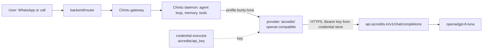

# Model provider: AICredits

Status: **Proposed** (decision D-18). How Bunty's assistants reach a language model.

## What it is

[AICredits](https://aicredits.in) is a model gateway: one API key, many models (OpenAI, Anthropic,
Google, DeepSeek, Sarvam and more), billed in rupees from prepaid credit. Its API is
OpenAI-compatible: `POST https://api.aicredits.in/v1/chat/completions` with
`Authorization: Bearer <key>`. Model ids are `provider/model`, for example `openai/gpt-6-luna`.

We do not call it from our own code. Each Vellum assistant calls it through Vellum's built-in
`openai-compatible` provider, which uses the Chat Completions API
(`vellum/assistant/src/providers/inference/adapter-factory.ts`, `"openai-compatible"` entry).

## How a turn reaches the model

| Piece | Value |
| --- | --- |
| Credential | `aicredits/api_key` in each assistant's credential store (never in code, logs or chat) |
| Provider entry | `aicredits`: `--provider openai-compatible --base-url https://api.aicredits.in/v1 --model openai/gpt-6-luna` |
| Profile | `bunty-luna`: provider `openai-compatible`, connection `aicredits`, made the active chat profile |
| Speech on calls | Unchanged: Deepgram (speech to text) and ElevenLabs (text to speech) |

## Setup

1. Paste the key into `.env` as `AICREDITS_API_KEY` (the file is git-ignored).
2. `bun infra/scripts/check-aicredits.ts`: checks the model is listed, the key and balance, a plain
   reply, a Hindi/Hinglish reply, a tool call and streaming, and prints latency.
3. `infra/scripts/connect-aicredits.sh chintu`: stores the key in Chintu, adds the provider and
   profile, sends one test message, and makes the profile active.
4. `vellum client chintu` to chat.

## Prices (from aicredits.in/models, 22 Oct 2026)

USD per 1M tokens (input / cached input / output). AICredits bills in INR and says its prices
include a 5% forex buffer and a 5% platform fee.

| Model id | Input | Cached | Output |
| --- | --- | --- | --- |
| `openai/gpt-6-luna` | $0.10 | $0.01 | $0.50 |
| `openai/gpt-5.6-luna` | $0.20 | $0.02 | $1.20 |
| `anthropic/claude-haiku-5.5` | $0.10 | $0.01 | $0.50 |
| `anthropic/claude-haiku-4.5` | $1.00 | $0.10 | $5.00 |

Switching model later is one command: `assistant inference providers update aicredits --model <id>`,
then `assistant inference profiles update bunty-luna --model <id>`.

## Risks and open points

- **One more company in the path.** Every conversation goes through AICredits as well as the
  model maker. Check their data-retention and privacy terms before real users (DPDP Act).
- **Prompt caching** through the gateway is not confirmed. Without it, long system prompts cost
  full price on every turn.
- **Quality of GPT-6 Luna** for Hindi, Hinglish, Gujarati and our tools is not measured yet. The
  check script is a smoke test, not an evaluation.
- `anthropic/claude-haiku-5.5` costs the same on AICredits and is the Claude model AGENTS.md
  section 4 assumes. Worth comparing side by side.
